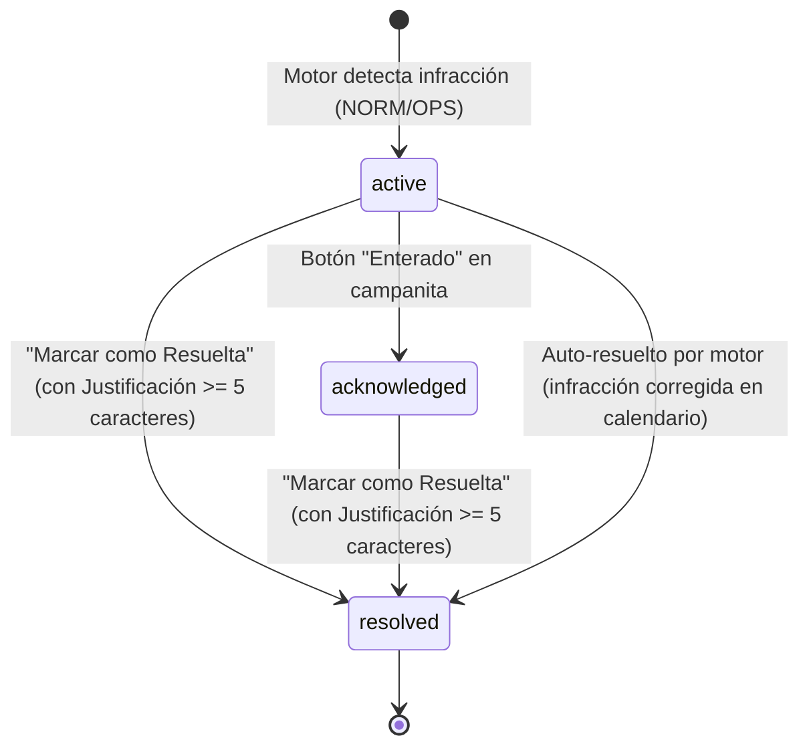

# Resumen de Sesión — Motor de Alertas Inteligentes, Excepciones de Turno y Sincronización con Dashboard

- **Fecha:** 2026-09-19 / 2026-09-20
- **Ubicación:** `.specs/context/resumen-alertas-excepciones-dashboard.md`
- **Áreas Afectadas:**
  - Backend: [`server/services/alert.service.ts`](file:///C:/Users/sebas/workspace/Proyecto_ZuriApp/server/services/alert.service.ts), [`server/services/dashboard.service.ts`](file:///C:/Users/sebas/workspace/Proyecto_ZuriApp/server/services/dashboard.service.ts), [`server/models/alert.model.ts`](file:///C:/Users/sebas/workspace/Proyecto_ZuriApp/server/models/alert.model.ts), [`server/models/shift-exception.model.ts`](file:///C:/Users/sebas/workspace/Proyecto_ZuriApp/server/models/shift-exception.model.ts)
  - Frontend: [`client/src/components/alerts/AlertDetailModal.vue`](file:///C:/Users/sebas/workspace/Proyecto_ZuriApp/client/src/components/alerts/AlertDetailModal.vue), [`client/src/components/layout/AlertsBell.vue`](file:///C:/Users/sebas/workspace/Proyecto_ZuriApp/client/src/components/layout/AlertsBell.vue), [`client/src/components/dashboard/KPICards.vue`](file:///C:/Users/sebas/workspace/Proyecto_ZuriApp/client/src/components/dashboard/KPICards.vue)
  - Tests: [`server/tests/unit/dashboard-shift-exceptions.test.ts`](file:///C:/Users/sebas/workspace/Proyecto_ZuriApp/server/tests/unit/dashboard-shift-exceptions.test.ts), [`server/tests/unit/alert.service.test.ts`](file:///C:/Users/sebas/workspace/Proyecto_ZuriApp/server/tests/unit/alert.service.test.ts), [`server/tests/unit/dashboard.service.test.ts`](file:///C:/Users/sebas/workspace/Proyecto_ZuriApp/server/tests/unit/dashboard.service.test.ts)

---

## 1. Puntos Clave y Decisiones de Negocio

### 1.1 Catálogo de Alertas Inteligentes y Adaptación Hospitalaria
Se revisó el catálogo integral de alertas inteligentes del sistema ZuriApp:
* **Normativas:**
  * `NORM-01`: Descanso mínimo inter-turno insuficiente (< 12 horas continuas).
  * `NORM-02`: Doble turno continuo prohibido (jornada de 24 horas continuas sin descanso).
  * `NORM-03`: Exceso de turnos nocturnos consecutivos (> 2 noches consecutivas).
  * `NORM-06`: Exceso de carga horaria semanal sobre el marco legal (> 44 horas).
* **Operativas:**
  * `OPS-01`: Déficit de dotación mínima por servicio, franja y posición (estamento).
  * `OPS-02`: Anticipación crítica en reemplazos no programados (< 4 horas previo al inicio).

### 1.2 Regla NORM-06 vs Realidad Operativa del Hospital
* **Análisis de Contratos:** Funcionarios de Planta y Contrata (Ley 18.834 / Estatuto Administrativo) y Código del Trabajo tienen tope nominal de 44 horas semanales.
* **Problema Planteado:** En la operación real hospitalaria (3er y 4to turno), el personal rota y realiza reemplazos continuos que superan fácilmente 44 horas (alcanzando hasta 60 horas semanales en contingencias). Disparar una alerta genérica cada vez que se superan las 44 horas saturaría con falsos positivos a la jefatura.
* **Solución de Diseño (Opción C):** Las alertas deben focalizarse en eventos de **alteración no autorizada del patrón mediante Excepciones de Turno (`ShiftException`)** o límites de seguridad clínica (descanso inter-turno y dobles turnos), evitando el spam por acumulación de horas regulares.

### 1.3 Eliminación de Regla OPS-03 y Jerarquía de Alertas
* **Conflicto Detectado:** Al crear una excepción en un 4to turno (`L N X X` $\rightarrow$ `L N L X`), el sistema disparaba 4 alertas en cascada: `OPS-03`, `NORM-03`, `NORM-02` y `NORM-01`.
* **Decisión:** Se acordó una jerarquía estricta de alertas donde una infracción más crítica suprime alertas operativas redundantes sobre la misma frontera de turno, y se procedió a **eliminar la regla `OPS-03`** (secuencia anómala) por colisionar con las normativas y resultar redundante.

---

## 2. Implementaciones y Correcciones Técnicas con TDD

### 2.1 Corrección TDD: Detección de Infracciones en Alteraciones de Patrón (`L N L X`)
* **Problema:** Tras cambiar `L N X X` a `L N L X`, la campana de alertas no emitía la infracción correspondiente.
* **Causa Raíz:** Las excepciones de turno se concatenaban sin ordenar estrictamente las marcas temporales de entrada y salida entre el turno saliente (Noche: `20:00 - 08:00`) y el entrante (Largo: `08:00 - 20:00`).
* **Solución:** Ordenamiento cronológico de jornadas consolidadas en `alert.service.ts` y evaluación precisa de la frontera entre turnos consecutivos.

### 2.2 Corrección TDD: Cómputo de Excepciones de Turno (`ShiftException`) en KPIs del Dashboard
* **Problema:** En el Dashboard (ej. Servicio de Farmacia), el indicador de **Jornadas Programadas** (`scheduledShiftDays`) no reflejaba las excepciones de turno.
  * Si un funcionario tenía asignación base de 4 días `L N X X` (2 jornadas laborales presenciales) y se creaba una excepción en el día 3 pasando a `L N N X`, el Dashboard continuaba mostrando 2 jornadas en lugar de 3.
  * Si se creaba una excepción convirtiendo un día de trabajo en libre (`X`), no se restaba.
* **Ciclo TDD Ejecutado:**
  1. **RED:** Se creó el archivo de prueba [`server/tests/unit/dashboard-shift-exceptions.test.ts`](file:///C:/Users/sebas/workspace/Proyecto_ZuriApp/server/tests/unit/dashboard-shift-exceptions.test.ts) con 2 casos de prueba exactos en MongoDB in-memory. Ambas pruebas fallaron reproduciendo el defecto (`expected 2 to be 3` y `expected 2 to be 1`).
  2. **GREEN:** Se actualizó [`server/services/dashboard.service.ts`](file:///C:/Users/sebas/workspace/Proyecto_ZuriApp/server/services/dashboard.service.ts):
     - Importación y consulta de [`ShiftExceptionModel`](file:///C:/Users/sebas/workspace/Proyecto_ZuriApp/server/models/shift-exception.model.ts) filtrando por las asignaciones y reemplazos del servicio en el rango del mes.
     - Mapeo en memoria O(1) con clave `${assignment_id}_${YYYY-MM-DD}`.
     - Sobrescritura de la sigla y bandera `esLibre` en el bucle diario tanto de asignaciones oficiales como de reemplazos.
     - Afectación directa en `scheduledShiftDays`, tasa de reemplazos (`replacementRate`), horas totales/diurnas/nocturnas y matriz de dotación diaria (`dailyStaffing`) para semáforos de cobertura.
  3. **REFACTOR & REGRESIÓN:**
     - `dashboard-shift-exceptions.test.ts`: **2/2 tests pasados**.
     - Backend completo: **34/34 archivos pasados, 209/209 tests pasados**.
     - Frontend completo: **38/38 archivos pasados, 167/167 tests pasados**.
     - Tipado: `npx vue-tsc --noEmit` completado con 0 errores.

---

## 3. Arquitectura del Ciclo de Vida de Alertas y Justificación

### 3.1 Flujo Operativo en la Interfaz (Campana y Modal)
Existen 3 estados definidos en el modelo [`Alert`](file:///C:/Users/sebas/workspace/Proyecto_ZuriApp/server/models/alert.model.ts):

* **Botón "Cerrar" (en [`AlertDetailModal.vue`](file:///C:/Users/sebas/workspace/Proyecto_ZuriApp/client/src/components/alerts/AlertDetailModal.vue)):**  
  Solo cierra la ventana emergente en pantalla; no modifica el estado ni borra la alerta de la base de datos.
* **Botón "Enterado" (`acknowledged` en [`AlertsBell.vue`](file:///C:/Users/sebas/workspace/Proyecto_ZuriApp/client/src/components/layout/AlertsBell.vue)):**  
  Disminuye el contador visual de no leídas en la campana, pero la alerta y la infracción persisten activas en el sistema.
* **"Marcar como Resuelta" (`resolved`):**  
  Exige obligatoriamente una justificación (`resolutionNote` de mínimo 5 caracteres). Remueve la alerta de la lista activa y notifica en tiempo real por WebSocket ([`emitAlertResolved`](file:///C:/Users/sebas/workspace/Proyecto_ZuriApp/server/services/socket.service.ts)).

### 3.2 Almacenamiento y Utilidad de la Justificación (`resolutionNote`)
* **Ubicación en Base de Datos:**  
  Colección `alerts` en MongoDB, en los campos `status = "resolved"`, `resolutionNote`, `resolvedAt` (timestamp ISO) y `updated_at`.
* **Utilidad en el Sistema:**
  1. **Respaldo Legal y Auditoría Clínica:** Proporciona trazabilidad probatoria ante inspecciones del trabajo o auditorías del Servicio de Salud cuando la jefatura autoriza turnos excepcionales (ej. 24h continuas por emergencias sanitarias).
  2. **Idempotencia y Supresión de Spam:** El cronjob diario de las 06:00 AM y el motor de eventos no vuelven a alertar una infracción que ya fue resuelta y justificada.
  3. **Trazabilidad Manual vs Automática:** Permite contrastar resoluciones del sistema (`"Auto-resuelto: infracción corregida"`) contra decisiones fundamentadas de la jefatura de servicio.
  4. **Reportabilidad:** Expuesta mediante endpoints como `GET /api/alerts?status=resolved` para libros de novedades, auditorías e históricos.

---

## 4. Estado de la Suite de Pruebas

| Componente | Archivos de Prueba | Tests Pasados | Estado |
| :--- | :---: | :---: | :---: |
| **Backend (`server`)** | 34 / 34 | 209 / 209 | ✅ Verde |
| **Frontend (`client`)** | 38 / 38 | 167 / 167 | ✅ Verde |
| **Typecheck (`vue-tsc`)** | N/A | 0 errores | ✅ Verde |
