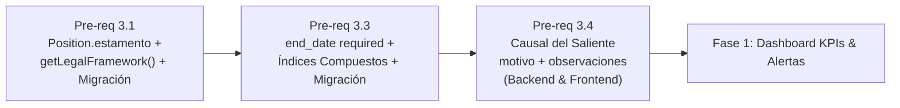

# Resumen de Sesión — Auditoría Critique, Blindaje Técnico y Corrección de Modelo
- **Fecha:** 2026-09-15 / 2026-09-16
- **Documento Principal Afectado:** [.specs/docs/zuriapp-v2-expansion-spec.md](file:///C:/Users/sebas/workspace/Proyecto_ZuriApp/.specs/docs/zuriapp-v2-expansion-spec.md)
- **Objetivo General:** Llevar la especificación maestra de ZuriApp v2 a un nivel de **cero fricción y cero improvisación**, validándola línea a línea contra el código fuente existente, resolviendo deudas técnicas históricas del modelo de datos y blindando los contratos de interfaces (Zod, TypeScript, Mongoose, Socket.io y BullMQ) antes de iniciar la codificación.

---

## 1. Puntos Clave y Decisiones Acordadas

### 1.1 Limpieza de GAPs y Consolidación de ADRs
- Se eliminaron las secciones de GAPs y Decisiones Pendientes (DPs) transitorias del spec maestro, ya que todas fueron formalizadas y resueltas.
- En su lugar, se consolidó la **Sección 9: Registro de Decisiones Arquitectónicas (ADRs)** con 10 ADRs definitivos que rigen la arquitectura del sistema.

### 1.2 Auditoría Exhaustiva `/critique` y los 6 Blindajes Técnicos
Tras contrastar la especificación contra el código real ([server/controllers/replacement.controller.ts](file:///C:/Users/sebas/workspace/Proyecto_ZuriApp/server/controllers/replacement.controller.ts), [server/schemas/replacement.schema.ts](file:///C:/Users/sebas/workspace/Proyecto_ZuriApp/server/schemas/replacement.schema.ts), [client/src/types/replacement.types.ts](file:///C:/Users/sebas/workspace/Proyecto_ZuriApp/client/src/types/replacement.types.ts), [server/services/socket.service.ts](file:///C:/Users/sebas/workspace/Proyecto_ZuriApp/server/services/socket.service.ts)), se identificaron e integraron directamente en el spec los siguientes blindajes:

1. **Esquemas de Validación Zod (`server/schemas/`):**
   - ZuriApp valida payloads mediante el middleware `validateSchema(schema)` basado en **Zod** (`z.object({...})`), no validaciones ad-hoc en controladores.
   - Se formalizó la actualización en `replacement.schema.ts`:
     ```typescript
     motivo: z.enum([
       'LICENCIA_MEDICA', 'PRE_POST_NATAL', 'PERMISO_ADMINISTRATIVO',
       'FERIADO_LEGAL', 'DIA_COMPENSATORIO', 'COMISION_SERVICIO',
       'PERMISO_GREMIAL', 'OTRO'
     ]),
     observaciones: z.string().max(500).optional(),
     ```
   - Se inventariaron los esquemas Zod necesarios para las nuevas entidades: `alert.schema.ts`, `service-staffing.schema.ts`, `replacement-offer.schema.ts` y `pwa-auth.schema.ts`.

2. **Alineación de Tipos Frontend con el Código Existente:**
   - La interfaz en el frontend es [ReplacementRegistration](file:///C:/Users/sebas/workspace/Proyecto_ZuriApp/client/src/types/replacement.types.ts) (no existía `IReplacement`).
   - Se actualizó el spec para modificar exactamente `ReplacementRegistration` sumando `motivo: AusenciaSalienteMotivo` y `observaciones?: string`, evitando tipos duplicados.

3. **Fachada Oficial de Eventos WebSocket (`socket.service.ts`):**
   - Para no acoplar los controladores al objeto global `io`, se formalizaron las firmas del servicio:
     - `emitDashboardInvalidated(serviceId, year, month)`
     - `emitAlertNew(serviceId, alert)`
     - `emitAlertAcknowledged(serviceId, alertId, acknowledgedBy)`
     - `emitAlertResolved(serviceId, alertId, resolvedAt, resolutionNote)`
     - `emitOfferApplicantWithdrawn(serviceId, offerId, staffId)`

4. **Interfaz TypeScript Formal para el Scoring Engine (`ScoredCandidate`):**
   - Se especificó el DTO exacto en `server/types/replacement-offer.types.ts` con el desglose de los 7 criterios de ponderación (+30 historial, +25 horas mes, +20 descanso post-turno, +15 coincidencia cargo, +10 récord limpio, -20 tope 44h, -30 noche contigua).

5. **Infraestructura Web Push y Rate Limiting OTP:**
   - Subdocumento en `Staff`: `pushSubscriptions: [{ endpoint, keys: { p256dh, auth }, createdAt }]`.
   - Poda automática de endpoints zombi cuando la Web Push API responde `410 Gone` o `404 Not Found`.
   - Rate limit en Redis para `POST /api/pwa/auth/request-otp` (`pwa:otp:ratelimit:{rut}` máx. 3 solicitudes / 10 min) para blindar el presupuesto de WhatsApp Cloud API.

6. **Transición de Turnos en PWA y Alerta Formal por Indisponibilidad (`OPS-03`):**
   - Un turno confirmado (`confirmed`) en la PWA mantiene accesible el enlace secundario: `[ ⚠️ Declarar Emergencia / Indisponibilidad ]` para casos imprevistos de fuerza mayor.
   - Pasa el estado a `unavailable` y genera de forma persistente la alerta crítica `OPS-03: INDISPONIBILIDAD_REPORTADA` en la campana de escritorio de la jefatura con botón directo a la Bolsa de Reemplazos.
   - Se dividió el índice de idempotencia de `Alert` en dos índices parciales (`idx_idempotency_ops01` y `idx_idempotency_individual`) para evitar colisiones entre funcionarios.

7. **Expiración de Convocatorias al Segundo Exacto (BullMQ Delayed Jobs):**
   - Se descartó el cron lento de sondeo para cerrar convocatorias de turnos urgentes.
   - Se programan BullMQ Delayed Jobs con `delay = expiresAt - Date.now()`, respaldados por un cron cada 30 min como red de seguridad.

---

### 1.3 Corrección de Dominio Hospitalario: `TurnAssignment.end_date` Obligatorio
- **Hallazgo del Usuario:** En la práctica hospitalaria y en ZuriApp, los turnos se programan y asignan **estrictamente mes a mes**. Ninguna asignación puede carecer de fecha de término.
- **Evidencia en Código:** En el frontend ([TurnAssignmentModal.vue](file:///C:/Users/sebas/workspace/Proyecto_ZuriApp/client/src/components/shifts/TurnAssignmentModal.vue#L470-L471)), el formulario ya exigía:
  ```typescript
  if (!form.value.end_date) {
    errors.value.end_date = 'La fecha de término es requerida';
  }
  ```
  La opcionalidad en [turn-assignment.model.ts](file:///C:/Users/sebas/workspace/Proyecto_ZuriApp/server/models/turn-assignment.model.ts) (`end_date?: Date`) y en [turn-assignment.schema.ts](file:///C:/Users/sebas/workspace/Proyecto_ZuriApp/server/schemas/turn-assignment.schema.ts) (`.optional()`) era una deuda técnica histórica.
- **Decisión y Simplificación:**
  1. `end_date` pasa a ser **`required: true`** en el modelo Mongoose y en el esquema Zod.
  2. Se eliminan las cláusulas `$or` con `{ end_date: null }`.
  3. Se formaliza la consulta canónica de pertenencia por rango, directa y de alto rendimiento:
     ```typescript
     const assignments = await TurnAssignmentModel.find({
       service: serviceId,
       start_date: { $lte: rangeEnd },
       end_date: { $gte: rangeStart },
     });
     ```
  4. Se agregó a los Pre-requisitos el script de backfill `server/migrations/fix-turn-assignment-end-date.ts` para rellenar registros históricos existentes con el fin de mes correspondiente.

---

## 2. Estado Actual de los Artefactos y Especificaciones

| Artefacto / Documento | Ruta | Estado | Rol |
|---|---|:---:|---|
| **Especificación Maestra v2** | [.specs/docs/zuriapp-v2-expansion-spec.md](file:///C:/Users/sebas/workspace/Proyecto_ZuriApp/.specs/docs/zuriapp-v2-expansion-spec.md) | 🟢 Aprobado (1.586 líneas) | Documento único de la verdad técnica para desarrollo. Cero vacíos ni improvisación. |
| **Reporte Critique Final** | `C:\Users\sebas\.gemini\antigravity-cli\brain\bd4d84c1-c4ed-4c22-9dde-13c0aa1aea35\critique-report-final-zuriapp-v2.md` | 🟢 Completado (Score: 9.7 ➔ 10) | Registro de debate multi-agente, CoVe y los 6 blindajes. |
| **Resumen Traspaso Previo** | [.specs/context/session-handover.md](file:///C:/Users/sebas/workspace/Proyecto_ZuriApp/.specs/context/session-handover.md) | 🟢 Histórico | Contexto de acuerdos iniciales de GAPs y DPs. |
| **Resumen PWA y Reemplazos** | [.specs/context/resumen-conversacion-pwa-y-reemplazos.md](file:///C:/Users/sebas/workspace/Proyecto_ZuriApp/.specs/context/resumen-conversacion-pwa-y-reemplazos.md) | 🟢 Histórico | Refinamiento de arquitectura PWA, contratos y bolsa. |
| **Resumen Sesión Actual** | [.specs/context/resumen-auditoria-critique-y-blindaje-final.md](file:///C:/Users/sebas/workspace/Proyecto_ZuriApp/.specs/context/resumen-auditoria-critique-y-blindaje-final.md) | 🟢 Este Documento | Síntesis ejecutiva de la auditoría final y blindajes aplicados. |

---

## 3. Plan Inmediato de Implementación: Pre-requisitos (~4 días)

La especificación está lista para codificar. La ruta crítica comienza por los **Pre-requisitos Fundacionales**:



### Detalle de Tareas:

1. **Paso 1 (Pre-requisito 3.1 — ~2 días):**
   - [position.model.ts](file:///C:/Users/sebas/workspace/Proyecto_ZuriApp/server/models/position.model.ts): Agregar `estamento` (enum `MEDICO`, `PROFESIONAL`, `TECNICO`, `ADMINISTRATIVO`, `AUXILIAR`, `default: 'PROFESIONAL'`).
   - Sumar `'estamento'` a `POSITION_AUDIT_FIELDS`.
   - Crear [server/utils/legal-framework.util.ts](file:///C:/Users/sebas/workspace/Proyecto_ZuriApp/server/utils/legal-framework.util.ts) con función `getLegalFramework(contractType, estamento)`.
   - Crear script de backfill `server/migrations/set-default-estamentos.ts`.

2. **Paso 2 (Pre-requisito 3.3 — ~0.5 días):**
   - [turn-assignment.model.ts](file:///C:/Users/sebas/workspace/Proyecto_ZuriApp/server/models/turn-assignment.model.ts): Cambiar `end_date` a `required: true` y agregar índice compuesto `{ service: 1, start_date: 1, end_date: 1 }`.
   - [turn-assignment.schema.ts](file:///C:/Users/sebas/workspace/Proyecto_ZuriApp/server/schemas/turn-assignment.schema.ts): Exigir `end_date: z.string().datetime()`.
   - [replacement.model.ts](file:///C:/Users/sebas/workspace/Proyecto_ZuriApp/server/models/replacement.model.ts): Agregar índice compuesto `{ servicio: 1, fecha_inicio: 1, fecha_termino: 1 }`.
   - Crear script de backfill `server/migrations/fix-turn-assignment-end-date.ts`.

3. **Paso 3 (Pre-requisito 3.4 — ~1.5 días):**
   - [replacement.model.ts](file:///C:/Users/sebas/workspace/Proyecto_ZuriApp/server/models/replacement.model.ts): Agregar enum `motivo` (8 causales) y `observaciones` (max 500).
   - [replacement.schema.ts](file:///C:/Users/sebas/workspace/Proyecto_ZuriApp/server/schemas/replacement.schema.ts): Validación Zod en creación y actualización.
   - [replacement.controller.ts](file:///C:/Users/sebas/workspace/Proyecto_ZuriApp/server/controllers/replacement.controller.ts) y [replacement.service.ts](file:///C:/Users/sebas/workspace/Proyecto_ZuriApp/server/services/replacement.service.ts): Recibir, persistir y retornar ambos campos.
   - [replacement.types.ts](file:///C:/Users/sebas/workspace/Proyecto_ZuriApp/client/src/types/replacement.types.ts): Actualizar interfaz `ReplacementRegistration`.
   - Frontend components: [ReplacementModalCreate.vue](file:///C:/Users/sebas/workspace/Proyecto_ZuriApp/client/src/components/replacements/ReplacementModalCreate.vue), [ReplacementModalUpdate.vue](file:///C:/Users/sebas/workspace/Proyecto_ZuriApp/client/src/components/replacements/ReplacementModalUpdate.vue), [ActiveReplacementsView.vue](file:///C:/Users/sebas/workspace/Proyecto_ZuriApp/client/src/views/active-replacements/ActiveReplacementsView.vue) y [StaffModalDetail.vue](file:///C:/Users/sebas/workspace/Proyecto_ZuriApp/client/src/components/staff/StaffModalDetail.vue).
