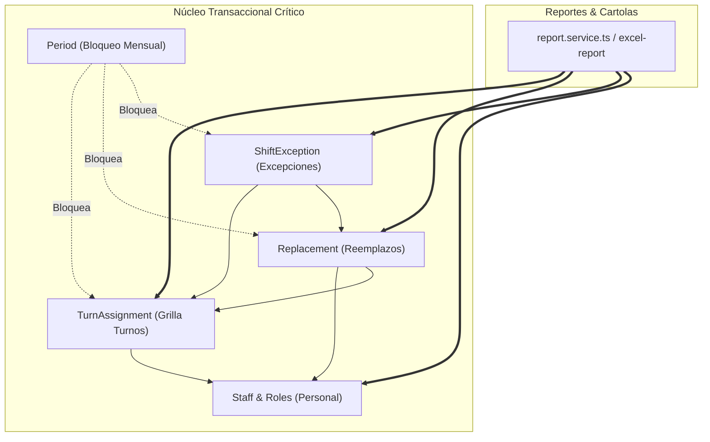
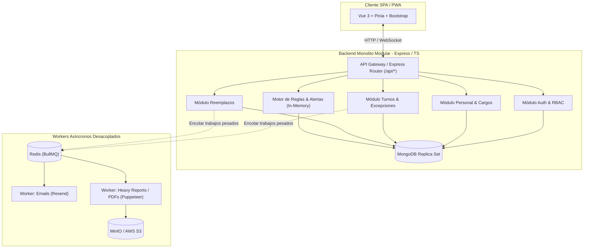

# Dictamen de Arquitectura: Factibilidad y Evaluación de Migración a Microservicios para ZuriApp

> **Fecha:** 2026-09-16  
> **Autor:** Arquitecto de Software  
> **Estado:** 🛑 **RECHAZADO / NO RECOMENDADO (Favor Monolito Modular)**  
> **Destinatario:** Equipo de Desarrollo / Lead  

---

## 1. Contexto y Alcance del Análisis

Se ha realizado un análisis exhaustivo del repositorio **ZuriApp** (backend Node/Express/TypeScript, frontend Vue 3/Pinia, base de datos MongoDB y colas Redis/BullMQ) con el fin de evaluar la factibilidad técnica, operativa y económica de descomponer la aplicación en una arquitectura de **microservicios**.

### Métricas y Estado Actual del Sistema:
* **Escala y Dominio:** Gestión operativa hospitalaria de turnos y reemplazos para servicios clínicos (con dotaciones de entre 20 y 150 funcionarios por servicio, e.g. Hospital Base San José de Osorno).
* **Volumen del Código:**
  * Backend: 17 controladores, 21 servicios, 15 modelos de Mongoose, 2 colas BullMQ.
  * Grafo de llamadas: ~2.200 nodos y ~4.300 dependencias/aristas analizadas.
* **Modelo de Despliegue:** Contenedores Docker (`server`, `client`, `mongo`, `redis`, `minio`), orquestados mediante Docker Compose con CI/CD automatizado.
* **Infraestructura de Concurrencia:** Concurrencia moderada de nivel hospitalario departamental (decenas a cientos de usuarios activos concurrentes, no millones de transacciones/segundo).

---

## 2. Diagnóstico del Arquitecto: Factibilidad vs. Conveniencia

### ⚖️ Veredicto:
> **¿Es técnicamente factible?** **Sí.** Es posible separar el sistema en microservicios (e.g. Servicio de Auth/Personal, Servicio de Turnos/Asignaciones, Servicio de Reemplazos, Servicio de Reportes/Auditoría, API Gateway).  
> **¿Es conveniente o recomendable?** **ROTUNDAMENTE NO.** Sería una **sobreingeniería prematura** que aumentaría exponencialmente la complejidad accidental, degradaría la velocidad de desarrollo y multiplicaría los puntos de fallo y costos operativos sin aportar beneficios reales al negocio.

---

## 3. Matriz de Evaluación: Monolito Modular vs. Microservicios

| Dimensión | Monolito Modular (Estado Recomendado) | Arquitectura de Microservicios | Impacto en ZuriApp |
| :--- | :--- | :--- | :--- |
| **Complejidad de Dominio y Datos** | **Baja-Media.** Transacciones ACID locales en MongoDB. Joins y pipelines de agregación nativos en memoria. | **Extrema.** Pérdida de integridad referencial. Requiere Sagas distribuidas, Event-Driven Architecture (EDA) o patrón CQRS. | 🔴 **Crítico:** Módulos como Cartolas y Reportes cruzan Turnos, Reemplazos, Excepciones y Personal. En microservicios requeriría replicar datos o un ETL distribuido. |
| **Latencia y Rendimiento** | **Sub-milisegundo.** Llamadas in-process entre servicios en RAM (< 0.1 ms). | **Alta.** Salto de red (HTTP/gRPC/Kafka) + serialización JSON + TLS (5-20 ms por llamada). | 🟡 Afecta la grilla interactiva y el cálculo en tiempo real de reglas de descanso. |
| **Bloqueos de Período y Consistencia** | **Trivial.** `period-lock.middleware.ts` valida el estado del mes en 1 consulta antes de mutar turnos o reemplazos. | **Complejo.** Requiere consenso distribuido o orquestación de bloqueo multi-servicio. | 🔴 El bloqueo mensual de turnos/reemplazos exige consistencia inmediata, no eventual. |
| **Costos de Infraestructura** | **Mínimo.** Corre cómodamente en un VPS o instancia única de 2 a 4 GB RAM (~$10 - $20 USD/mes). | **Alto.** Múltiples contenedores, API Gateway (Kong/Traefik), Service Mesh/Discovery, Broker (Kafka/RabbitMQ), observabilidad (Jaeger, Loki). Mínimo 8-16 GB RAM (~$80 - $200+ USD/mes). | 🔴 Incremento de costos x5 o x10 sin ganancia en ingresos ni throughput. |
| **Ley de Conway y Equipo** | **Ideal para 1 a 5 desarrolladores.** Un solo flujo de commits, refactorings atómicos con TypeScript y un solo `npm run dev`. | **Diseñado para >20 desarrolladores.** Los microservicios resuelven un problema de *organización humana*, permitiendo que múltiples equipos autónomos no se bloqueen entre sí. | 🔴 Para un equipo pequeño o unipersonal, los microservicios son un "impuesto distribuido" insostenible. |
| **Mantenimiento y Debugging** | **Simple.** Stack trace unificado en Sentry/Winston con contexto directo. | **Complejo.** Distributed tracing (OpenTelemetry, correlation IDs), fallas parciales, retries con exponential backoff, circuit breakers. | 🔴 Diagnosticar errores de un reemplazo tomaría horas entre múltiples logs. |

---

## 4. Análisis Profundo de Acoplamientos Críticos en ZuriApp

Si intentáramos separar ZuriApp en microservicios, chocaríamos de inmediato con las siguientes dependencias intrínsecas del negocio:

### 1. El Módulo de Reportes (`report.service.ts` / Cartola de Servicio)
Para construir la cartola mensual de un servicio hospitalario, el sistema calcula de forma unificada:
* El ciclo base del turno (`TurnAssignment`) de cada funcionario.
* Las excepciones individuales del día (`ShiftException`).
* Los reemplazos activos (`Replacement`) donde el funcionario es saliente o entrante.
* La clasificación estatuaria del cargo (`Position.estamento` y `Staff.contractType`) para horas diurnas vs. nocturnas.
* **Problema en Microservicios:** En una arquitectura con bases de datos aisladas (*Database-per-Service*), armar la cartola requeriría llamar a 4 microservicios por red para cada funcionario o implementar una base de datos de lectura proyectada (CQRS con Apache Kafka), multiplicando la base de código por cuatro.

### 2. El Cierre y Bloqueo de Período (`PeriodLock`)
ZuriApp posee una regla de negocio estricta: *Si un mes está cerrado contablemente, no se puede alterar ningún turno, reemplazo ni excepción.*
* **En el Monolito:** Un middleware (`period-lock.middleware.ts`) realiza una validación atómica en memoria/MongoDB antes de procesar el POST/PUT.
* **En Microservicios:** Exigiría implementar un protocolo 2PC (Two-Phase Commit) o un patrón Saga orquestado para coordinar el bloqueo de escrituras entre servicios independientes.

### 3. Trazabilidad Forense (`audit.service.ts`)
Cada acción realizada en la plataforma guarda un snapshot del estado anterior y posterior (*diff*). En el monolito, esto se resuelve con `audit.service.logAction()` en el mismo ciclo de vida de la petición. En microservicios, requeriría un bus de eventos persistente y schemas compartidos de eventos de auditoría.

---

## 5. Arquitectura Recomendada: Monolito Modular con Asincronía Especializada

En lugar de microservicios, el estándar de la industria para sistemas del tamaño y alcance de ZuriApp (y recomendado por autoridades de arquitectura como Martin Fowler, Shopify y Basecamp) es el **Monolito Modular con Workers Desacoplados**.

### ¿Qué tenemos ya bien implementado en ZuriApp?
1. **Asincronía donde realmente importa:** BullMQ + Redis ya aíslan las tareas pesadas (cierre de reportes mensuales en `report.queue.ts` y despacho de correos en `email.queue.ts`) fuera del ciclo HTTP principal.
2. **Eventos en tiempo real:** Socket.io proporciona comunicación bidireccional inmediata para invalidación de dashboards y actualización de turnos sin requerir un message broker distribuido como RabbitMQ o Kafka.
3. **Caché estratégica:** Redis ya absorbe las consultas repetitivas de reemplazos y dashboards.

---

## 6. La "Válvula de Escape": ¿Cuándo sí tendría sentido separar un componente?

Si el sistema creciera sustancialmente, la única separación pragmática (*The Ponytail / Lazy Approach*) sería el desacople de **un solo servicio satélite de cómputo intensivo**:

* **Candidato único:** El generador de PDFs con Puppeteer (`server/queues/report.queue.ts` o script de reportes).
  * **Motivo:** Puppeteer levanta instancias headless de Chromium, las cuales consumen picos de CPU y memoria RAM.
  * **Solución sin microservicios:** Ni siquiera requiere microservicios: basta con ejecutar el Worker de BullMQ en un contenedor Docker separado (`worker` service en `docker-compose.yml`) apuntando al mismo Redis y código base.

---

## 7. Plan de Acción Recomendado (Siguientes Pasos)

En vez de invertir meses en una migración destructiva a microservicios:

1. **Mantener el Monolito Modular:** Reforzar las fronteras lógicas internas del backend organizando el código por dominios (`modules/shifts`, `modules/replacements`, `modules/staff`, `modules/reports`) si se desea mayor orden visual.
2. **Consolidar la Fase 1 de Inteligencia (ZuriApp v2):**
   * Implementar el motor de alertas normativas y operativas (`alert.service.ts`) que ya está diseñado para ejecutarse en memoria a alta velocidad (< 5 ms).
   * Desplegar el Dashboard de Indicadores y Cobertura de Dotación.
3. **Optimizar Workers de BullMQ:** Si el servidor experimenta picos de memoria por Puppeteer, simplemente desacoplar el proceso del worker en Docker Compose:
   * Contenedor `api`: API Express + Sockets (liviano y rápido).
   * Contenedor `worker`: Procesa `reportClosureQueue` y `emailQueue` (aislado).

---

## Conclusión
La arquitectura actual de ZuriApp (Monolito Modular asistido por colas Redis) es la **elección técnica correcta, madura y costo-eficiente** para el problema de negocio que resuelve. Migrar a microservicios agregaría un costo de desarrollo y mantenimiento desmedido sin ninguna ventaja tangible para los hospitales y usuarios finales.
