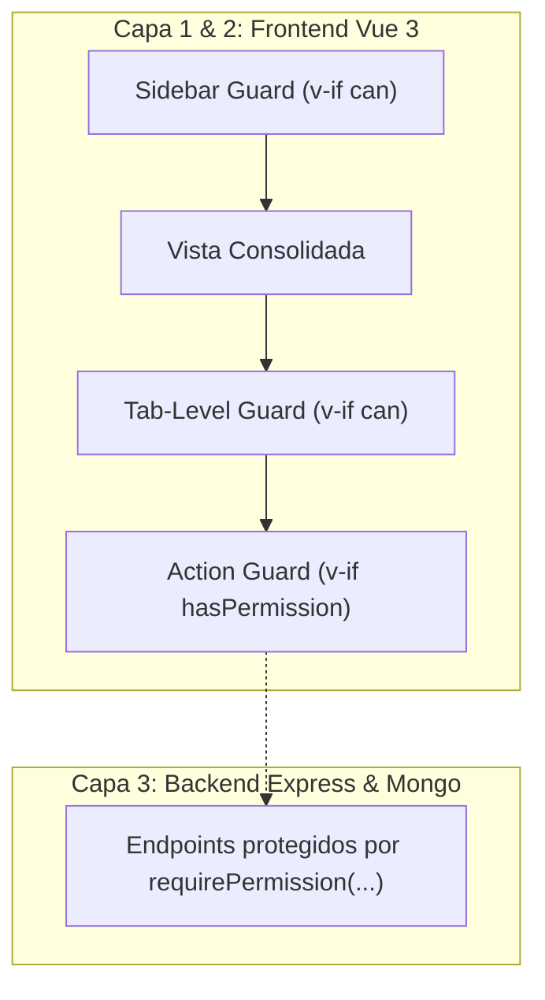
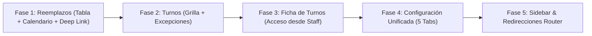

# ZuriApp — Especificación de Reestructuración y Consolidación de Módulos

> **Estado:** 🟢 Listo para implementación  
> **Versión:** 1.1 (Refinada tras evaluación de arquitectura `/critique`)  
> **Autor:** Arquitecto de Software  
> **Fecha de actualización:** 2026-09-09  
> **Ámbito:** Frontend (`client/src/views/`, `client/src/components/`, `client/src/router/index.ts`)  

---

## 1. Resumen Ejecutivo y Decisiones Clave

Tras la revisión técnica inicial y la posterior evaluación formal de arquitectura (`/critique`), se consolidan las siguientes directrices definitivas:

1. **Reemplazos (Módulo Único):** En la parte superior se incluye un switcher de pestañas para alternar entre **Vista Tabla** y **Vista Calendario**. En la Vista Tabla, se incorpora un dropdown de filtrado por **Estado** (`Todos`, `En curso / Activos`, `Finalizados`, `Anulados`) que absorbe el historial anterior.
2. **Turnos y Excepciones:** Se unifica la operativa de turnos. `CurrentShiftsView` absorbe el historial mediante navegación temporal reactiva (`< Mes >`), bloqueando la edición si el período está cerrado. Las **Excepciones de Turno** se integran como pestaña operativa interna amparada por `shifts.view`, permitiendo la fiscalización diaria de Coordinadores y Jefes de Turno sin exponer la **Auditoría Forense** (reservada exclusivamente para Administradores TI con `audit.view`).
3. **Ficha de Turnos Desacoplada del Sidebar:** Se retira del menú lateral y se accede de forma contextual mediante un botón **"Ver Ficha"** en la tabla de **Funcionarios**, implementando precarga automática vía query param (`?staffId=...`).
4. **Configuración Centralizada en 5 Pestañas:** Un único botón en el sidebar (**Configuración**) con cabecera dinámica unificada y 5 pestañas: *Servicios*, *Tipos de Turno*, *Leyenda (Siglas)*, *Roles y Accesos* y *Cargos Físicos*.
5. **Deep Linking y Estado en la URL (Refinamiento Critique):** El estado de las pestañas y vistas activas se sincroniza bidireccionalmente con **URL Query Parameters** (`?view=...`, `?tab=...`), garantizando compatibilidad con el botón "Atrás" del navegador, recarga de página (F5) y enlaces directos compartibles.
6. **Preservación Total de RBAC:** Se aplica un esquema de seguridad en 3 capas (Backend Zero Trust, Sidebar Guard y Tab-Level RBAC), asegurando que ningún permiso se altere ni degrade.

---

## 2. Nueva Estructura del Menú Lateral (Sidebar)

De **13 accesos dispersos** se pasa a **6 módulos de alto nivel**:

```
SIDEBAR ANTERIOR (13 ítems)            NUEVO SIDEBAR CONSOLIDADO (6 ítems)
===========================            ====================================
PERSONAL                               PERSONAL
  ├── Funcionarios                       └── 1. Funcionarios  (con botón "Ver Ficha")
  └── Ficha de Turnos
                                       OPERACIONES
OPERACIONES                              ├── 2. Turnos        (Grilla + Excepciones)
  ├── Reemplazos Activos                 └── 3. Reemplazos    (Tabla + Calendario)
  ├── Calendario Reemplazos
  └── Turnos Actuales                  REPORTES & AUDITORÍA
                                         ├── 4. Centro de Reportes
HISTORIAL & REPORTES                     └── 5. Auditoría de Cambios (Solo Admin TI)
  ├── Reemplazos Finalizados
  ├── Turnos Anteriores                CONFIGURACIÓN
  ├── Excepciones de Turno               └── 6. Configuración (5 tabs internas)
  ├── Auditoría de Cambios
  └── Centro de Reportes

CONFIGURACIÓN
  ├── Servicios
  ├── Tipos de Turno
  └── Roles y Cargos
```

---

## 3. Arquitectura de Seguridad y RBAC (3 Capas)



1. **Capa Backend (Zero Trust):** Los endpoints en Express (`/api/services`, `/api/roles`, `/api/replacement`, etc.) continúan exigiendo sus middlewares `requirePermission(...)`. Si un usuario intenta invocar un endpoint sin permiso, el backend responde `403 Forbidden`.
2. **Capa Sidebar:** Los 6 botones del menú evalúan si el usuario posee al menos un permiso del grupo:
   - **Funcionarios:** `v-if="can('users.view')"`
   - **Turnos:** `v-if="can('shifts.view')"`
   - **Reemplazos:** `v-if="can('replacement.view')"`
   - **Centro de Reportes:** `v-if="can('shifts.view')"`
   - **Auditoría:** `v-if="can('audit.view')"` *(Invisible para perfiles operativos)*
   - **Configuración:** `v-if="can('service.view') || can('turn-type.view') || can('turn-sigla.view') || can('role.view') || can('position.view')"`
3. **Capa Pestañas (Tab-Level RBAC):** Cada pestaña dentro de una vista consolidada evalúa su propio permiso (`v-if="can(...)"`). Si un usuario solo tiene `service.view`, solo se renderiza la pestaña de Servicios. El sistema calcula automáticamente como pestaña activa por defecto la primera pestaña a la que el usuario tenga derecho.

---

## 4. Especificación Detallada de los Módulos Consolidados

### 4.1 Dominio: Reemplazos (`/operaciones/reemplazos`)

* **Navegación & Deep Linking:**
  - Sincronización con query param: `?view=table` (default) | `?view=calendar`.
  - La URL actualiza reactivamente la vista sin recargar la página (`router.replace({ query: { ...route.query, view: newView } })`).
* **Cabecera Unificada:**
  - Switcher de vista: `[ 📑 Vista Tabla | 📅 Vista Calendario ]`.
  - Botón *"Nuevo Reemplazo"* condicionado a `hasPermission('replacement.create')`.
  - Botón *"Limpiar Filtros"*.
* **Pestaña 1: Vista Tabla:**
  - Barra de filtros optimizada:
    - Búsqueda por RUT / Nombre.
    - Filtro por Servicio.
    - **Dropdown de Estado:** `[ Todos | En curso (Activo) | Finalizados | Anulados ]`.
  - Tabla de Reemplazos:
    - Reemplazos en curso: acciones completas (*Modificar*, *Finalizar*, *Anular*, *Exportar PDF*).
    - Reemplazos finalizados/anulados: modo consulta (*Ver Detalles*, *Exportar PDF*).
* **Pestaña 2: Vista Calendario:**
  - Embebe el componente `FullCalendar`.
  - **Manejo de Ciclo de Vida (Refinamiento Critique):** El componente se monta con `v-if="viewMode === 'calendar'` para asegurar que el cálculo dimensional del DOM de FullCalendar ocurra sobre un contenedor con ancho visible (evitando el bug de 0px de ancho).
  - Filtro contextual de Servicios y modales de evento existentes preservados.

---

### 4.2 Dominio: Turnos (`/operaciones/turnos`)

* **Navegación & Deep Linking:**
  - Sincronización con query param: `?tab=grilla` (default) | `?tab=excepciones`.
* **Pestañas Superiores:**
  - `[ 📊 Grilla Mensual | ⚠️ Excepciones Vigentes ]`.
* **Sub-vista 1: Grilla Mensual:**
  - Grilla interactiva de turnos de `CurrentShiftsView.vue`.
  - Navegación temporal `< Mes Año >`.
  - **Bloqueo Inteligente de Período Histórico / Cerrado:**
    - Si el mes consultado es anterior o el período está cerrado (`periodStore.isClosed`):
      - Se deshabilita o retira el botón *"Asignar Planta"*.
      - Las celdas de la grilla se marcan como `readonly`.
      - Se despliega un banner de estado: `ℹ️ Período Cerrado — Grilla en modo consulta`.
    - **Elimina por completo la necesidad de la vista `Turnos Anteriores`.**
* **Sub-vista 2: Excepciones Vigentes (`ShiftExceptionsTab.vue`):**
  - **Extracción limpia (Refinamiento Critique):** Se extrae el contenido de `ShiftExceptionsView.vue` a un subcomponente sin envoltorio de página completo para evitar cabeceras duplicadas o doble margen.
  - Filtros por Servicio, Cargo y Fecha.
  - Permite la fiscalización inmediata de modificaciones manuales vigentes sin requerir privilegios de TI.

---

### 4.3 Dominio: Personal / Funcionarios (`/personal/staff`)

* **Tabla de Funcionarios (`StaffTable.vue`):**
  - Se añade un botón de acción rápida en cada fila:
    - `<button class="btn btn-sm btn-light" title="Ver Ficha de Turnos" @click="goToFicha(staff._id)"> <i class="bi bi-person-lines-fill text-primary"></i> </button>`
* **Ficha de Turnos (`ShiftRecordsView.vue` — Deep Link Refinement):**
  - La ruta interna se conserva (`/personal/ficha-turnos`), pero se retira del menú lateral.
  - **Precarga por URL (Refinamiento Critique):** En su hook `onMounted`, se verifica si existe `route.query.staffId`. Si viene presente:
    - Se busca y selecciona automáticamente al funcionario en el `v-select`.
    - Se cargan de inmediato sus turnos y reemplazos del mes sin que el operador deba digitar su nombre.

---

### 4.4 Dominio: Reportes y Auditoría

* **Centro de Reportes (`/reportes`):**
  - Módulo independiente sin alteraciones. Generación de cartolas consolidadas por servicio y descargas (PDF / Excel).
  - Permiso: `shifts.view`.
* **Auditoría de Cambios (`/historial/auditoria`):**
  - Registro forense inmutable de seguridad.
  - Permiso: `audit.view` (Solo visible y accesible para `SYS_ADMIN`).

---

### 4.5 Dominio: Configuración (`/configuracion`)

* **Navegación & Deep Linking:**
  - Sincronización con query param: `?tab=servicios` (default) | `?tab=tipos-turno` | `?tab=siglas` | `?tab=roles` | `?tab=cargos`.
* **Cabecera Dinámica Unificada (Refinamiento Critique):**
  - El encabezado superior cambia su botón de acción principal de forma reactiva según la pestaña activa y los permisos:
    - Pestaña *Servicios*: Botón *"Nuevo Servicio"* (`v-if="can('service.create')"`).
    - Pestaña *Tipos de Turno*: Botón *"Nuevo Turno"* (`v-if="can('turn-type.create')"`).
    - Pestaña *Leyenda (Siglas)*: Botón *"Nueva Sigla"* (`v-if="can('turn-sigla.create')"`).
    - Pestaña *Roles y Accesos*: Botón *"Nuevo Rol"* (`v-if="can('role.create')"`).
    - Pestaña *Cargos Físicos*: Botón *"Nuevo Cargo"* (`v-if="can('position.create')"`).
* **Barra de Pestañas Responsive (Refinamiento Critique):**
  - Implementada con navegación en píldoras y soporte táctil/scroll horizontal (`flex-nowrap overflow-x-auto`) para garantizar visualización perfecta en dispositivos móviles o pantallas compactas.
* **Componentes Hijos Desacoplados:**
  - Los formularios y tablas de cada pestaña se renderizan sin tarjetas envolventes redundantes, manteniendo una jerarquía visual limpia y profesional.

---

## 5. Matriz de Rutas y Redirecciones de Compatibilidad

Para evitar enlaces rotos o bookmarks antiguos de los usuarios, se configuran alias y redirecciones en `router/index.ts`:

| Ruta Antigua | Comportamiento Nuevo | Destino |
|---|---|---|
| `/operaciones/calendario-reemplazos` | Redirección 301 / replace | `/operaciones/reemplazos?view=calendar` |
| `/historial/reemplazos` | Redirección 301 / replace | `/operaciones/reemplazos?status=completed` |
| `/historial/turnos` | Redirección 301 / replace | `/operaciones/turnos` |
| `/historial/excepciones` | Redirección 301 / replace | `/operaciones/turnos?tab=excepciones` |
| `/configuracion/servicios` | Redirección 301 / replace | `/configuracion?tab=servicios` |
| `/configuracion/tipos-turno` | Redirección 301 / replace | `/configuracion?tab=tipos-turno` |
| `/personal/cargos` | Redirección 301 / replace | `/configuracion?tab=roles` |

---

## 6. Plan de Implementación por Fases



### Fase 1: Consolidación de Reemplazos
- [x] 1.1 Crear subcomponente `ReplacementCalendarTab.vue` extrayendo la lógica visual de `ReplacementCalendarView.vue`.
- [x] 1.2 Agregar sincronización con `route.query.view` (`table` | `calendar`) y switcher visual en la cabecera.
- [x] 1.3 Incorporar dropdown de filtro de estado (`Todos`, `Activos`, `Finalizados`, `Anulados`) en la barra de filtros de la tabla.
- [x] 1.4 Validar renderizado de FullCalendar con `v-if` y apertura del modal de detalle de evento.

### Fase 2: Consolidación de Turnos
- [x] 2.1 Añadir tabs superiores `[ Grilla Mensual | Excepciones ]` sincronizados con `route.query.tab`.
- [x] 2.2 Integrar `ShiftExceptionsTab.vue` sin cabeceras redundantes.
- [x] 2.3 Implementar bloqueo `readonly` y badge de aviso cuando la grilla navega a un mes cerrado o anterior.

### Fase 3: Integración de Ficha de Turnos
- [x] 3.1 Agregar botón de acceso rápido *"Ver Ficha"* en las filas de `StaffTable.vue`.
- [x] 3.2 Modificar `ShiftRecordsView.vue` para que lea `route.query.staffId` en `onMounted` y autoseleccione al funcionario.

### Fase 4: Configuración Unificada
- [x] 4.1 Crear `ConfigurationView.vue` con cabecera dinámica de acciones y barra de 5 pestañas con scroll horizontal.
- [x] 4.2 Integrar los subcomponentes de Servicios, Tipos de Turno, Siglas, Roles y Cargos Físicos con Tab-Level RBAC.
- [x] 4.3 Sincronizar la pestaña activa con `route.query.tab`.

### Fase 5: Limpieza de Sidebar y Enrutamiento
- [x] 5.1 Rediseñar `SidebarMenu.vue` con la lista final de 6 módulos y sus respectivos guards `can(...)`.
- [x] 5.2 Configurar redirecciones de retrocompatibilidad en `router/index.ts`.
- [x] 5.3 Pruebas de navegación extremo a extremo y validación de perfiles de usuario (Admin TI, Coordinador, Usuario estándar).
