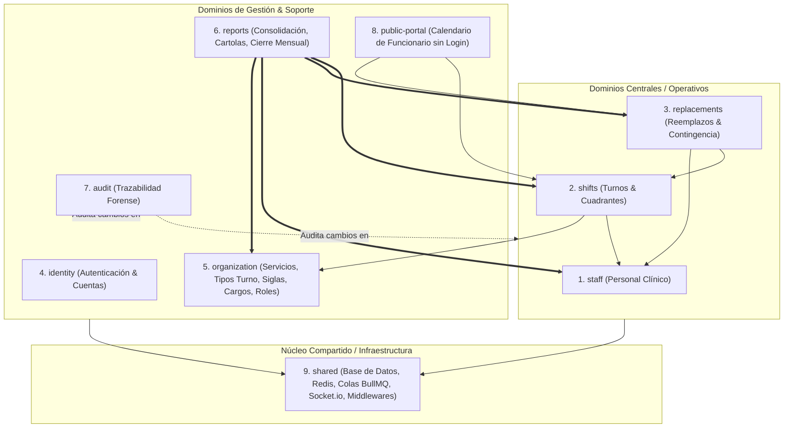
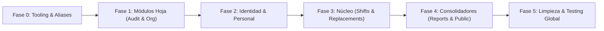

# Especificación Técnica: Migración Integral a Arquitectura Monolito Modular + DDD (Backend & Frontend)

> **Documento:** Plan Director de Reestructuración Arquitectónica  
> **Estado:** 🟡 Listo para Ejecución por Fases  
> **Autor:** Arquitecto de Software  
> **Fecha:** 2026-09-16  
> **Ámbito:** `server/` (Node.js/Express/TypeScript) y `client/` (Vue 3/Vite/Pinia)  
> **Regla de Oro:** **Cero regresión funcional, cero cambio de contratos HTTP/API y cero impacto en el esquema físico de MongoDB.**

---

## 1. Resumen Ejecutivo y Objetivos

### 1.1 El Problema Actual
ZuriApp opera hoy bajo una arquitectura de **Monolito en Capas (*Package-by-Type*)**:
* **Backend:** La lógica de un mismo concepto de negocio (ej. *Reemplazos*) está dispersa horizontalmente en [`routes/api/`](file:///C:/Users/sebas/workspace/Proyecto_ZuriApp/server/routes/api/), [`controllers/`](file:///C:/Users/sebas/workspace/Proyecto_ZuriApp/server/controllers/), [`services/`](file:///C:/Users/sebas/workspace/Proyecto_ZuriApp/server/services/), [`models/`](file:///C:/Users/sebas/workspace/Proyecto_ZuriApp/server/models/) y [`schemas/`](file:///C:/Users/sebas/workspace/Proyecto_ZuriApp/server/schemas/).
* **Frontend:** Para ajustar una sola vista de negocio, un desarrollador debe navegar entre 6 carpetas distintas en los extremos opuestos del proyecto ([`views/`](file:///C:/Users/sebas/workspace/Proyecto_ZuriApp/client/src/views/), [`components/`](file:///C:/Users/sebas/workspace/Proyecto_ZuriApp/client/src/components/), [`composables/`](file:///C:/Users/sebas/workspace/Proyecto_ZuriApp/client/src/composables/), [`stores/`](file:///C:/Users/sebas/workspace/Proyecto_ZuriApp/client/src/stores/), [`services/`](file:///C:/Users/sebas/workspace/Proyecto_ZuriApp/client/src/services/) y [`types/`](file:///C:/Users/sebas/workspace/Proyecto_ZuriApp/client/src/types/)).

### 1.2 El Estado Objetivo
Transformar el sistema en un **Monolito Modular guiado por DDD (Domain-Driven Modular Monolith)**:
1. **Vertical Slice / Package-by-Feature:** Todo lo que cambia junto por motivos de negocio vive junto en el mismo directorio.
2. **Simetría Full-Stack:** Los mismos nombres de dominios (*Bounded Contexts*) estructuran tanto el backend (`server/src/modules/<domain>`) como el frontend (`client/src/modules/<domain>`).
3. **Encapsulamiento y Fronteras Claras:** Cada módulo expone un único archivo de barril (`index.ts`) que define su API pública hacia el resto de la aplicación. Las dependencias internas de un módulo están protegidas.
4. **Preservación Tecnológica Total:**
   * Mismo runtime Node.js 22 y misma base de datos MongoDB (Replica Set).
   * Mismo framework Vue 3 + Pinia + Vite.
   * Sin necesidad de microservicios, brokers de mensajería complejos ni latencias de red añadidas.

---

## 2. Mapa de Contextos Delimitados (DDD Bounded Contexts)

El dominio hospitalario de ZuriApp se descompone en **8 Módulos de Dominio** y **1 Módulo Transversal (Shared/Core)**:



---

## 3. Matriz de Mapeo Exhaustiva: Backend (`server/`)

Cada uno de los archivos existentes en el backend tiene un destino exacto asignado. **Ningún archivo queda huérfano.**

### 3.1 Módulo `identity` (Autenticación, Cuentas y Perfil)
* **Propósito:** Gestión de credenciales, tokens JWT, cuentas de usuario del sistema, historial de sesiones y perfil propio.
* **Ubicación destino:** `server/src/modules/identity/`

| Archivo Origen | Archivo Destino | Rol en el Módulo |
| :--- | :--- | :--- |
| `server/routes/api/auth.routes.ts` | `server/src/modules/identity/routes/auth.routes.ts` | Endpoints de login, refresh token, logout |
| `server/routes/api/account.routes.ts` | `server/src/modules/identity/routes/account.routes.ts` | Endpoints de gestión de cuentas |
| `server/routes/api/profile.routes.ts` | `server/src/modules/identity/routes/profile.routes.ts` | Endpoints de perfil del usuario logueado |
| `server/controllers/auth.controller.ts` | `server/src/modules/identity/controllers/auth.controller.ts` | Controlador HTTP Auth |
| `server/controllers/account.controller.ts` | `server/src/modules/identity/controllers/account.controller.ts` | Controlador HTTP Cuentas |
| `server/controllers/profile.controller.ts` | `server/src/modules/identity/controllers/profile.controller.ts` | Controlador HTTP Perfil |
| `server/services/auth.service.ts` | `server/src/modules/identity/services/auth.service.ts` | Lógica de negocio Auth & JWT |
| `server/services/account.service.ts` | `server/src/modules/identity/services/account.service.ts` | Lógica de negocio Cuentas |
| `server/services/profile.service.ts` | `server/src/modules/identity/services/profile.service.ts` | Lógica de negocio Perfil |
| `server/models/account.model.ts` | `server/src/modules/identity/models/account.model.ts` | Schema Mongoose Cuenta |
| `server/models/login-history.model.ts` | `server/src/modules/identity/models/login-history.model.ts` | Schema Mongoose Historial Login |
| `server/schemas/auth.schema.ts` | `server/src/modules/identity/schemas/auth.schema.ts` | Validación Zod Auth |
| `server/schemas/account.schema.ts` | `server/src/modules/identity/schemas/account.schema.ts` | Validación Zod Cuentas |
| *(Nuevo)* | `server/src/modules/identity/index.ts` | **Barrel export** (Rutas unificadas y servicios públicos) |

---

### 3.2 Módulo `staff` (Personal Clínico)
* **Propósito:** Registro y administración del personal hospitalario (RUT, nombres, contrato, estamento, estado activo).
* **Ubicación destino:** `server/src/modules/staff/`

| Archivo Origen | Archivo Destino | Rol en el Módulo |
| :--- | :--- | :--- |
| `server/routes/api/staff.routes.ts` | `server/src/modules/staff/routes/staff.routes.ts` | Endpoints CRUD de funcionarios |
| `server/controllers/staff.controller.ts` | `server/src/modules/staff/controllers/staff.controller.ts` | Controlador HTTP Staff |
| `server/services/staff.service.ts` | `server/src/modules/staff/services/staff.service.ts` | Lógica de negocio Staff |
| `server/models/staff.model.ts` | `server/src/modules/staff/models/staff.model.ts` | Schema Mongoose Staff |
| `server/schemas/staff.schema.ts` | `server/src/modules/staff/schemas/staff.schema.ts` | Validación Zod Staff |
| *(Nuevo)* | `server/src/modules/staff/index.ts` | **Barrel export** |

---

### 3.3 Módulo `shifts` (Turnos, Cuadrantes y Excepciones)
* **Propósito:** Asignación de patrones de turno a funcionarios, visualización de cuadrante y manejo de excepciones de turno puntuales.
* **Ubicación destino:** `server/src/modules/shifts/`

| Archivo Origen | Archivo Destino | Rol en el Módulo |
| :--- | :--- | :--- |
| `server/routes/api/turn-assignment.routes.ts` | `server/src/modules/shifts/routes/turn-assignment.routes.ts` | Endpoints de asignación de cuadrante |
| `server/routes/api/shift-exception.routes.ts` | `server/src/modules/shifts/routes/shift-exception.routes.ts` | Endpoints de excepciones de turno |
| `server/controllers/turn-assignment.controller.ts` | `server/src/modules/shifts/controllers/turn-assignment.controller.ts` | Controlador Asignaciones |
| `server/controllers/shift-exception.controller.ts` | `server/src/modules/shifts/controllers/shift-exception.controller.ts` | Controlador Excepciones |
| `server/services/turn-assignment.service.ts` | `server/src/modules/shifts/services/turn-assignment.service.ts` | Lógica de cuadrante y asignaciones |
| `server/services/shift-exception.service.ts` | `server/src/modules/shifts/services/shift-exception.service.ts` | Lógica de excepciones diarias |
| `server/models/turn-assignment.model.ts` | `server/src/modules/shifts/models/turn-assignment.model.ts` | Schema Mongoose TurnAssignment |
| `server/models/shift-exception.model.ts` | `server/src/modules/shifts/models/shift-exception.model.ts` | Schema Mongoose ShiftException |
| `server/schemas/turn-assignment.schema.ts` | `server/src/modules/shifts/schemas/turn-assignment.schema.ts` | Validación Zod Asignaciones |
| `server/schemas/shift-exception.schema.ts` | `server/src/modules/shifts/schemas/shift-exception.schema.ts` | Validación Zod Excepciones |
| *(Nuevo)* | `server/src/modules/shifts/index.ts` | **Barrel export** |

---

### 3.4 Módulo `replacements` (Gestión de Reemplazos)
* **Propósito:** Registro de reemplazantes entrantes ante ausencias de titulares salientes, motivos de inasistencia, cortes anticipados y cron jobs de vigencia.
* **Ubicación destino:** `server/src/modules/replacements/`

| Archivo Origen | Archivo Destino | Rol en el Módulo |
| :--- | :--- | :--- |
| `server/routes/api/replacement.routes.ts` | `server/src/modules/replacements/routes/replacement.routes.ts` | Endpoints CRUD y cortes de reemplazos |
| `server/controllers/replacement.controller.ts` | `server/src/modules/replacements/controllers/replacement.controller.ts` | Controlador Reemplazos |
| `server/services/replacement.service.ts` | `server/src/modules/replacements/services/replacement.service.ts` | Lógica de reemplazos, cortes y caché |
| `server/models/replacement.model.ts` | `server/src/modules/replacements/models/replacement.model.ts` | Schema Mongoose Replacement |
| `server/models/counter.model.ts` | `server/src/modules/replacements/models/counter.model.ts` | Schema Mongoose Numerador correlativo |
| `server/schemas/replacement.schema.ts` | `server/src/modules/replacements/schemas/replacement.schema.ts` | Validación Zod Reemplazos |
| `server/jobs/replacement.cron.ts` | `server/src/modules/replacements/jobs/replacement.cron.ts` | Cron job de actualización de estado medianoche |
| *(Nuevo)* | `server/src/modules/replacements/index.ts` | **Barrel export** |

---

### 3.5 Módulo `organization` (Estructura Organizacional y Catálogos Maestros)
* **Propósito:** Administración de Servicios hospitalarios (UCI, Urgencias), Tipos de Turno (Cuarto Turno, Diurno), Leyenda de Siglas (L, N, X), Cargos y Roles RBAC.
* **Ubicación destino:** `server/src/modules/organization/`

| Archivo Origen | Archivo Destino | Rol en el Módulo |
| :--- | :--- | :--- |
| `server/routes/api/service.routes.ts` | `server/src/modules/organization/routes/service.routes.ts` | Endpoints Servicios Clínicos |
| `server/routes/api/turn-type.routes.ts` | `server/src/modules/organization/routes/turn-type.routes.ts` | Endpoints Tipos de Turno |
| `server/routes/api/turn-sigla.routes.ts` | `server/src/modules/organization/routes/turn-sigla.routes.ts` | Endpoints Siglas de Turno |
| `server/routes/api/position.routes.ts` | `server/src/modules/organization/routes/position.routes.ts` | Endpoints Cargos Físicos |
| `server/routes/api/role.routes.ts` | `server/src/modules/organization/routes/role.routes.ts` | Endpoints Roles y Permisos |
| `server/controllers/service.controller.ts` | `server/src/modules/organization/controllers/service.controller.ts` | Controlador Servicios |
| `server/controllers/turn-type.controller.ts` | `server/src/modules/organization/controllers/turn-type.controller.ts` | Controlador Tipos de Turno |
| `server/controllers/turn-sigla.controller.ts` | `server/src/modules/organization/controllers/turn-sigla.controller.ts` | Controlador Siglas |
| `server/controllers/position.controller.ts` | `server/src/modules/organization/controllers/position.controller.ts` | Controlador Cargos |
| `server/controllers/role.controller.ts` | `server/src/modules/organization/controllers/role.controller.ts` | Controlador Roles |
| `server/services/service.service.ts` | `server/src/modules/organization/services/service.service.ts` | Servicio Servicios |
| `server/services/turn-type.service.ts` | `server/src/modules/organization/services/turn-type.service.ts` | Servicio Tipos de Turno |
| `server/services/turn-sigla.service.ts` | `server/src/modules/organization/services/turn-sigla.service.ts` | Servicio Siglas |
| `server/services/position.service.ts` | `server/src/modules/organization/services/position.service.ts` | Servicio Cargos |
| `server/services/role.service.ts` | `server/src/modules/organization/services/role.service.ts` | Servicio Roles |
| `server/models/service.model.ts` | `server/src/modules/organization/models/service.model.ts` | Schema Mongoose Service |
| `server/models/turn-type.model.ts` | `server/src/modules/organization/models/turn-type.model.ts` | Schema Mongoose TurnType |
| `server/models/turn-sigla.model.ts` | `server/src/modules/organization/models/turn-sigla.model.ts` | Schema Mongoose TurnSigla |
| `server/models/position.model.ts` | `server/src/modules/organization/models/position.model.ts` | Schema Mongoose Position |
| `server/models/role.model.ts` | `server/src/modules/organization/models/role.model.ts` | Schema Mongoose Role |
| `server/schemas/service.schema.ts` | `server/src/modules/organization/schemas/service.schema.ts` | Schema Zod Service |
| `server/schemas/turn-type.schema.ts` | `server/src/modules/organization/schemas/turn-type.schema.ts` | Schema Zod TurnType |
| `server/schemas/turn-sigla.schema.ts` | `server/src/modules/organization/schemas/turn-sigla.schema.ts` | Schema Zod TurnSigla |
| `server/schemas/position.schema.ts` | `server/src/modules/organization/schemas/position.schema.ts` | Schema Zod Position |
| `server/schemas/role.schema.ts` | `server/src/modules/organization/schemas/role.schema.ts` | Schema Zod Role |
| *(Nuevo)* | `server/src/modules/organization/index.ts` | **Barrel export** |

---

### 3.6 Módulo `reports` (Centro de Reportes, Cartolas y Cierres)
* **Propósito:** Consolidación mensual, cálculo de horas diurnas/nocturnas, generación de planillas Excel, snapshots y PDFs de cierre mensual mediante BullMQ + Puppeteer.
* **Ubicación destino:** `server/src/modules/reports/`

| Archivo Origen | Archivo Destino | Rol en el Módulo |
| :--- | :--- | :--- |
| `server/routes/api/report.routes.ts` | `server/src/modules/reports/routes/report.routes.ts` | Endpoints de Cartolas y Exportaciones |
| `server/routes/api/period.routes.ts` | `server/src/modules/reports/routes/period.routes.ts` | Endpoints de Cierre y Apertura de Período |
| `server/controllers/report.controller.ts` | `server/src/modules/reports/controllers/report.controller.ts` | Controlador Reportes |
| `server/controllers/period.controller.ts` | `server/src/modules/reports/controllers/period.controller.ts` | Controlador Períodos |
| `server/services/report.service.ts` | `server/src/modules/reports/services/report.service.ts` | Motor de cálculo mensual y timeline |
| `server/services/excel-report.service.ts` | `server/src/modules/reports/services/excel-report.service.ts` | Generador de planillas Excel (.xlsx) |
| `server/services/period.service.ts` | `server/src/modules/reports/services/period.service.ts` | Gestión de estados de período contable |
| `server/models/period.model.ts` | `server/src/modules/reports/models/period.model.ts` | Schema Mongoose Period |
| `server/models/report-snapshot.model.ts` | `server/src/modules/reports/models/report-snapshot.model.ts` | Schema Mongoose Snapshot histórico |
| `server/queues/report.queue.ts` | `server/src/modules/reports/queues/report.queue.ts` | Cola BullMQ para cierre asíncrono y PDFs |
| `server/jobs/report-closure.cron.ts` | `server/src/modules/reports/jobs/report-closure.cron.ts` | Cron job de cierre mensual automático |
| *(Nuevo)* | `server/src/modules/reports/index.ts` | **Barrel export** |

---

### 3.7 Módulo `audit` (Auditoría Forense)
* **Propósito:** Registro inmutable de trazabilidad de cambios (diffs de estado antes y después) de todas las operaciones del sistema.
* **Ubicación destino:** `server/src/modules/audit/`

| Archivo Origen | Archivo Destino | Rol en el Módulo |
| :--- | :--- | :--- |
| `server/routes/api/audit.routes.ts` | `server/src/modules/audit/routes/audit.routes.ts` | Endpoints de consulta de auditoría |
| `server/controllers/audit.controller.ts` | `server/src/modules/audit/controllers/audit.controller.ts` | Controlador Auditoría |
| `server/services/audit.service.ts` | `server/src/modules/audit/services/audit.service.ts` | Lógica de registro de auditoría (`logAction`) |
| `server/models/audit.model.ts` | `server/src/modules/audit/models/audit.model.ts` | Schema Mongoose Audit |
| `server/constants/audit.constants.ts` | `server/src/modules/audit/constants/audit.constants.ts` | Constantes de acciones auditables |
| `server/config/audit.registry.ts` | `server/src/modules/audit/config/audit.registry.ts` | Registro de mapeo de campos auditables |
| *(Nuevo)* | `server/src/modules/audit/index.ts` | **Barrel export** |

---

### 3.8 Módulo `public-portal` (Portal y Calendarios Públicos)
* **Propósito:** Vista de solo lectura de turnos de un funcionario sin requerir autenticación completa (mediante enlace único/WhatsApp) y exportación a formato iCal/Webcal.
* **Ubicación destino:** `server/src/modules/public-portal/`

| Archivo Origen | Archivo Destino | Rol en el Módulo |
| :--- | :--- | :--- |
| `server/routes/api/public.routes.ts` | `server/src/modules/public-portal/routes/public.routes.ts` | Endpoints de consulta pública |
| `server/routes/api/calendar.routes.ts` | `server/src/modules/public-portal/routes/calendar.routes.ts` | Endpoints de feed ICS/Webcal |
| `server/controllers/public.controller.ts` | `server/src/modules/public-portal/controllers/public.controller.ts` | Controlador Público |
| `server/controllers/calendar.controller.ts` | `server/src/modules/public-portal/controllers/calendar.controller.ts` | Controlador Calendario ICS |
| `server/services/public.service.ts` | `server/src/modules/public-portal/services/public.service.ts` | Servicio Consulta Pública |
| `server/services/calendar.service.ts` | `server/src/modules/public-portal/services/calendar.service.ts` | Servicio Generador de iCal |
| *(Nuevo)* | `server/src/modules/public-portal/index.ts` | **Barrel export** |

---

### 3.9 Módulo `shared` (Infraestructura Transversal & Shared Kernel)
* **Propósito:** Todo el código compartido que no pertenece a un dominio en particular: middlewares globales, clientes de base de datos, Redis, Sockets, logger, utilitarios puros y cola de correos.
* **Ubicación destino:** `server/src/shared/`

| Archivo Origen | Archivo Destino | Descripción |
| :--- | :--- | :--- |
| `server/middleware/authentication.middleware.ts` | `server/src/shared/middleware/authentication.middleware.ts` | Guard JWT y RBAC (`requirePermission`) |
| `server/middleware/period-lock.middleware.ts` | `server/src/shared/middleware/period-lock.middleware.ts` | Guard de validación de mes cerrado |
| `server/middleware/errorHandler.middleware.ts` | `server/src/shared/middleware/errorHandler.middleware.ts` | Middleware central de manejo de errores |
| `server/middleware/validate.middleware.ts` | `server/src/shared/middleware/validate.middleware.ts` | Middleware de validación con Zod |
| `server/middleware/validate-object-id.middleware.ts` | `server/src/shared/middleware/validate-object-id.middleware.ts` | Middleware validador de ObjectId MongoDB |
| `server/config/db.config.ts` | `server/src/shared/config/db.config.ts` | Conexión Mongoose a MongoDB |
| `server/config/redis.config.ts` | `server/src/shared/config/redis.config.ts` | Cliente ioredis y helpers get/set |
| `server/config/bullmq-connection.ts` | `server/src/shared/config/bullmq-connection.ts` | Conexión común para colas BullMQ |
| `server/config/socket.ts` | `server/src/shared/config/socket.ts` | Inicialización de Socket.io |
| `server/config/s3.client.ts` | `server/src/shared/config/s3.client.ts` | Cliente AWS S3 / MinIO |
| `server/config/logger.config.ts` | `server/src/shared/config/logger.config.ts` | Configuración Winston |
| `server/config/env.config.ts` | `server/src/shared/config/env.config.ts` | Variables de entorno tipadas |
| `server/config/cors.config.ts` | `server/src/shared/config/cors.config.ts` | Configuración CORS |
| `server/config/limiter.config.ts` | `server/src/shared/config/limiter.config.ts` | Rate Limiters |
| `server/config/email.config.ts` | `server/src/shared/config/email.config.ts` | Configuración cliente Resend |
| `server/config/swagger.config.ts` | `server/src/shared/config/swagger.config.ts` | Configuración Swagger |
| `server/config/instrument.config.ts` | `server/src/shared/config/instrument.config.ts` | Configuración Sentry Profiling |
| `server/config/allowedOrigins.config.ts` | `server/src/shared/config/allowedOrigins.config.ts` | Lista blanca de orígenes |
| `server/services/socket.service.ts` | `server/src/shared/services/socket.service.ts` | Fachada de emisión de eventos WebSocket |
| `server/services/email.service.ts` | `server/src/shared/services/email.service.ts` | Servicio de envío de correo |
| `server/services/notification.service.ts` | `server/src/shared/services/notification.service.ts` | Notificaciones WhatsApp Meta API |
| `server/queues/email.queue.ts` | `server/src/shared/queues/email.queue.ts` | Cola BullMQ de correos asíncronos |
| `server/routes/api/sentry.routes.ts` | `server/src/shared/routes/sentry.routes.ts` | Túnel Sentry |
| `server/errors/app-error.ts` | `server/src/shared/errors/app-error.ts` | Clase base `AppError` |
| `server/utils/formatters.ts` | `server/src/shared/utils/formatters.ts` | Formateadores utilitarios |
| `server/utils/regex.ts` | `server/src/shared/utils/regex.ts` | Expresiones regulares |
| `server/types/express.d.ts` | `server/src/shared/types/express.d.ts` | Ampliación de tipos Express (`req.staff`) |

---

## 4. Matriz de Mapeo Exhaustiva: Frontend (`client/`)

En el frontend, la estructura se alinea exactamente con los mismos 8 Bounded Contexts. La convención es:
`client/src/modules/<domain>/` alberga sus **views**, **components**, **composables**, **stores**, **services** y **types**.

### 4.1 Mapeo de Vistas (`views/`) hacia Módulos

| Vista Actual en `client/src/views/` | Módulo Destino (`client/src/modules/`) |
| :--- | :--- |
| `login/LoginView.vue` | `identity/views/LoginView.vue` |
| `profile/ProfileView.vue` | `identity/views/ProfileView.vue` |
| `employees/EmployeesView.vue` | `staff/views/EmployeesView.vue` |
| `current-shifts/CurrentShiftsView.vue` | `shifts/views/CurrentShiftsView.vue` |
| `shift-exceptions/ShiftExceptionsView.vue` | `shifts/views/ShiftExceptionsView.vue` |
| `shift-history/ShiftHistoryView.vue` | `shifts/views/ShiftHistoryView.vue` |
| `shift-records/ShiftRecordsView.vue` | `shifts/views/ShiftRecordsView.vue` |
| `active-replacements/ActiveReplacementsView.vue` | `replacements/views/ActiveReplacementsView.vue` |
| `replacement-calendar/ReplacementCalendarView.vue` | `replacements/views/ReplacementCalendarView.vue` |
| `replacement-history/ReplacementHistoryView.vue` | `replacements/views/ReplacementHistoryView.vue` |
| `configuration/ConfigurationView.vue` | `organization/views/ConfigurationView.vue` |
| `service-management/ServiceManagementView.vue` | `organization/views/ServiceManagementView.vue` |
| `shift-type-management/ShiftTypeManagementView.vue` | `organization/views/ShiftTypeManagementView.vue` |
| `positions/PositionsView.vue` | `organization/views/PositionsView.vue` |
| `reports/ReportsView.vue` | `reports/views/ReportsView.vue` |
| `audit/AuditView.vue` | `audit/views/AuditView.vue` |
| `public-calendar/PublicCalendarView.vue` | `public-portal/views/PublicCalendarView.vue` |

---

### 4.2 Mapeo de Componentes (`components/`) hacia Módulos

| Carpeta Actual en `client/src/components/` | Destino en Módulos o Shared |
| :--- | :--- |
| `auth/` | `client/src/modules/identity/components/` |
| `staff/` y `personal/` | `client/src/modules/staff/components/` |
| `shifts/` | `client/src/modules/shifts/components/` |
| `replacements/` y `historial/` | `client/src/modules/replacements/components/` |
| `config/` | `client/src/modules/organization/components/` |
| `reports/` | `client/src/modules/reports/components/` |
| `audit/` | `client/src/modules/audit/components/` |
| `common/` | `client/src/shared/components/common/` (Modales base, botones, spinners) |
| `layout/` | `client/src/shared/components/layout/` (Navbar, SidebarMenu, Footer) |

---

### 4.3 Mapeo de Stores Pinia (`stores/`) hacia Módulos

| Store Actual en `client/src/stores/` | Destino en Módulos |
| :--- | :--- |
| `auth.store.ts` y `account.store.ts` | `client/src/modules/identity/store/` |
| `staff.store.ts` | `client/src/modules/staff/store/` |
| `turn-assignment.store.ts` y `shift-exception.store.ts` | `client/src/modules/shifts/store/` |
| `replacement.store.ts` | `client/src/modules/replacements/store/` |
| `service.store.ts`, `turn-type.store.ts`, `turn-sigla.store.ts`, `position.store.ts`, `role.store.ts` | `client/src/modules/organization/store/` |
| `report.store.ts` y `period.store.ts` | `client/src/modules/reports/store/` |
| `audit.store.ts` | `client/src/modules/audit/store/` |
| `public-calendar.store.ts` | `client/src/modules/public-portal/store/` |

---

### 4.4 Mapeo de Servicios Axios (`services/`) hacia Módulos

| Servicio Actual en `client/src/services/` | Destino en Módulos |
| :--- | :--- |
| `auth.service.ts`, `account.service.ts`, `profile.service.ts` | `client/src/modules/identity/services/` |
| `staff.service.ts` | `client/src/modules/staff/services/` |
| `turn-assignment.service.ts`, `shift-exception.service.ts` | `client/src/modules/shifts/services/` |
| `replacement.service.ts` | `client/src/modules/replacements/services/` |
| `turn-pattern.service.ts` | `client/src/modules/organization/services/` |
| `report.service.ts` | `client/src/modules/reports/services/` |
| `audit.service.ts` | `client/src/modules/audit/services/` |
| `public-calendar.service.ts` | `client/src/modules/public-portal/services/` |

---

### 4.5 Mapeo de Composables (`composables/`) hacia Módulos

| Composable Actual en `client/src/composables/` | Destino en Módulos o Shared |
| :--- | :--- |
| `login/`, `profile/` | `client/src/modules/identity/composables/` |
| `employees/` | `client/src/modules/staff/composables/` |
| `current-shifts/` | `client/src/modules/shifts/composables/` |
| `active-replacements/`, `replacement-calendar/`, `replacement-history/` | `client/src/modules/replacements/composables/` |
| `positions/` | `client/src/modules/organization/composables/` |
| `reports/` | `client/src/modules/reports/composables/` |
| `audit/` | `client/src/modules/audit/composables/` |
| `public-calendar/` | `client/src/modules/public-portal/composables/` |
| `useApi.ts`, `usePagination.ts`, `useDatePicker.ts` | `client/src/shared/composables/` |

---

### 4.6 Mapeo de Tipos TypeScript (`types/`) hacia Módulos

| Archivo Actual en `client/src/types/` | Destino en Módulos o Shared |
| :--- | :--- |
| `auth.types.ts`, `account.types.ts` | `client/src/modules/identity/types/` |
| `staff.types.ts` | `client/src/modules/staff/types/` |
| `turn.types.ts` | `client/src/modules/shifts/types/` |
| `replacement.types.ts` | `client/src/modules/replacements/types/` |
| `job-role.types.ts` | `client/src/modules/organization/types/` |
| `audit.types.ts` | `client/src/modules/audit/types/` |
| `public-calendar.types.ts` | `client/src/modules/public-portal/types/` |
| `common.types.ts` | `client/src/shared/types/common.types.ts` |

---

### 4.7 Módulo `shared` en el Frontend (`client/src/shared/`)

* **`components/`**: Componentes reutilizables agnósticos del dominio (`BaseModal.vue`, `BaseButton.vue`, `LoadingSpinner.vue`, `Navbar.vue`, `SidebarMenu.vue`).
* **`composables/`**: `useApi.ts`, `usePagination.ts`, `useDatePicker.ts`.
* **`utils/`**: `date-utils.ts`, `errorHandler.ts`, `exportHelpers.ts`, `helpers.ts`, `rut.util.ts`, `text-formatters.ts`.
* **`config/`**: Configuración de Axios (`client/src/config/axios.ts`).
* **`plugins/`**: Inicialización del socket (`client/src/plugins/socket.ts`).

---

## 5. Arquitectura de Módulos y Reglas de Encapsulamiento

### 5.1 Anatomía Estándar de un Módulo
Cada módulo (tanto en backend como en frontend) sigue estrictamente el patrón **Barrel Export (`index.ts`)**:

```
server/src/modules/replacements/
├── routes/
│   └── replacement.routes.ts
├── controllers/
│   └── replacement.controller.ts
├── services/
│   └── replacement.service.ts
├── models/
│   ├── replacement.model.ts
│   └── counter.model.ts
├── schemas/
│   └── replacement.schema.ts
├── jobs/
│   └── replacement.cron.ts
└── index.ts  <-- ÚNICA PUERTA DE ENTRADA PÚBLICA DEL MÓDULO
```

### 5.2 Contrato del Archivo de Barril (`index.ts`)
Los archivos fuera del módulo **SOLO pueden importar desde `index.ts`**. Tienen prohibido hacer *deep imports* (ej. `import ... from '@/modules/replacements/models/replacement.model'`).

```typescript
// server/src/modules/replacements/index.ts
export { default as replacementRoutes } from "./routes/replacement.routes";
export { default as replacementService } from "./services/replacement.service";
export { IReplacement } from "./models/replacement.model";
```

### 5.3 Regla de Dependencias Unidireccionales (Cero Ciclos)
Para garantizar que jamás ocurran dependencias circulares, se establece una **pirámide estricta de llamadas**:

$$\text{Shared (Base)} \longrightarrow \text{Organization / Staff} \longrightarrow \text{Shifts / Replacements} \longrightarrow \text{Reports / Public Portal}$$

* Un módulo superior (ej. `reports`) puede importar de módulos inferiores (`shifts`, `replacements`, `staff`).
* Un módulo inferior **NUNCA** puede importar de un módulo superior.
* Si dos módulos operativos necesitan coordinarse (ej. `replacements` necesita validar un turno de `shifts`), lo hace invocando el método público de su servicio (`shiftsService.getAssignment(...)`), nunca consultando su modelo Mongoose directamente.

---

## 6. Configuración de Path Aliases (TypeScript & Vite)

Para que los imports sean limpios, legibles y no dependan de secuencias relativas frágiles (`../../../../`), se configuran alias de ruta estándar:

### 6.1 Backend: [server/tsconfig.json](file:///C:/Users/sebas/workspace/Proyecto_ZuriApp/server/tsconfig.json)
```json
{
  "compilerOptions": {
    "baseUrl": "./",
    "paths": {
      "@modules/*": ["src/modules/*"],
      "@shared/*": ["src/shared/*"]
    }
  }
}
```

### 6.2 Frontend: [client/tsconfig.json](file:///C:/Users/sebas/workspace/Proyecto_ZuriApp/client/tsconfig.json) & [client/vite.config.ts](file:///C:/Users/sebas/workspace/Proyecto_ZuriApp/client/vite.config.ts)
```typescript
// client/vite.config.ts
resolve: {
  alias: {
    '@': fileURLToPath(new URL('./src', import.meta.url)),
    '@modules': fileURLToPath(new URL('./src/modules', import.meta.url)),
    '@shared': fileURLToPath(new URL('./src/shared', import.meta.url))
  }
}
```

---

## 7. Plan de Ejecución por Fases (Migración Cero Riesgo)

La migración se ejecutará en **6 fases secuenciales**. Cada fase es un incremento verificable mediante compilación y tests:



### Fase 0: Preparación de Tooling y Estructura Base
- [ ] Configurar path aliases en `server/tsconfig.json`, `client/tsconfig.json` y `client/vite.config.ts`.
- [ ] Crear las carpetas esqueleto: `server/src/modules/`, `server/src/shared/`, `client/src/modules/`, `client/src/shared/`.
- [ ] Mover infraestructura base de backend (`middleware/`, `config/`, `errors/`, `utils/`) a `server/src/shared/`.

### Fase 1: Migración de Módulos Hoja (Independientes)
*Estos módulos no dependen de otros dominios de negocio.*
- [ ] **Módulo `audit`:** Mover archivos de backend y frontend. Crear `index.ts`. Validar con tests de auditoría.
- [ ] **Módulo `organization`:** Mover Servicios, Tipos de Turno, Siglas, Cargos y Roles (backend y frontend). Crear `index.ts`.

### Fase 2: Migración de Identidad y Personal
- [ ] **Módulo `identity`:** Mover Auth, Accounts y Profile. Unificar rutas en `identity/index.ts`. Actualizar imports en `app.ts`.
- [ ] **Módulo `staff`:** Mover Staff (model, schema, service, controller, routes en backend; views, stores, components en frontend).

### Fase 3: Migración de Módulos Operativos Centrales
- [ ] **Módulo `shifts`:** Mover Asignaciones de Cuadrante y Excepciones de Turno.
- [ ] **Módulo `replacements`:** Mover Reemplazos, Numerador y Cron.
- [ ] Validar que la interacción entre turnos y reemplazos ocurra únicamente a través de sus `index.ts`.

### Fase 4: Migración de Módulos Consolidadores
- [ ] **Módulo `reports`:** Mover Cartolas, Cierres de Período, Generador Excel y Cola BullMQ de reportes.
- [ ] **Módulo `public-portal`:** Mover vista pública de calendario y exportador iCal.
- [ ] En [client/src/router/index.ts](file:///C:/Users/sebas/workspace/Proyecto_ZuriApp/client/src/router/index.ts), actualizar todos los dynamic imports apuntando a `@modules/*/views/*.vue`.

### Fase 5: Limpieza Legacy y Verificación Integral
- [ ] Eliminar las carpetas antiguas vacías en `server/` (`controllers/`, `services/`, `models/`, `routes/`, `schemas/`).
- [ ] Eliminar las carpetas antiguas vacías en `client/src/` (`stores/`, `services/`, `types/`, `composables/`, `views/`).
- [ ] Ejecutar Quality Gates (Verificación de tipos y suite de pruebas).

---

## 8. Protocolo de Verificación y Criterios de Aceptación (Quality Gates)

Para declarar la migración como exitosa y completada, el sistema debe superar **sin excepciones** las siguientes compuertas de calidad:

1. **TypeScript Type-Check (Backend):**
   ```bash
   cd server && npm run type-check
   ```
   *Criterio:* Cero errores de tipos (`0 errors`).
2. **TypeScript Type-Check (Frontend):**
   ```bash
   cd client && npx vue-tsc --noEmit
   ```
   *Criterio:* Cero errores de tipos (`0 errors`).
3. **Pruebas Unitarias e Integración:**
   ```bash
   cd server && npm run test
   cd client && npm run test
   ```
   *Criterio:* 100% de los tests existentes pasando en verde.
4. **Validación E2E (Playwright):**
   ```bash
   cd client && npx playwright test
   ```
   *Criterio:* Los flujos de login, asignación de turnos y registro de reemplazos pasan exitosamente.
5. **Arranque en Contenedor Docker:**
   ```bash
   docker-compose down -v && docker-compose up --build
   ```
   *Criterio:* El servidor inicia en el puerto 3500, conecta a Mongo/Redis, levanta los workers de BullMQ y el cliente Vite sirve la aplicación en el puerto 5173 sin errores en consola.
