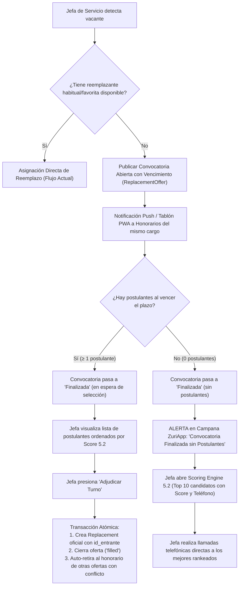

# ZuriApp v2 — Especificación de Expansión Funcional

> **Estado:** 🟢 Aprobado para Implementación  
> **Autor:** Arquitecto  
> **Fecha:** 2026-09-14  
> **Origen:** [roadmap_zuriapp_v2.md](file:///C:/Users/sebas/OneDrive/Escritorio/roadmap_zuriapp_v2.md)

---

## 1. Contexto y Motivación

### 1.1 Problema

ZuriApp resuelve hoy **dos funciones core**:

1. **Generación de turnos** — Visualización en tabla mensual de asignaciones rotativas por servicio.
2. **Registro de reemplazos** — Quién sale, quién entra, datos del servicio asociado.

Adicionalmente, los funcionarios reciben un link vía WhatsApp donde ven su calendario del mes en curso (vista pública de solo lectura).

Aunque a nivel técnico el sistema es robusto (JWT, RBAC granulado, auditoría, cron jobs, colas BullMQ, Socket.io, etc.), **el valor percibido por el usuario final se limita a estas dos funciones**. El hospital base de Osorno opera sin un sistema formal — usan diario mural con post-its o Excel.

### 1.2 Objetivo

Expandir ZuriApp de un **sistema de registro pasivo** a un **sistema de gestión inteligente** con:

- Indicadores operativos (KPIs) que hoy se calculan manualmente
- Alertas proactivas basadas en normativa laboral chilena real
- Interacción bidireccional con los funcionarios (confirmación de turnos e indisponibilidad vía PWA)
- Sugerencia inteligente de reemplazantes (bolsa de candidatos con scoring)

### 1.3 Restricciones

| Restricción | Detalle |
|---|---|
| **Escala** | 20-150 funcionarios por servicio. No requiere optimización extrema. |
| **Dominio** | Solo gestión operativa de dotación. No toca finanzas, nómina ni contabilidad. |
| **Canal de comunicación** | **PWA (Progressive Web App)** como canal primario de interacción y notificaciones push nativas. WhatsApp limitado al onboarding inicial del funcionario (magic link + OTP). |
| **Presupuesto WhatsApp** | Solo para onboarding inicial (magic link + OTP). Notificaciones push del día a día → Web Push API de la PWA. |
| **Normativa** | Ley 18.834, Ley 19.664/15.076, Código del Trabajo — reglas de descanso distintas según estatuto jurídico del funcionario. |

---

## 2. Estado Actual del Codebase (Inventario)

### 2.1 Modelos de Datos Existentes

| Modelo | Archivo | Campos Relevantes |
|---|---|---|
| **Staff** | [staff.model.ts](file:///C:/Users/sebas/workspace/Proyecto_ZuriApp/server/models/staff.model.ts) | `rut`, `firstName`, `lastName`, `phone`, `email`, `contractType` (CONTRATA\|PLANTA\|HONORARIO), `isActive`, `roleId`, `positionId` |
| **TurnAssignment** | [turn-assignment.model.ts](file:///C:/Users/sebas/workspace/Proyecto_ZuriApp/server/models/turn-assignment.model.ts) | `staffId`, `service`, `turn_type` (ref TurnType), `start_date`, `end_date`, `snapshot_secuencia[]` |
| **Replacement** | [replacement.model.ts](file:///C:/Users/sebas/workspace/Proyecto_ZuriApp/server/models/replacement.model.ts) | `id_saliente`, `id_entrante`, `tipo_turno`, `turn_type_id`, `fecha_inicio`, `fecha_termino`, `servicio`, `status`, `snapshot_secuencia[]`, `corte_anticipado` |
| **TurnType** | [turn-type.model.ts](file:///C:/Users/sebas/workspace/Proyecto_ZuriApp/server/models/turn-type.model.ts) | `nombre`, `codigo`, `jornada` (DIURNO\|NOCTURNO\|MIXTO), `cantidad_dias`, `secuencia[]` (dia, turno_entrada, turno_salida, es_libre, sigla) |
| **TurnSigla** | [turn-sigla.model.ts](file:///C:/Users/sebas/workspace/Proyecto_ZuriApp/server/models/turn-sigla.model.ts) | `sigla`, `nombre`, `turno_entrada`, `turno_salida`, `color` |
| **ShiftException** | [shift-exception.model.ts](file:///C:/Users/sebas/workspace/Proyecto_ZuriApp/server/models/shift-exception.model.ts) | `assignment_id`, `assignment_model` (TurnAssignment\|Replacement), `date`, `original_type`, `override_type`, `reason` |
| **Service** | [service.model.ts](file:///C:/Users/sebas/workspace/Proyecto_ZuriApp/server/models/service.model.ts) | `nombre`, `codigo`, `jefe_servicio`, `supervisor`, `coordinadores[]`, `jefes_turno[]`, `centro_costo`, `ubicacion` |
| **Position** | [position.model.ts](file:///C:/Users/sebas/workspace/Proyecto_ZuriApp/server/models/position.model.ts) | `name`, `position_code`, `description` |
| **Period** | [period.model.ts](file:///C:/Users/sebas/workspace/Proyecto_ZuriApp/server/models/period.model.ts) | `month`, `year`, `status` (OPEN\|CLOSED), `closedBy`, `pdfUrls` |

### 2.2 Servicios Existentes Relevantes

| Servicio | Archivo | Rol |
|---|---|---|
| **report.service** | [report.service.ts](file:///C:/Users/sebas/workspace/Proyecto_ZuriApp/server/services/report.service.ts) | `getMonthlyReport()` — calcula timeline, horas diurnas/nocturnas, siglas, por staff/mes. `calculateDayNightMetrics()` para desglose hora diurna vs nocturna. |
| **notification.service** | [notification.service.ts](file:///C:/Users/sebas/workspace/Proyecto_ZuriApp/server/services/notification.service.ts) | `notifyReplacement()`, `notifyShiftAssignment()`, `sendWhatsApp()` — envío push vía Meta API. |
| **public.service** | [public.service.ts](file:///C:/Users/sebas/workspace/Proyecto_ZuriApp/server/services/public.service.ts) | `getPublicUserShifts()` — vista pública de calendario (sin auth). |
| **calendar.service** | [calendar.service.ts](file:///C:/Users/sebas/workspace/Proyecto_ZuriApp/server/services/calendar.service.ts) | Generación de ICS/Webcal para eventos de reemplazo. |
| **replacement.service** | [replacement.service.ts](file:///C:/Users/sebas/workspace/Proyecto_ZuriApp/server/services/replacement.service.ts) | CRUD completo de reemplazos con validaciones de negocio. |

### 2.3 Infraestructura Asíncrona

| Componente | Archivo | Función |
|---|---|---|
| **email.queue** | [email.queue.ts](file:///C:/Users/sebas/workspace/Proyecto_ZuriApp/server/queues/email.queue.ts) | Cola BullMQ para envío de emails |
| **report.queue** | [report.queue.ts](file:///C:/Users/sebas/workspace/Proyecto_ZuriApp/server/queues/report.queue.ts) | Cola BullMQ para cierre mensual (genera PDFs, snapshots) |
| **replacement.cron** | [replacement.cron.ts](file:///C:/Users/sebas/workspace/Proyecto_ZuriApp/server/jobs/replacement.cron.ts) | Job cron para manejo automático de reemplazos |
| **report-closure.cron** | [report-closure.cron.ts](file:///C:/Users/sebas/workspace/Proyecto_ZuriApp/server/jobs/report-closure.cron.ts) | Job cron para cierre de período mensual |

---

## 3. Pre-requisitos y Decisiones Fundacionales del Modelo

> **CRÍTICO:** Esta sección define las modificaciones estructurales y las decisiones de diseño base que deben implementarse como **pre-requisitos inmediatos (~4 días)** antes de abordar las fases 1, 2 y 3.

### 3.1 Marco Legal y Estatuto Jurídico (Position.estamento + Helper Legal)

**Definición de Arquitectura:** El modelo [Staff](file:///C:/Users/sebas/workspace/Proyecto_ZuriApp/server/models/staff.model.ts) **no se modifica**. El marco legal aplicable (`LEY_18834`, `LEY_19664` o `CODIGO_TRABAJO`) se **deriva en tiempo de ejecución** combinando dos datos: `staff.contractType` + `position.estamento`.

#### Cambio 1: Agregar `estamento` al modelo Position
El modelo [Position](file:///C:/Users/sebas/workspace/Proyecto_ZuriApp/server/models/position.model.ts) actualmente tiene `name`, `position_code`, `description`. Se agrega:

```typescript
estamento: {
  type: String,
  enum: ['MEDICO', 'PROFESIONAL', 'TECNICO', 'ADMINISTRATIVO', 'AUXILIAR'],
  required: true,
  default: 'PROFESIONAL', // Retrocompatibilidad segura con cargos existentes
}
```

> **Nota de Auditoría y Migración:** Se debe actualizar la constante `POSITION_AUDIT_FIELDS` en [position.model.ts](file:///C:/Users/sebas/workspace/Proyecto_ZuriApp/server/models/position.model.ts) sumando `'estamento'` para registrar cambios de estatuto en el log de auditoría. Para la base de datos existente, se ejecutará un script breve de backfill (`server/migrations/set-default-estamentos.ts`) para asignar el estamento correcto a los cargos actuales.

**Contexto de Dominio Hospitalario:** El "estamento" es la clasificación estándar del sector público de salud chileno:

| Estamento | Cargos agrupados |
|---|---|
| `MEDICO` | Médico Cirujano, Odontólogo, Químico Farmacéutico |
| `PROFESIONAL` | Enfermera, Matrona, Kinesiólogo, Informático |
| `TECNICO` | TENS, Técnico de Laboratorio |
| `ADMINISTRATIVO` | Secretaria, Digitador |
| `AUXILIAR` | Auxiliar de Servicio, Camillero |

**UX:** Este campo se configura **una sola vez** al crear el cargo (`Position`), no cada vez que se crea un funcionario. Los cargos son pocos y se crean raramente.

#### Cambio 2: Función utilitaria de derivación legal

```typescript
// server/utils/legal-framework.util.ts  [NUEVO]

export type LegalFramework = 'LEY_18834' | 'LEY_19664' | 'CODIGO_TRABAJO';

export function getLegalFramework(
  contractType: 'PLANTA' | 'CONTRATA' | 'HONORARIO',
  estamento: string
): LegalFramework {
  if (contractType === 'HONORARIO') return 'CODIGO_TRABAJO';
  if (estamento === 'MEDICO') return 'LEY_19664';
  return 'LEY_18834';
}
```

**Regla de Precedencia:** `contractType` toma prioridad. Un médico a honorarios → Código del Trabajo (es contratista). La ley médica solo aplica a médicos funcionarios públicos (`PLANTA`/`CONTRATA`).

| contractType | estamento | Marco legal derivado | Caso real |
|---|---|---|---|
| PLANTA / CONTRATA | MEDICO | `LEY_19664` | Médico de planta del hospital |
| HONORARIO | MEDICO | `CODIGO_TRABAJO` | Médico a honorarios cubriendo turnos |
| PLANTA / CONTRATA | TECNICO | `LEY_18834` | TENS de contrata |
| HONORARIO | TECNICO | `CODIGO_TRABAJO` | TENS como reemplazante |

**Impacto en Staff:** Ninguno. Sin modificaciones al esquema de Staff.  
**Uso en Motor de Alertas:** `staff.positionId` → populate → `position.estamento` → `getLegalFramework(staff.contractType, position.estamento)`.

---

### 3.2 Evaluación Matemática de Turnos Dinámicos (Sin Enums Rígidos)

**Decisión Arquitectónica (YAGNI & Flexibilidad):** **NO se agrega ningún campo `turnPattern` ni enums rígidos a `TurnType`.**

#### Justificación Técnica y de Dominio:
1. **ZuriApp es dinámico por diseño:** Los turnos se construyen libremente en `TurnType.secuencia[]` con cualquier longitud (`cantidad_dias`).
   - Ej: Cuarto Turno = ciclo de 4 días (`[L, N, X, X]`).
   - Ej: Tercer Turno hospitalario real (HBSJO) = ciclo de 6 días (`[L, L, N, N, X, X]`).
2. **Evaluación matemática directa en memoria:** El motor no necesita etiquetas de texto. Evalúa directamente la secuencia de turnos y las horas reales entre turnos:
   - **Descanso post-noche:** Mide las horas continuas entre el fin del turno nocturno (`turno_salida`) y el inicio del siguiente turno activo (`turno_entrada`).
   - **Excepciones de turno:** Se evalúa siempre el **calendario efectivo** (`secuencia base` + `ShiftException[]`), detectando descansos insuficientes tanto en turnos base como en alteraciones de días libres (`X`).
3. **Ciclos deslizantes y semanas calendario ISO (Lunes a Domingo):**
   - Un ciclo de 6 días (`L L N N X X`) rota naturalmente sobre los 7 días de la semana calendario (resuelto por el operador módulo `diff % secuencia.length` en [report.service.ts](file:///C:/Users/sebas/workspace/Proyecto_ZuriApp/server/services/report.service.ts)).
   - En semanas calendario ISO (Lunes a Domingo), el funcionario puede tener semanas pico de 5 turnos (60 horas = +16h de sobretiempo/compensatorio), y en otras 48h o 36h.
   - El motor agrupa por semana calendario real y computa el balance horario exacto sin requerir clasificación estática de turnos.

**Impacto en TurnType:** Ninguno. Sin migraciones ni campos nuevos en la base de datos.

---

### 3.3 Pertenencia Dinámica Funcionario ↔ Servicio (Pertenencia por Cuadrante)

**Decisión Arquitectónica (YAGNI & Realidad Hospitalaria):** **NO se agrega ningún campo `serviceId` ni modelo pivot fijo a `Staff`.**

#### Justificación de Dominio (Estatuto Administrativo):
En el sistema de salud público chileno (Ley 18.834, facultad de destinación), el personal no está contratado para un servicio clínico en particular (ej. UCI, Urgencias, Medicina). El hospital tiene la facultad de mover y redistribuir al personal entre distintos servicios según contingencias o necesidades de dotación. Forzar un campo estático en `Staff` falsearía la realidad operativa y generaría desincronización constante al rotar funcionarios.

#### Patrón: "Pertenencia Dinámica por Período"
- No se agrega modelo nuevo ni campo fijo en `Staff` (filosofía YAGNI).
- La pertenencia a un servicio en un período determinado se deduce dinámicamente de los `TurnAssignment` y `Replacement` activos en ese rango de fechas.
- Esto preserva el histórico real (permite consultar exactamente quién estuvo en qué servicio cada mes pasado).

#### Optimización de Rendimiento (< 5ms) y Normalización de `end_date` Obligatorio:
En la operativa hospitalaria real y en el diseño de ZuriApp, la programación de turnos se realiza **estrictamente mes a mes**. En el frontend ([TurnAssignmentModal.vue](file:///C:/Users/sebas/workspace/Proyecto_ZuriApp/client/src/components/shifts/TurnAssignmentModal.vue)), la fecha de término ya es un campo validado como obligatorio (`'La fecha de término es requerida'`).

Por ende, se formaliza la corrección de esta discrepancia en el backend:
1. **`end_date` pasa a ser estrictamente obligatorio (`required: true`)** en el modelo [turn-assignment.model.ts](file:///C:/Users/sebas/workspace/Proyecto_ZuriApp/server/models/turn-assignment.model.ts) y en su esquema de validación Zod [turn-assignment.schema.ts](file:///C:/Users/sebas/workspace/Proyecto_ZuriApp/server/schemas/turn-assignment.schema.ts).
2. **Backfill histórico seguro:** Para garantizar integridad referencial con asignaciones históricas existentes en base de datos que pudieran tener `end_date: null`, se incluye un script breve de backfill (`server/migrations/fix-turn-assignment-end-date.ts`) que asigna `end_date` al último día del mes correspondiente a su `start_date`.
3. **Consulta de pertenencia limpia y de alto rendimiento:** Al ser ambos campos obligatorios y contar con índices compuestos, las consultas de cuadrante se simplifican radicalmente eliminando cláusulas `$or` complejas:
   ```typescript
   // Consulta canónica de pertenencia por rango (ultra-rápida con índice compuesto)
   const assignments = await TurnAssignmentModel.find({
     service: serviceId,
     start_date: { $lte: rangeEnd },
     end_date: { $gte: rangeStart },
   });
   ```

#### Índices Compuestos en MongoDB:
1. En [turn-assignment.model.ts](file:///C:/Users/sebas/workspace/Proyecto_ZuriApp/server/models/turn-assignment.model.ts): `{ service: 1, start_date: 1, end_date: 1 }`
2. En [replacement.model.ts](file:///C:/Users/sebas/workspace/Proyecto_ZuriApp/server/models/replacement.model.ts): `{ servicio: 1, fecha_inicio: 1, fecha_termino: 1 }`

**Impacto en Modelo Staff:** Ninguno. Sin tablas pivot ni campos redundantes.

---

### 3.4 Causal de Ausencia del Titular Saliente en Reemplazos

**Definición de Dominio:** En todo reemplazo, la causal de ausencia y las observaciones le pertenecen **exclusivamente al funcionario titular saliente** (justificación de la ausencia del puesto). No describe al entrante ni representa refuerzos de dotación (en ZuriApp todo reemplazo vincula a un titular saliente con un reemplazante entrante).

#### Reglas de Diseño:
1. **Combo de dos campos estructurados:**
   * **`motivo` (Desplegable obligatorio):** Enum estructurado con las 8 causales operativas hospitalarias. Evita textos libres inconsistentes (`"LM"`, `"lic"`, `"asdf"`), permitiendo filtros limpios en pantalla y reportes confiables.
   * **`observaciones` (Texto libre opcional):** Hasta 500 caracteres para notas operativas específicas (obligatorio únicamente si se selecciona `"OTRO"`).
2. **Delimitación de Dominio:** Se excluyen conceptos remunerativos como "con/sin goce de sueldo", ya que ZuriApp no audita liquidaciones ni finanzas hospitalarias.
3. **Confidencialidad Hospitalaria:** El motivo del titular saliente es visible **únicamente para la jefatura y administración** en el sistema web. En la PWA, los reemplazantes honorarios solo ven los datos operativos y requerimientos técnicos del turno, protegiendo estrictamente la privacidad médica y laboral del colega ausente.

#### Catálogo Oficial de Causales (`motivo`):

```typescript
export type AusenciaSalienteMotivo =
  | 'LICENCIA_MEDICA'         // Licencia médica común, laboral o reposo
  | 'PRE_POST_NATAL'          // Descanso maternal, pre/postnatal y parental
  | 'PERMISO_ADMINISTRATIVO'  // Días administrativos reglamentarios (Ley 18.834)
  | 'FERIADO_LEGAL'           // Vacaciones legales programadas o urgentes
  | 'DIA_COMPENSATORIO'       // Descanso compensatorio por horas extras
  | 'COMISION_SERVICIO'       // Capacitación oficial o labores externas
  | 'PERMISO_GREMIAL'         // Actividades gremiales autorizadas
  | 'OTRO';                   // Otros imprevistos (exige detalle en observaciones)
```

#### Alcance de Implementación End-to-End:

| Capa | Archivo | Modificación |
|---|---|---|
| **Backend Model** | [replacement.model.ts](file:///C:/Users/sebas/workspace/Proyecto_ZuriApp/server/models/replacement.model.ts) | Agregar `motivo` (enum, required, `default: 'OTRO'` para retrocompatibilidad con datos históricos) y `observaciones` (String, max 500). |
| **Backend Zod Schema** | [replacement.schema.ts](file:///C:/Users/sebas/workspace/Proyecto_ZuriApp/server/schemas/replacement.schema.ts) | En `createReplacementSchema` y `updateReplacementSchema`, agregar `motivo: z.enum([...])` obligatorio y `observaciones: z.string().max(500).optional()`. |
| **Backend Controller** | [replacement.controller.ts](file:///C:/Users/sebas/workspace/Proyecto_ZuriApp/server/controllers/replacement.controller.ts) | En `registerReemplazo`, recibir y persistir `motivo` y `observaciones`. |
| **Backend Service** | [replacement.service.ts](file:///C:/Users/sebas/workspace/Proyecto_ZuriApp/server/services/replacement.service.ts) | En `registrar`, guardar y retornar `motivo` y `observaciones` en listados y consultas. |
| **Frontend Types** | [replacement.types.ts](file:///C:/Users/sebas/workspace/Proyecto_ZuriApp/client/src/types/replacement.types.ts) | Actualizar interfaz `ReplacementRegistration` con `motivo: AusenciaSalienteMotivo` y `observaciones?: string`. |
| **Frontend Modal Create** | [ReplacementModalCreate.vue](file:///C:/Users/sebas/workspace/Proyecto_ZuriApp/client/src/components/replacements/ReplacementModalCreate.vue) | Selector desplegable obligatorio de motivo bajo el titular saliente + input opcional de observaciones. |
| **Frontend Modal Update** | [ReplacementModalUpdate.vue](file:///C:/Users/sebas/workspace/Proyecto_ZuriApp/client/src/components/replacements/ReplacementModalUpdate.vue) | Permitir visualizar y editar `motivo` y `observaciones`. |
| **Frontend Vista Principal** | [ActiveReplacementsView.vue](file:///C:/Users/sebas/workspace/Proyecto_ZuriApp/client/src/views/active-replacements/ActiveReplacementsView.vue) | Columna/badge de `Motivo` en tabla de reemplazos activos y filtro rápido por causal. |
| **Frontend Historial Staff** | [StaffModalDetail.vue](file:///C:/Users/sebas/workspace/Proyecto_ZuriApp/client/src/components/staff/StaffModalDetail.vue) | Mostrar `motivo` en la tabla del historial de reemplazos del funcionario. |

---

## 4. Fase 1: Inteligencia sobre Datos Existentes

**Duración estimada:** ~4 semanas  
**Dependencias:** Pre-requisitos base resueltos (Sección 3: estamento en Position, índices compuestos y causales del titular saliente).

### 4.1 Dashboard de Indicadores por Servicio

#### 4.1.1 Delimitación de Dominio: ZuriApp vs. Reloj Control Biométrico
> **ALCANCE DE DOMINIO:** ZuriApp **no es ni interactúa con el tótem de marcaje biométrico ni con el reloj control de RRHH (SIRH)** del hospital. El sistema no mide "asistencia física" ni atrasos al minuto. Lo que ZuriApp administra y conoce con exactitud matemática es la **planificación de turnos oficiales y los reemplazos formales** autorizados por jefatura. Por ende, el sistema mide la **Tasa de Reemplazos** (nivel de inestabilidad o contingencia de la dotación), no el "ausentismo no justificado" de reloj control.

#### 4.1.2 Catálogo de KPIs y Fórmulas Matemáticas

| KPI | Clave Técnica | Fórmula / Lógica de Negocio | Interpretación y Valor Operativo |
|---|---|---|---|
| **Total Reemplazos del Mes** | `totalReplacements` | `count(Replacement)` donde `servicio == serviceId` y `fecha_inicio` pertenece al mes | Volumen neto de contingencias gestionadas en el período. |
| **Tasa de Reemplazos (%)** | `replacementRate` | $\left( \frac{\text{jornadas reemplazadas}}{\text{jornadas programadas}} \right) \times 100$ | **Indicador clave de estabilidad:** Mide qué % de las jornadas planificadas debió cubrirse con reemplazantes. Normaliza por tamaño de servicio: permite comparar equitativamente un servicio de 60 funcionarios con uno de 5. Si `jornadas programadas == 0` $\rightarrow 0\%$. |
| **Jornadas Programadas** | `scheduledShiftDays` | Suma de jornadas presenciales con turno activo (Largos, Noches, Diurnos, excluyendo días libres `X`) para todo el personal asignado al servicio en el mes según `TurnAssignment`. | Denominador base de la capacidad operativa instalada del servicio. |
| **Jornadas Reemplazadas** | `totalShiftsReplaced` | Suma de jornadas presenciales con turno activo (Largos, Noches, Diurnos, excluyendo días libres `X`) cubiertas por reemplazos activos en el mes asociados al servicio. | Volumen exacto de turnos presenciales cubiertos por personal de reemplazo. |
| **Top Funcionarios con Más Turnos Reemplazados** | `topReplacedStaff` | Agrupar reemplazos por `id_saliente`, contar eventos y sumar jornadas presenciales cubiertas. Limitar a **Top 5**. | Identifica funcionarios con licencias médicas prolongadas o permisos recurrentes que impactan la continuidad del servicio. |
| **Cobertura de Dotación Mensual (%)** | `coverage.overallPercentage` | Puestos-persona cubiertos vs requeridos: $\% = \left(\frac{\sum \text{presentes efectivos}}{\sum \text{mínimos requeridos}}\right) \times 100$. Si `Service.dotacion_minima` está vacía, retorna `configured: false` y `% = null`. | **Semáforo Contextual por Servicio:** Se compara dinámicamente contra los umbrales configurados para ESE servicio (`Service.umbrales_cobertura`: `verde` default 95%, `amarillo` default 85%). Retorna `status: 'optimal' \| 'warning' \| 'critical'`. Así, un 90% en Maternidad resulta en 🟢 *Óptimo*, mientras que ese mismo 90% en UCI resulta en 🟡 *Alerta* o 🔴 *Crítico*. |
| **Desglose Horas Diurnas vs Nocturnas** | `hoursBreakdown` | Reutiliza `report.service.calculateDayNightMetrics()`. Retorna `totalHours`, `dayHours`, `nightHours` y `nightPercentage`. | Exposición y sobrecarga nocturna del servicio (relevante para asignaciones de turno DFL 30 y fatiga laboral). |
| **Comparativo Mes Anterior** | `comparative` | Deltas porcentuales respecto al mes $M-1$: $\Delta\%$ Reemplazos, $\Delta$ Puntos de Tasa de Reemplazo y $\Delta$ Puntos de Cobertura. | Tendencia evolutiva: detecta si la contingencia del servicio va al alza (ej: campañas de invierno) o se estabilizó. |

#### 4.1.3 Contrato de API REST y DTOs

##### A) Obtención de Métricas del Dashboard
* **Ruta:** `server/routes/api/dashboard.routes.ts` (montada en `/api/dashboard`)
* **Endpoint:** `GET /api/dashboard/:serviceId/kpis?month=X&year=Y`
* **Middlewares:** `authMiddleware`, `requirePermission("shifts.view")`
* **Query Params:**
  * `month`: número entero (1..12). Opcional, default mes actual.
  * `year`: número entero ($\ge 2020$). Opcional, default año actual.

```typescript
// server/types/dashboard.types.ts  [NUEVO]

export interface DashboardKPIResponse {
  success: boolean;
  data: {
    period: { month: number; year: number };
    service: { 
      id: string; 
      name: string;
      canEditStaffing: boolean;       // true si el usuario logueado puede editar dotación de este servicio
    };
    summary: {
      totalReplacements: number;
      replacementRate: number;        // e.g. 4.67 (%)
      scheduledShiftDays: number;     // e.g. 320 jornadas planificadas (excluye libres X)
      totalShiftsReplaced: number;    // e.g. 15 jornadas cubiertas por reemplazo
    };
    coverage: {
      configured: boolean;            // false si el servicio no tiene dotacion_minima
      overallPercentage: number | null; // e.g. 91.5 (null si configured === false)
      status: 'optimal' | 'warning' | 'critical'; // Semáforo contextual según umbrales de este servicio
      thresholds: {
        green: number;                // e.g. 95 (o el valor personalizado de este servicio)
        yellow: number;               // e.g. 85
      };
      uncoveredSlotsCount: number;    // Cantidad de franjas diurnas/nocturnas con déficit
      byPosition: Array<{
        positionId: string;
        positionName: string;
        minDay: number;
        minNight: number;
        coveragePercentage: number;
      }>;
    };
    hoursBreakdown: {
      totalHours: number;
      dayHours: number;
      nightHours: number;
      nightPercentage: number;        // e.g. 48.5 (%)
    };
    topReplacedStaff: Array<{
      staffId: string;
      fullName: string;
      rut: string;
      positionName: string;
      replacementCount: number;
      totalShiftsReplaced: number;
    }>;
    comparative: {
      previousPeriod: { month: number; year: number };
      replacementsDeltaPct: number | null;     // % de cambio relativo en cantidad de reemplazos
      replacementRateDeltaPoints: number | null; // Cambio en puntos porcentuales de la tasa
      coverageDeltaPoints: number | null;      // Cambio en puntos porcentuales de cobertura
    };
    cached: boolean;
    generatedAt: string;              // Formato ISO Date
  };
}
```

##### B) Ajuste Operativo de Dotación y Umbrales (Gobernanza Contextual)
Para evitar otorgar permisos administrativos globales (`service.update`) a las supervisoras de turno, se crea un endpoint específico con control de acceso contextual:

* **Ruta:** `server/routes/api/service.routes.ts`
* **Endpoint:** `PATCH /api/services/:id/staffing`
* **Middlewares:** `authMiddleware`
* **Regla de Autorización (Backend RBAC Contextual):**
  $$\text{Autorizado} \iff \begin{cases} 
  \text{Rol del usuario es Administrador (SYS\_ADMIN)} \\
  \quad \mathbf{O} \\
  \text{El usuario (staffId) está asignado como } \mathbf{jefe\_servicio}, \mathbf{supervisor} \text{ o en } \mathbf{coordinadores[]} \text{ de este servicio}
  \end{cases}$$
  *Si el usuario no cumple ninguna, responde `403 Forbidden: "No tienes autorización para modificar la dotación de este servicio"`.*

```typescript
// server/types/dashboard.types.ts (DTO de actualización)
export interface UpdateServiceStaffingDTO {
  dotacion_minima?: Array<{
    positionId: string;
    minimo_dia: number;
    minimo_noche: number;
  }>;
  umbrales_cobertura?: {
    verde: number;    // e.g. 95 (>= verde -> optimal)
    amarillo: number; // e.g. 85 (>= amarillo -> warning; < amarillo -> critical)
  };
}
```

#### 4.1.4 Estrategia de Caché (Redis) y Reactividad en Tiempo Real (Socket.io)

1. **Almacenamiento en Redis:**
   * **Clave:** `kpi:service:{serviceId}:{year}:{month}`
   * **TTL:** 24 horas (86.400 segundos). Evita recálculos pesados en visitas recurrentes al dashboard.
2. **Invalidación Perezosa (Lazy Invalidation):**
   * En lugar de recalcular síncronamente al guardar turnos (lo que ralentizaría las mutaciones), el sistema borra la clave mediante `redis.del(key)`.
   * **Disparadores de invalidación (Hooks en servicios existentes):**
     * `TurnAssignment`: al crear, actualizar o eliminar asignaciones.
     * `Replacement`: al crear reemplazo, corte anticipado o cancelar.
     * `ShiftException`: al registrar excepciones o permisos.
     * `Service`: al mutar dotación o umbrales vía `PATCH /api/services/:id/staffing`.
3. **Notificación Reactiva vía WebSockets:**
   * Al invalidar la clave, el backend emite:
     `io.to("service:" + serviceId).emit("dashboard:invalidated", { serviceId, year, month })`
   * El cliente Pinia (`dashboard.store.ts`), si tiene la vista de ese servicio y período activa, dispara automáticamente un refresco en segundo plano sin interrumpir al usuario.

#### 4.1.5 UX y Arquitectura de Código

##### A) Experiencia de Usuario (UX)
* **Preferencia de Servicio Habitual:** Cada funcionaria trabaja usualmente en su propio servicio. Para evitar que deba buscar su unidad en una lista de 30 servicios cada vez que entra, el cliente almacena la última selección en `localStorage.getItem('zuriapp_preferred_service')`. Al entrar a `/dashboard`, se carga automáticamente su servicio habitual. Si es un directivo o administrador, puede cambiar de servicio libremente mediante el selector global del header.
* **Modal Dedicado (`ServiceStaffingModal.vue`):** En lugar de navegar a la administración de servicios, la supervisora hace clic en ⚙️ *"Ajustar Dotación y Metas"* directamente en la card de cobertura.
* **Seguridad Visual:** El botón ⚙️ solo se muestra si `canEditStaffing === true`. Si una supervisora mira un servicio ajeno, el dashboard opera en modo **solo lectura**.

##### B) Arquitectura de Archivos

**Backend (`server/`):**
```
server/types/dashboard.types.ts       [NUEVO — Interfaces DTO Dashboard & Staffing]
server/services/dashboard.service.ts  [NUEVO — Lógica de agregación y cálculo de KPIs]
├── getServiceKPIs(serviceId, month, year, accountStaffId) → DashboardKPIResponse
├── calculateReplacementMetrics(...)  → summary & topReplacedStaff
├── calculateCoverageMetrics(...)     → coverage (aplica umbrales_cobertura del servicio)
└── calculateComparativeMetrics(...)  → comparative

server/controllers/dashboard.controller.ts  [NUEVO]
└── getServiceKPIsHandler(req, res, next)

server/routes/api/dashboard.routes.ts       [NUEVO — Convención API ZuriApp]
└── GET /api/dashboard/:serviceId/kpis

server/controllers/service.controller.ts    [MODIFICADO]
└── updateServiceStaffingHandler(req, res, next) — Verifica pertenencia o SYS_ADMIN

server/routes/api/service.routes.ts         [MODIFICADO]
└── PATCH /api/services/:id/staffing
```

> **REUTILIZACIÓN OBLIGATORIA:** `dashboard.service.ts` debe importar y reutilizar directamente `calculateDayNightMetrics` y las fórmulas de expansión de turnos (`diff % patternSeq.length`) de [report.service.ts](file:///C:/Users/sebas/workspace/Proyecto_ZuriApp/server/services/report.service.ts), evitando duplicar algoritmos de fecha u horarios.

**Frontend (`client/src/`):**
```
client/src/types/dashboard.types.ts            [NUEVO — Interfaces TypeScript de DTOs KPI y Staffing]
client/src/services/dashboard.service.ts       [NUEVO — Servicio Axios consumidor de /api/dashboard y /api/services/:id/staffing]
├── getServiceKPIs(serviceId, month, year)     → Promise<DashboardKPIResponse>
└── updateServiceStaffing(serviceId, payload)  → Promise<{ success: boolean; data: any }>

client/src/views/DashboardView.vue             [NUEVO — Vista principal con selector y persistencia de servicio habitual]
client/src/components/dashboard/
├── KPICards.vue             — Cards con métricas de resumen (Total reemplazos, Tasa, Jornadas programadas, Jornadas reemplazadas)
├── ReplacementChart.vue     — Gráfico de reemplazos del mes (Chart.js vía vue-chartjs)
├── CoverageGauge.vue        — Indicador de cobertura con semáforo contextual (optimal/warning/critical)
├── TopReplacedStaff.vue     — Tabla con el top 5 de personal con más turnos reemplazados
├── HoursBreakdownCard.vue   — Barra de proporción horas diurnas vs nocturnas
├── EmptyStateCoverage.vue   — Banner informativo cuando dotacion_minima no está configurada
└── ServiceStaffingModal.vue — Modal para ajustar dotación mínima por cargo y umbrales verde/amarillo

client/src/stores/dashboard.store.ts           [NUEVO — Store Pinia con caché reactiva, localStorage y Socket.io]
client/src/router/index.ts                     [MODIFICADO — Reemplaza el placeholder /app/dashboard por DashboardView.vue]
```

---

---

### 4.2 Sistema de Alertas Inteligentes

#### 4.2.1 Delimitación y Modelo de Disparo Dual (Tiempo Real + Cron)
Para evitar tanto la fatiga de alertas por avisos tardíos como la sobrecarga de consultas en base de datos, el motor opera en **dos niveles complementarios**:

1. **Nivel 1: Tiempo Real (Event-Driven — Quirúrgico):**
   * Se ejecuta de forma síncrona/ligera (< 10ms) cada vez que se crea o muta un `TurnAssignment`, `Replacement` o `ShiftException`.
   * Evalúa **únicamente al funcionario modificado** en una ventana de $\pm 2$ días frente a las reglas normativas (`NORM-01`, `NORM-02`, `NORM-03`, `NORM-06`, `OPS-02`).
   * Emite la alerta inmediatamente a la campana superior mediante Socket.io (`alert:new`).
2. **Nivel 2: Programado (Cron Diario 06:00 AM — Red de Seguridad y Cobertura):**
   * Barre la ventana rodante de los próximos 7 días evaluando la dotación mínima de todos los servicios (`OPS-01`).
   * **Auto-resolución de alertas:** Si un déficit de dotación previo ya fue cubierto mediante un reemplazo, el cron marca la alerta como `status = 'resolved'` de forma automática.

#### 4.2.2 Modelo de Datos e Índices de MongoDB

```typescript
// server/models/alert.model.ts  [NUEVO]

interface IAlert extends Document {
  ruleId: 'NORM-01' | 'NORM-02' | 'NORM-03' | 'NORM-06' | 'OPS-01' | 'OPS-02' | 'OPS-03';
  severity: 'critical' | 'high' | 'medium';
  category: 'normative' | 'operational';
  serviceId: ObjectId;        // ref → Service
  staffId?: ObjectId;         // ref → Staff (para alertas normativas individuales e indisponibilidad)
  date?: Date;                // Fecha afectada por la alerta (normalizada a 00:00:00.000Z UTC)
  shiftSlot?: 'DIA' | 'NOCHE'; // Franja horaria con déficit (para OPS-01)
  positionId?: ObjectId;      // ref → Position (cargo deficitario para OPS-01)
  message: string;            // Descripción clara y legible de la alerta
  context: Record<string, any>; // Datos técnicos (horas de descanso, requeridos vs presentes, motivo de indisponibilidad)
  status: 'active' | 'acknowledged' | 'resolved';
  resolutionNote?: string;    // Nota de resolución (manual o "Auto-resuelto: dotación cubierta")
  createdAt: Date;
  acknowledgedAt?: Date;
  resolvedAt?: Date;
  acknowledgedBy?: ObjectId;  // ref → Staff (coordinador que acusó recibo)
}
```

##### Índices de Rendimiento e Idempotencia en MongoDB (Blindaje de Concurrencia)
Para evitar bloqueos por claves duplicadas cuando múltiples funcionarios disparan alertas en la misma fecha y servicio, se definen **dos índices parciales especializados**:

1. **Índice de Idempotencia Operativa (OPS-01 — Cobertura de Dotación):**
   ```typescript
   alertSchema.index(
     { serviceId: 1, ruleId: 1, date: 1, shiftSlot: 1, positionId: 1, status: 1 },
     { partialFilterExpression: { ruleId: 'OPS-01' }, name: 'idx_idempotency_ops01' }
   );
   ```
   *Garantiza que el cron diario jamás inserte alertas repetidas para un mismo turno y cargo descubierto.*

2. **Índice de Idempotencia Normativa e Individual (NORM-01..06, OPS-02, OPS-03):**
   ```typescript
   alertSchema.index(
     { staffId: 1, ruleId: 1, date: 1, status: 1 },
     { partialFilterExpression: { staffId: { $exists: true } }, name: 'idx_idempotency_individual' }
   );
   ```
   *Garantiza que no se dupliquen alertas para un mismo funcionario en la misma fecha, sin colisionar con otros colegas del mismo servicio.*

3. **Índice de Consulta Rápida (Campana de Alertas UI):**
   `{ serviceId: 1, status: 1, createdAt: -1 }`
   *Permite a la campana del frontend listar alertas activas en < 2ms.*

4. **Índice de Historial por Funcionario:**
   `{ staffId: 1, createdAt: -1 }` (sparse: true)

#### 4.2.3 Catálogo Purgado de Reglas Esenciales

| ID | Regla | Lógica de Evaluación | Severidad | Disparador |
|---|---|---|:---:|---|
| **`NORM-01`** | **Descanso mínimo 12h** | Entre turnos consecutivos de un funcionario: `turno_entrada[N+1] - turno_salida[N] < 12h`. | 🔴 Crítica | Tiempo Real + Cron Diario |
| **`NORM-02`** | **Doble turno prohibido** | Funcionario asignado a Largo + Noche continuo (24h ininterrumpidas sin descanso). | 🔴 Crítica | Tiempo Real + Cron Diario |
| **`NORM-03`** | **Descanso post-noche insuficiente** | Tras turno Noche (salida 08:00 AM), reingreso a trabajar con menos de 24h de descanso efectivo. | 🟡 Alta | Tiempo Real + Cron Diario |
| **`NORM-06`** | **Balance sobretiempo semanal (>44h)** | Evalúa horas efectivas en semana calendario ISO (Lunes a Domingo). Si supera 44h (ej: 60h en semanas pico de 3er turno), alerta saldo para compensatorio. | 📊 Balance | Tiempo Real + Cron Diario |
| **`OPS-01`** | **Déficit de dotación (ventana 7 días)** | Para cada día de los próximos 7 días (incluyendo fines de semana y feriados): evalúa si presentes efectivos por cargo < `Service.dotacion_minima`. **Auto-resolución:** si el turno se cubre, se marca `resolved` automáticamente. | ⚠️ Media | Cron Diario (06:00 AM) |
| **`OPS-02`** | **Noches consecutivas (3+ noches)** | Funcionario asignado a 3 o más turnos nocturnos consecutivos (fatiga extrema). | ⚠️ Media | Tiempo Real + Cron Diario |
| **`OPS-03`** | **Indisponibilidad reportada (PWA)** | Funcionario declara fuerza mayor o indisponibilidad en PWA para un turno confirmado o programado. Genera alerta crítica en campana para reemplazo preventivo inmediato. | 🔴 Crítica | Tiempo Real (Evento PWA) |

#### 4.2.4 Reglas Descartadas por Análisis de Dominio Hospitalario (YAGNI)

Tras auditar la operativa real del Hospital Base San José de Osorno (HBSJO) y el funcionamiento interno de ZuriApp, se descartaron **7 reglas que generaban ruido y falsa complejidad**:

1. **`NORM-05` (Máximo 11h Código del Trabajo) ❌ DESCARTADA:** En hospitales públicos chilenos, todo el personal de reemplazo clínico opera bajo jornadas hospitalarias autorizadas de 12 horas. Disparar esta alerta generaría falsas alarmas el 100% de las veces.
2. **Reemplazo sin finalizar (antigua propuesta) ❌ DESCARTADA:** ZuriApp ya cuenta con el cron [`server/jobs/replacement.cron.ts`](file:///C:/Users/sebas/workspace/Proyecto_ZuriApp/server/jobs/replacement.cron.ts) que cierra los reemplazos vencidos de forma automática a medianoche. *(El identificador `OPS-03` se reasigna a la alerta formal de Indisponibilidad reportada)*.
3. **`OPS-04` (Feriado con dotación mínima) ❌ DESCARTADA (Unificada):** Redundante. Los sábados, domingos y feriados están incluidos dentro de la ventana de 7 días evaluada por `OPS-01`.
4. **`OPS-05` (Excepciones sin regularizar) ❌ DESCARTADA:** Las excepciones de cuadrante en ZuriApp no requieren aprobación manual; el cierre mensual contable se ejecuta automáticamente el 5 de cada mes.
5. **`EQ-01` (Carga desigual de noches) ❌ DESCARTADA DE LA CAMPANA:** En 4to turno, la rotación matemática es homogénea (7-8 noches al mes). Quien hace más noches es por contingencia voluntaria; este dato ya se visibiliza en el Dashboard sin requerir alertas invasivas.
6. **`EQ-02` (Concentración de reemplazos) ❌ DESCARTADA:** En los servicios clínicos, llamar a un reemplazante experimentado y capacitado es una práctica deliberada por **seguridad del paciente y eficiencia**, no un acto de favoritismo arbitrario.
7. **`EQ-03` (Distribución de fines de semana) ❌ DESCARTADA:** La Ley 18.834 no exige reparto idéntico mensual de fines de semana en turnos rotativos. La rotación continua de 4 días balancea los fines de semana a lo largo del año.

#### 4.2.5 Contrato de API REST y DTOs

* **Rutas:** `server/routes/api/alert.routes.ts` (montada en `/api/alerts`)
* **Middlewares globales:** `authMiddleware`

```typescript
// server/types/alert.types.ts  [NUEVO]

export interface AlertDTO {
  id: string;
  ruleId: 'NORM-01' | 'NORM-02' | 'NORM-03' | 'NORM-06' | 'OPS-01' | 'OPS-02' | 'OPS-03';
  severity: 'critical' | 'high' | 'medium';
  category: 'normative' | 'operational';
  serviceId: string;
  staffId?: string;
  staffName?: string;
  rut?: string;
  date?: string;                // YYYY-MM-DD
  shiftSlot?: 'DIA' | 'NOCHE';
  positionName?: string;
  message: string;
  context: Record<string, any>;
  status: 'active' | 'acknowledged' | 'resolved';
  resolutionNote?: string;
  createdAt: string;            // ISO Date
  acknowledgedAt?: string;
  resolvedAt?: string;
}

export interface AlertsListResponse {
  success: boolean;
  data: {
    alerts: AlertDTO[];
    unreadCount: number;
    countsBySeverity: {
      critical: number;
      high: number;
      medium: number;
    };
  };
}

export interface ResolveAlertDTO {
  resolutionNote: string;       // Motivo obligatorio si la resolución es manual
}
```

##### Endpoints y Permisos:
| Método | Endpoint | Permiso | Descripción |
|---|---|---|---|
| `GET` | `/api/alerts?serviceId=X&status=active` | `shifts.view` | Lista alertas activas del servicio con contadores por severidad |
| `PATCH` | `/api/alerts/:id/acknowledge` | `shifts.update` | Marca la alerta como acusada de recibo (`status = 'acknowledged'`) |
| `PATCH` | `/api/alerts/:id/resolve` | `shifts.update` | Resuelve manualmente la alerta con nota obligatoria (`ResolveAlertDTO`) |

#### 4.2.6 Arquitectura del Motor y Prevención de Consultas N+1

Para garantizar que la evaluación en tiempo real tome **< 5 milisegundos**, las 6 reglas **no hacen consultas directas a MongoDB**. El orquestador `alert.service.ts` carga el contexto consolidado en una sola query y se lo pasa en memoria:

```typescript
// server/services/alert-rules/alert-rule.interface.ts  [NUEVO]

export interface RuleContext {
  staffId?: string;
  serviceId: string;
  dateRange: { start: Date; end: Date };
  // Datos precargados en memoria RAM por alert.service (cero queries N+1)
  assignments: any[];           // TurnAssignment del rango
  replacements: any[];          // Replacement del rango
  exceptions: any[];            // ShiftException del rango
  dotacionMinima?: any[];       // Service.dotacion_minima (para OPS-01)
}

export interface AlertCandidate {
  ruleId: 'NORM-01' | 'NORM-02' | 'NORM-03' | 'NORM-06' | 'OPS-01' | 'OPS-02';
  severity: 'critical' | 'high' | 'medium';
  category: 'normative' | 'operational';
  serviceId: string;
  staffId?: string;
  date?: Date;
  shiftSlot?: 'DIA' | 'NOCHE';
  positionId?: string;
  message: string;
  context: Record<string, any>;
}

export interface AlertRule {
  id: string;
  category: 'normative' | 'operational';
  severity: 'critical' | 'high' | 'medium';
  evaluate: (context: RuleContext) => Promise<AlertCandidate[]>;
}
```

```
server/models/alert.model.ts                  [NUEVO — Modelo con índices de idempotencia]
server/types/alert.types.ts                   [NUEVO — Interfaces DTO de API]
server/services/alert-rules/alert-rule.interface.ts [NUEVO — Interface de contexto en memoria]
server/services/alert-rules/                  [NUEVO — 6 Reglas Puras en Memoria]
├── norm-01.rule.ts  — Descanso mínimo 12h
├── norm-02.rule.ts  — Doble turno prohibido (24h)
├── norm-03.rule.ts  — Descanso post-noche (< 24h)
├── norm-06.rule.ts  — Jornada semanal > 44h (Semana ISO)
├── ops-01.rule.ts   — Dotación mínima ventana 7 días + auto-resolución
└── ops-02.rule.ts   — Noches consecutivas acumuladas (3+)

server/services/alert.service.ts              [NUEVO — Orquestador]
├── evaluateStaffNormative(staffId, dateRange)  → Alert[] (Tiempo Real en mutaciones)
├── evaluateServiceOperations(serviceId, range)  → Alert[] (OPS-01)
├── evaluateAllDaily()                          → Invocado por cron diario
├── acknowledgeAlert(alertId, staffId)          → Alert
└── resolveAlert(alertId, note, staffId)        → Alert

server/jobs/alerts.cron.ts                    [NUEVO — Cron Diario 06:00 AM]
└── Ejecuta evaluateAllDaily() en la cola alertQueue de BullMQ

server/controllers/alert.controller.ts         [NUEVO]
├── getAlertsHandler(req, res, next)
├── acknowledgeAlertHandler(req, res, next)
└── resolveAlertHandler(req, res, next)

server/routes/api/alert.routes.ts             [NUEVO]
```

#### 4.2.7 Contrato de Eventos en Tiempo Real (Socket.io) y Fachada `socket.service.ts`

Para mantener la separación de responsabilidades y no acoplar los controladores al objeto global `io`, todas las emisiones se centralizan en [server/services/socket.service.ts](file:///C:/Users/sebas/workspace/Proyecto_ZuriApp/server/services/socket.service.ts):

* **Sala WebSocket:** `service:{serviceId}` (la misma sala a la que se conecta el Dashboard y la Campana).
* **Unión a Sala (Frontend):** Al seleccionar un servicio en el Dashboard o vista operativa, el store emite `socket.emit("join:service", serviceId)` (y abandona con `"leave:service"` al cambiar de unidad).
* **Métodos a Incorporar en [socket.service.ts](file:///C:/Users/sebas/workspace/Proyecto_ZuriApp/server/services/socket.service.ts):**
  ```typescript
  // Extensiones a server/services/socket.service.ts
  export const emitDashboardInvalidated = (serviceId: string, year: number, month: number) => {
    socketConfig.getIO().to(`service:${serviceId}`).emit("dashboard:invalidated", { serviceId, year, month });
  };

  export const emitAlertNew = (serviceId: string, alert: AlertDTO) => {
    socketConfig.getIO().to(`service:${serviceId}`).emit("alert:new", { alert });
  };

  export const emitAlertAcknowledged = (serviceId: string, alertId: string, acknowledgedBy: string) => {
    socketConfig.getIO().to(`service:${serviceId}`).emit("alert:acknowledged", { alertId, acknowledgedBy });
  };

  export const emitAlertResolved = (serviceId: string, alertId: string, resolvedAt: string, resolutionNote: string) => {
    socketConfig.getIO().to(`service:${serviceId}`).emit("alert:resolved", { alertId, resolvedAt, resolutionNote });
  };

  export const emitOfferApplicantWithdrawn = (serviceId: string, offerId: string, staffId: string) => {
    socketConfig.getIO().to(`service:${serviceId}`).emit("offer:applicant_withdrawn", { offerId, staffId });
  };
  ```

#### 4.2.8 Frontend: Campana de Alertas y Gestión de Infracciones

```
client/src/types/alert.types.ts               [NUEVO — Interfaces TypeScript de Alertas y DTOs de resolución]
client/src/services/alert.service.ts          [NUEVO — Servicio Axios consumidor de /api/alerts]
├── getAlerts(serviceId, status)              → Promise<AlertsListResponse>
├── acknowledgeAlert(id)                      → Promise<{ success: boolean; data: AlertDTO }>
└── resolveAlert(id, payload: ResolveAlertDTO)→ Promise<{ success: boolean; data: AlertDTO }>

client/src/components/layout/AlertsBell.vue   [NUEVO — Montado en NavBar.vue]
├── Badge reactivo con count de alertas activas (Socket.io listener: 'alert:new', 'alert:resolved')
├── Dropdown agrupado por severidad: Crítica (rojo), Alta (amarillo), Media (azul)
├── Click en alerta → abre AlertDetailModal con detalle del contexto y enlace al turno
└── Acciones rápidas en item: "Enterado" (acknowledge)

client/src/components/alerts/AlertDetailModal.vue [NUEVO]
├── Modal modal-dialog con contexto completo de la regla violada (funcionario, fechas, horas de descanso faltantes)
├── Botón de acción hacia el turno/cuadrante afectado o Bolsa de Reemplazos (si es OPS-03)
└── Formulario de Resolución: textarea obligatorio para 'resolutionNote' y botón "Marcar como Resuelta"

client/src/stores/alert.store.ts              [NUEVO — Store Pinia con reactividad Socket.io]
├── state: alerts[], countsBySeverity, loading
├── actions: fetchAlerts(), acknowledgeAlert(id), resolveAlert(id, note)
└── Socket.io: escucha 'alert:new', 'alert:acknowledged', 'alert:resolved' para actualización en vivo

client/src/components/auth/NavBar.vue         [MODIFICADO — Sustituye placeholder de campana por <AlertsBell />]
```

---

## 5. Fase 2: Interacción del Funcionario (PWA) & Bolsa de Reemplazos

**Duración estimada:** ~5 semanas  
**Dependencias:** Fase 1 completa (motor de alertas necesario para validación de candidatos en convocatorias y scoring).

---

### 5.1 Portal del Funcionario (PWA)

#### 5.1.1 Evolución del Flujo Actual

El link público que hoy se envía por WhatsApp (calendario web de solo lectura vía [public.service.ts](file:///C:/Users/sebas/workspace/Proyecto_ZuriApp/server/services/report.service.ts)) evoluciona a una **PWA instalable y reactiva** con comunicación bidireccional y auto-consulta operativa.

```
Hoy:       Link WhatsApp → Calendario web público (solo lectura, sin login)
Fase 2:    WhatsApp (Magic Link + OTP) → PWA instalable con sesión de 30 días,
           Mini-Dashboard de auto-consulta (KPIs y descarga de reportes propios),
           confirmación de recepción de turnos, notificaciones push nativas
           y bolsa de reemplazos para personal a honorarios.
```

#### 5.1.2 Autenticación, Acceso y Seguridad de Datos

* **Onboarding Inicial (1 sola vez):**
  1. El funcionario recibe un Magic Link por WhatsApp a su número oficial (`Staff.phone`).
  2. Al abrir el enlace, se le solicita ingresar un código **OTP de 6 dígitos** enviado simultáneamente por WhatsApp.
  3. Verificado el OTP, el backend emite un token JWT de sesión almacenado en una **Cookie segura `HttpOnly`, `SameSite=Lax` con vigencia de 30 días** (`zuriapp_pwa_session`).
* **Acceso Diario sin Fricción (1 solo toque):**
  * Al instalar la PWA en la pantalla de inicio del smartphone o al pulsar una notificación push, el funcionario entra **directo a la aplicación sin ingresar RUT ni contraseñas**.
  * **Principio de Usabilidad Clínica:** El personal hospitalario opera con guantes, bajo estrés o en tránsito entre pacientes. Exigir escribir el RUT (`12.345.678-9`) en cada apertura destruye la adopción y la velocidad de respuesta ante convocatorias urgentes.
  * **Seguridad Delegada:** La seguridad física del dispositivo recae en los mecanismos nativos del smartphone (bloqueo por huella, FaceID o PIN del SO).
  * **Renovación / Expiración:** Tras 30 días de inactividad o si el usuario presiona "Cerrar Sesión", la sesión expira y se solicita un nuevo OTP por WhatsApp.

##### Contratos de API para Autenticación PWA

```typescript
// server/types/pwa-auth.types.ts  [NUEVO]

export interface RequestOtpDTO {
  rut: string; // Formato 12.345.678-9 o 12345678-9
}

export interface VerifyOtpDTO {
  rut: string;
  otp: string; // 6 dígitos numéricos
}

export interface PwaAuthResponseDTO {
  success: boolean;
  message: string;
  data?: {
    staff: {
      id: string;
      rut: string;
      fullName: string;
      contractType: string;
      positionName: string;
    };
  };
}
```

* **`POST /api/pwa/auth/request-otp`**:
  * Recibe `{ rut }`. Valida que el funcionario exista y esté activo (`isActive: true`).
  * **Control de Tasa Anti-Spam (Rate Limit en Redis):** Clave `pwa:otp:ratelimit:{rut}` con un límite estricto de **máximo 3 solicitudes cada 10 minutos**. Si se excede, retorna `429 Too Many Requests: "Has superado el límite de intentos. Por favor espera unos minutos."` para proteger el presupuesto de WhatsApp Cloud API.
  * Genera un código OTP de 6 dígitos numéricos con TTL de 10 minutos almacenado en Redis (`pwa:otp:{rut}`).
  * Despacha el mensaje por WhatsApp vía [notification.service.ts](file:///C:/Users/sebas/workspace/Proyecto_ZuriApp/server/services/notification.service.ts) al teléfono registrado (`Staff.phone`).
* **`POST /api/pwa/auth/verify-otp`**:
  * Recibe `{ rut, otp }`. Compara contra Redis. Si es válido, elimina la clave OTP y genera un token JWT.
  * Inyecta la cookie de sesión `zuriapp_pwa_session`: `HttpOnly: true`, `Secure: true` (prod), `SameSite: 'Lax'`, `maxAge: 30 * 24 * 60 * 60 * 1000` (30 días).
* **`POST /api/pwa/auth/logout`**:
  * Limpia la cookie `zuriapp_pwa_session` en el cliente y finaliza la sesión.

##### 🔒 Principio de Aislamiento Estricto de Datos (Anti-IDOR)
* **Regla Inquebrantable:** El funcionario en la PWA **única y exclusivamente puede consultar, visualizar y descargar su propia información** (turnos, horas, KPIs y reportes).
* **Endpoints Ciegos a Identificadores Externos:**
  * En la API pública de la PWA (`/api/pwa/*`), los endpoints **no reciben ni aceptan `userId` ni `staffId`** en la URL (query params) ni en el cuerpo (body) de la solicitud.
  * El backend extrae obligatoriamente el identificador del funcionario directo desde la sesión autenticada validada en el middleware (`req.staff._id`).
  * Si un cliente malicioso manipula la petición enviando `?userId=otro_id`, el parámetro es ignorado completamente.
  * Toda cartola o informe descargado se genera rotulado y timbrado con el RUT y nombre exacto del funcionario en sesión.

```typescript
// server/controllers/pwa.controller.ts (Ejemplo de Extracción Segura)
export const getMyReportHandler = async (req: Request, res: Response) => {
  const staffId = (req as any).staff._id; // Identidad inmutable desde JWT verificado
  const { month, year } = req.query;

  const reportData = await ReportService.getMonthlySummaryWithSnapshot(
    Number(month),
    Number(year),
    String(staffId)
  );
  return res.json(reportData);
};
```

---

#### 5.1.3 Arquitectura de la PWA: App Shell y Navegación Móvil

Para maximizar la agilidad y ergonomía en smartphones (operación con 1 pulgar), la interfaz utiliza un **App Shell móvil** compuesto por:
1. **Header Superior Fijo:** Nombre de la aplicación, badge de notificaciones no leídas y avatar de acceso a **👤 Mi Perfil**.
2. **Área de Contenido:** Despliegue fluido de la vista activa con refresco al deslizar (*Pull-to-Refresh*).
3. **Barra de Navegación Inferior (*Bottom Navigation Bar*):** Pestañas fijas adaptadas al estatuto contractual del funcionario ([Staff.contractType](file:///C:/Users/sebas/workspace/Proyecto_ZuriApp/server/models/staff.model.ts)).

```
┌────────────────────────────────────────────────────────┐
│ 🏥 ZuriApp Móvil                     [🔔 2] [👤 Perfil]│
├────────────────────────────────────────────────────────┤
│                                                        │
│                                                        │
│                 [ CONTENIDO DEL MÓDULO ]               │
│                                                        │
│                                                        │
├────────────────────────────────────────────────────────┤
│  BARRA INFERIOR DE NAVEGACIÓN (BOTTOM BAR):            │
│                                                        │
│  Para Planta / Contrata (3 pestañas):                  │
│  [ 🏠 Inicio ]      [ 📅 Mis Turnos ]    [ 🔔 Avisos ] │
│                                                        │
│  Para Honorarios (4 pestañas):                         │
│  [ 🏠 Inicio ]  [ 📅 Mis Turnos ]  [ 📢 Bolsa ]  [ 🔔 ]│
└────────────────────────────────────────────────────────┘
```

| Módulo PWA | Ruta Móvil | Planta / Contrata | Honorarios | Propósito Principal |
|---|---|:---:|:---:|---|
| **1. Inicio** | `/portal/home` | ✅ | ✅ | Mini-Dashboard operativo, próximo turno, KPIs del mes y descarga de avance. |
| **2. Mis Turnos** | `/portal/shifts` | ✅ | ✅ | Calendario y agenda, navegación histórica mensual, filtro de reemplazos y descarga de cartolas oficiales. |
| **3. Bolsa** | `/portal/offers` | ❌ | ✅ | Convocatorias abiertas multiservicio por cargo y seguimiento de postulaciones. |
| **4. Avisos** | `/portal/notifications` | ✅ | ✅ | Historial cronológico de notificaciones push recibidas. |
| **5. Perfil (Header)** | Modal / Drawer | ✅ | ✅ | Ajustes personales, horas de silencio anti-fatiga, servicios preferidos y logout. |

---

#### 5.1.4 Módulo 1: 🏠 Inicio (Home / Mini-Dashboard Operativo)

Es la pantalla de bienvenida al abrir la aplicación. Proporciona una síntesis ejecutiva de la situación laboral del funcionario para el mes en curso.

##### 1. Tarjeta Destacada: "Tu Próximo Turno"
* Despliega el turno más inmediato (Fecha, Franja horaria: ej. *Largo 08:00 a 20:00*, Servicio y Piso).
* **Confirmación de Turnos (Próximos 7 días):**
  * `[ ✅ Confirmar Asistencia ]` $\rightarrow$ Registra el ACK en backend (`status: 'confirmed'`) e informa a la jefatura que el funcionario asistirá.
  * **Estado Post-Confirmación:** Tras confirmar, la tarjeta muestra el estado `[ ✅ Asistencia Confirmada ]`. Sin embargo, para responder a imprevistos clínicos reales (ej: urgencia médica repentina a pocas horas del turno), se mantiene visible un enlace secundario:  
    `[ ⚠️ Declarar Emergencia / Indisponibilidad ]`.
  * `[ ⚠️ Aviso de Indisponibilidad ]` $\rightarrow$ Despliega un panel inferior (*Bottom Sheet*) solicitando el motivo de fuerza mayor (`reason`: licencia médica inminente, urgencia familiar, etc.).  
    **Persistencia de Alerta y Flujo de Contingencia:**
    1. Registra o actualiza el documento en `IShiftConfirmation` (`status: 'unavailable'`).
    2. Crea de forma automática y persistente una alerta en la colección `Alert` con `ruleId: 'OPS-03'`, severidad `critical` y mensaje con el motivo declarado.
    3. Emite en tiempo real el evento Socket.io `'alert:new'` a la sala `service:{serviceId}` de la jefatura vía `socket.service.emitAlertNew(...)`.
    4. La Jefa de Servicio visualiza la alerta en su Campana de Alertas con el botón directo: `[ 📢 Publicar en Bolsa de Reemplazos ]` para activar la cobertura inmediata.

```typescript
// server/models/shift-confirmation.model.ts  [NUEVO]
export interface IShiftConfirmation extends Document {
  staffId: mongoose.Types.ObjectId;           // ref: Staff
  assignmentId: mongoose.Types.ObjectId;      // ref: TurnAssignment | Replacement
  assignmentModel: 'TurnAssignment' | 'Replacement';
  date: Date;                                 // Fecha del turno
  status: 'confirmed' | 'unavailable';
  reason?: string;                            // Obligatorio si status === 'unavailable'
  confirmedAt: Date;
  source: 'pwa';
}

// Índices:
// shiftConfirmationSchema.index({ staffId: 1, date: 1, assignmentId: 1 }, { unique: true });
// shiftConfirmationSchema.index({ date: 1, status: 1 });
```

##### 2. Mini-Dashboard del Mes en Curso (KPIs Personales)
Reutiliza en tiempo real los cálculos del motor de reportes ([report.service.ts](file:///C:/Users/sebas/workspace/Proyecto_ZuriApp/server/services/report.service.ts)):
* 📅 **Turnos del Mes:** Proporción de turnos cumplidos vs programados (ej. `8 realizados / 4 restantes`).
* 🤝 **Reemplazos Realizados:** Conteo de coberturas extraordinarias efectuadas en el mes actual.
* ☀️ **Horas Diurnas:** Total de horas trabajadas en franja diurna ordinaria.
* 🌙 **Horas Nocturnas:** Total de horas trabajadas con recargo nocturno (indicador fundamental de compensación y desgaste físico).

##### 3. Emisión de Reporte del Mes en Curso
* Botón de acción: `[ 📄 Descargar Mi Avance del Mes (PDF) ]`.
* Genera de forma inmediata el informe en PDF con sus turnos y horas acumuladas al día de la fecha. Vital para el personal a honorarios para anexar a su boleta de honorarios o informe de actividades mensual.

##### 4. Agenda de la Semana
* Lista cronológica de los próximos 7 días mostrando si corresponde Turno (Largo, Noche, etc.) o Descanso/Libre.

---

#### 5.1.5 Módulo 2: 📅 Mis Turnos, Historial y Reemplazos

Módulo para planificar, revisar la programación mensual, auditar el historial de meses anteriores y gestionar los contratos de reemplazo.

##### 1. Distinción Conceptual de Dominio (Turno vs. Reemplazo)
* **Turno Base ([TurnAssignment](file:///C:/Users/sebas/workspace/Proyecto_ZuriApp/server/models/turn-assignment.model.ts)):** Es la matriz programada del servicio hospitalario (el rol operativo que existe sí o sí para garantizar dotación continua 24/7).
* **Reemplazo ([Replacement](file:///C:/Users/sebas/workspace/Proyecto_ZuriApp/server/models/replacement.model.ts)):** Es el **acto formal / "pseudo-contrato" administrativo**. No es un simple turno: es el enlace legal que amarra a un titular ausente (`id_saliente` con su causal) con el funcionario entrante (`id_entrante`), generando un código de negocio único (`id_negocio`), fechas de vigencia y turnos asignados.
* **Impacto en Honorarios:** El personal a honorarios **no posee turnos base preasignados**. Cada jornada que un honorario realiza en el hospital existe única y exclusivamente amparada por un `Replacement` formal activo. Por ello, requieren un espacio donde auditar sus **contratos de reemplazo** como respaldo legal para sus boletas de cobro e informes de actividades.

##### 2. Estructura de Navegación: Conmutador Superior
En la parte superior de la pantalla, un control segmentado permite alternar entre:

```
┌────────────────────────────────────────────────────────┐
│ 📅 Mis Turnos                                          │
│                                                        │
│  ┌──────────────────────────┬───────────────────────┐  │
│  │ 📅 Calendario de Turnos  │ 🤝 Mis Reemplazos (3) │  │  <-- CONMUTADOR
│  └──────────────────────────┴───────────────────────┘  │
└────────────────────────────────────────────────────────┘
```

##### 3. Sub-pestaña A: 📅 Calendario de Turnos (Vista Principal)
Es la vista por defecto al ingresar al módulo:
* **Cuadrícula Mensual (FullCalendar Móvil):** Grilla mensual con las siglas hospitalarias oficiales (`L` Largo en azul, `N` Noche en morado, `X` Libre en gris).
* **Distintivo de Reemplazos:** Los días en que el funcionario cumple turnos derivados de un contrato de reemplazo muestran un identificador visual destacado (borde contrastante o badge `🤝`).
* **Navegación Histórica:** Flechas de mes `< Agosto 2026 >` para revisar meses pasados. En meses cerrados, despliega el botón `[ 📄 Descargar Mi Cartola Oficial (PDF) ]`.
* **Detalle Diario Interactivo:** Al tocar cualquier fecha, la tarjeta inferior detalla el horario, servicio y, si es un reemplazo, incluye un enlace directo:  
  *"Turno cubierto bajo Contrato **REP-2026-0891** en Urgencias. [ Ver Contrato de Reemplazo ➔ ]"*.
* **Alternador Opcional:** Botón para conmutar entre `[ 📅 Calendario ]` y `[ 📋 Agenda en Lista ]`.

##### 4. Sub-pestaña B: 🤝 Mis Reemplazos (Cartola de Contratos Administrativos)
Listado formal de los contratos de reemplazo donde el funcionario ha participado como entrante (o coberturas extraordinarias de planta):
* **Filtros Rápidos:** `[ Todos ]` | `[ Vigentes / Activos ]` | `[ Históricos / Finalizados ]`.
* **Tarjeta de Contrato de Reemplazo (`ReplacementContractCard`):**
  * **Código de Negocio:** ej. `REP-2026-0891` (con botón de 1 toque para copiar al portapapeles).
  * **Servicio Asignado:** ej. *Urgencias Adulto* o *UCI Pediátrica*.
  * **Vigencia:** Fechas de inicio y término (ej. *01/09/2026 al 15/09/2026 — 15 días*).
  * **Jornadas Comprometidas:** Desglose de turnos a cubrir (ej. *7 Turnos Largos, 4 Noches*).
  * **Origen:** *Asignación Directa de Jefatura* o *Adjudicado vía Bolsa de Reemplazos*.
  * **Estado del Contrato:** 🟢 `Activo`, ⚪ `Finalizado` o ⚠️ `Corte Anticipado` (reintegro del titular antes de término).
  * **Acción de Respaldo:** Botón `[ 📄 Descargar Comprobante (PDF) ]` que genera el certificado oficial del reemplazo individual para anexar a la boleta de honorarios.

##### 5. Puntos de Entrada y Atajos (Deep Linking)
1. **Desde el Home (Mini-Dashboard):** Al tocar la tarjeta interactiva `🤝 X Reemplazos este mes ➔`, la app navega directamente a la sub-pestaña *"Mis Reemplazos"* prefiltrando el mes actual.
2. **Desde el Calendario:** Al tocar un día con turno de reemplazo, el enlace en el detalle salta directamente a la ficha del contrato correspondiente.

---

#### 5.1.6 Módulo 3: 📢 Bolsa de Reemplazos (Exclusivo Personal a Honorarios)

Tablón móvil para postular a turnos vacantes en el hospital en 1 toque.

* **Sub-pestaña "Convocatorias Abiertas":**
  * **Alcance Multiservicio pero Estricto por Cargo:** Un honorario ve las convocatorias de **cualquier servicio del hospital**, siempre y cuando el cargo coincida exactamente con su especialidad (`staff.positionId.equals(offer.positionId)`).
    * *Ejemplo:* Un TENS de Medicina puede ver y postular a vacantes de TENS en Urgencias, UCI o Cirugía. No visualiza convocatorias de Enfermera o Médico.
  * **Privacidad y Probidad Hospitalaria:** La tarjeta muestra: Servicio solicitante, Cargo requerido, Fechas, Horario (`Largo 08:00-20:00` / `Noche 20:00-08:00`), Observaciones clínicas y Temporizador en vivo (⏳ *"Cierra en 1h 24m"*).
    * **Bajo ninguna circunstancia se expone la identidad ni el RUT del titular ausente (`id_saliente`) ni su causal de licencia médica**.
  * **Postulación Múltiple:** El honorario puede postular a varias convocatorias simultáneas.
  * **Pre-validación Normativa Inmediata (Memoria):** Al tocar *"Postular"*, el backend valida en memoria que cumpla las 4 reglas normativas purgadas (`NORM-01`, `NORM-02`, `NORM-03`, `NORM-06`) y descansos legales. Si no cumple, el botón se bloquea informando el motivo reglamentario.
  * **Cancelación Voluntaria:** Permite cancelar una postulación mientras la convocatoria permanezca abierta (`status: 'open'`).

* **Sub-pestaña "Mis Postulaciones":**
  * Tarjetas de seguimiento en tiempo real con estados:
    * 🟡 **En postulación:** Convocatoria abierta; opción de cancelar.
    * ⏳ **En evaluación:** Convocatoria finalizada; jefatura revisando candidatos con Score 5.2.
    * 🏆 **Adjudicado:** ¡Turno asignado! Se transfiere automáticamente a *"Mis Turnos"*.
    * ⚪ **No seleccionado:** El turno fue adjudicado a otro postulante.
    * 🔄 **Retirado por conflicto (`withdrawn_conflict`):** El postulante fue adjudicado en otro turno simultáneo, retirándolo automáticamente de esta postulación para evitar colisión horaria.

---

#### 5.1.7 Módulo 4: 🔔 Avisos y Preferencias Anti-Fatiga

Bandeja de entrada móvil para no perder ninguna notificación push descartada del sistema operativo.

##### Catálogo de Notificaciones Móviles:

| Evento | Mensaje Push en el Smartphone | Criticidad | Canal |
|---|---|:---:|:---:|
| **Adjudicación de Turno** | 🏆 **¡Turno Asignado!**<br>Fuiste seleccionado para el reemplazo en Urgencias el 18/09 (L 08:00-20:00). | **Crítica** | Push Obligatorio |
| **Aviso de Cancelación** | ⚠️ **Turno Cancelado**<br>El reemplazo del 20/09 en UCI ha sido cancelado por el servicio. | **Alta** | Push Obligatorio |
| **Recordatorio Turno Mañana** | ⏰ **Recordatorio de Turno**<br>Mañana tienes Turno Largo (08:00-20:00) en Urgencias. (18:00 hrs día previo). | **Media** | Configurable |
| **Nueva Convocatoria Abierta** | 📢 **Turno Disponible: TENS**<br>Urgencias busca TENS para Turno Noche hoy 20:00. Vence en 2 hrs. | **Informativa** | Configurable |
| **Convocatoria No Adjudicada** | ℹ️ **Convocatoria Finalizada**<br>El turno en Urgencias del 18/09 fue cubierto por otro postulante. | **Baja** | Configurable |

##### Esquema de Preferencias en `Staff`:

```typescript
// Subdocumento en Staff.notificationPreferences
notificationPreferences: {
  shiftReminders: { type: Boolean, default: true },
  shiftChanges: { type: Boolean, default: true },
  openCallsEnabled: { type: Boolean, default: true },
  preferredServices: [{ type: Schema.Types.ObjectId, ref: "Service" }], // Vacío = todos los servicios
  quietHours: {
    enabled: { type: Boolean, default: true },
    start: { type: String, default: "22:00" },
    end: { type: String, default: "07:00" }
  }
}
```
* **Filtro de Servicios Favoritos:** El honorario puede restringir las alertas push a sus servicios habituales (ej: solo Urgencias y UCI).
* **Modo Silencioso Nocturno (Quiet Hours):** Entre 22:00 y 07:00 no se despachan alertas de convocatorias abiertas (salvo asignaciones directas ya confirmadas).

---

#### 5.1.8 Módulo 5: 👤 Mi Perfil & Ajustes (Header Drawer)

Panel accesible en cualquier momento tocando el avatar en la barra superior:
* **Ficha del Funcionario:** Nombre, RUT, Correo, Teléfono, Cargo oficial, Estamento y Tipo de Contrato.
* **Configuración Anti-Fatiga:** Control de interruptores para horario silencioso y servicios preferidos.
* **Sesión y Dispositivo:** Navegador registrado y botón destacado `[ Cerrar Sesión ]` (invalida la cookie HttpOnly de 30 días en backend).

---

#### 5.1.9 Arquitectura de Backend y Endpoints PWA (`/api/pwa/*`)

Todas las rutas PWA se montan bajo `/api/pwa/*` en `server/routes/api/portal.routes.ts` y están protegidas por el middleware `portalAuthMiddleware` (excepto las rutas de autenticación OTP). El middleware valida la cookie `zuriapp_pwa_session` e inyecta `req.staff`:

```typescript
// server/routes/api/portal.routes.ts [NUEVO]
POST   /api/pwa/auth/request-otp          → Solicitar OTP (Rate Limit Redis 3/10m)
POST   /api/pwa/auth/verify-otp           → Verificar OTP y setear cookie zuriapp_pwa_session (30 días)
GET    /api/pwa/auth/me                   → Obtener sesión activa y perfil del funcionario
POST   /api/pwa/auth/logout               → Limpiar cookie de sesión y revocar acceso

GET    /api/pwa/home                      → Próximo turno, KPIs del mes y avisos activos
GET    /api/pwa/shifts                    → Calendario mensual, turnos y contratos de reemplazo (?month=X&year=Y)
POST   /api/pwa/shifts/:id/confirm        → Confirmar asistencia (status: 'confirmed')
POST   /api/pwa/shifts/:id/unavailable    → Indisponibilidad (status: 'unavailable', reason -> crea OPS-03)

GET    /api/pwa/reports/advance           → Generar y descargar PDF de avance del mes en curso
GET    /api/pwa/reports/cartola           → Generar y descargar PDF de Cartola Oficial (mes cerrado)
GET    /api/pwa/replacements/:id/voucher  → Generar y descargar Comprobante Individual de Reemplazo

PATCH  /api/pwa/profile/preferences       → Guardar servicios favoritos y horario silencioso en Staff
```

#### 5.1.10 Arquitectura de Frontend PWA (`client/src/`)

```
client/src/types/portal.types.ts              [NUEVO — DTOs de autenticación OTP, turnos, KPIs personales y contratos]
client/src/services/portal.service.ts         [NUEVO — Servicio Axios consumidor de /api/pwa/* con credentials: 'include']
├── requestOtp(rut)                           → Promise<void>
├── verifyOtp(rut, otp)                       → Promise<PwaAuthResponseDTO>
├── getMe()                                   → Promise<PwaAuthResponseDTO>
├── logout()                                  → Promise<void>
├── getHomeSummary()                          → Promise<PortalHomeSummaryDTO>
├── getShifts(month, year)                    → Promise<PortalShiftsDTO>
├── confirmShift(assignmentId, model, date)   → Promise<void>
├── reportUnavailable(id, model, date, reason)→ Promise<void>
├── downloadAdvancePdf(month, year)           → Promise<Blob>
├── downloadCartolaPdf(month, year)           → Promise<Blob>
├── downloadVoucherPdf(replacementId)         → Promise<Blob>
└── updatePreferences(preferences)            → Promise<void>

client/src/views/portal/PortalLayout.vue      [NUEVO — App Shell móvil: Header fijo, RouterView y Bottom Navigation Bar]
client/src/views/portal/PortalLogin.vue       [NUEVO — Formulario validación Magic Link / OTP WhatsApp con timer 60s]
client/src/views/portal/PortalHome.vue        [NUEVO — Mini-Dashboard KPIs personales, Próximo Turno y Descarga Avance PDF]
client/src/views/portal/PortalShifts.vue      [NUEVO — Conmutador: Calendario de Turnos vs Mis Reemplazos (Cartola REP)]
client/src/views/portal/PortalOpenOffers.vue  [NUEVO — Bolsa de Reemplazos: Convocatorias Abiertas y Mis Postulaciones]
client/src/views/portal/PortalNotifications.vue [NUEVO — Bandeja de Notificaciones Push Recibidas]
client/src/components/portal/
├── ProfileDrawer.vue                         — Drawer superior con ficha funcionario, quiet hours y logout
├── ShiftConfirmSheet.vue                     — Bottom Sheet para confirmar turno o declarar indisponibilidad
├── ReplacementContractCard.vue               — Tarjeta con detalle de contrato REP, vigencia y botón PDF
├── OfferCard.vue                             — Tarjeta de convocatoria con countdown y postulación en 1 toque
├── NotificationPreferencesModal.vue          — Modal de configuración anti-fatiga y servicios preferidos
└── PwaInstallBanner.vue                      — Banner inferior 'Agregar a pantalla de inicio' (A2HS beforeinstallprompt)

client/src/stores/portal.store.ts             [NUEVO — Store Pinia PWA con estado de sesión, turnos y llamadas a portal.service]
client/src/router/index.ts                    [MODIFICADO — Guardia portalAuthGuard para /portal/* y rutas guest para /portal/login]
```

---

### 5.2 Bolsa de Reemplazantes, Convocatorias y Scoring Engine

#### 5.2.1 El Flujo Operativo Hospitalario (Embudo de Dos Etapas)



#### 5.2.2 Arquitectura de Navegación y Vistas Enterprise (Jefatura / Coordinación)

Para preservar la **limpieza operativa, la trazabilidad de auditoría y evitar la sobrecarga de pestañas (tab fatigue)** en pantallas densas, la gestión de convocatorias se diseña como un **módulo independiente de primer nivel**:

```
┌─────────────────────────────────────────────────────────────────────────────┐
│ Menú Lateral (SidebarMenu.vue)                                              │
├─────────────────────────────────────────────────────────────────────────────┤
│ 📊 Dashboard               [NUEVO] — Home con KPIs, Dotación y Semáforos    │
│                                                                             │
│ OPERACIONES                                                                 │
│ 📅 Turnos                  [EXISTENTE] — Grilla mensual del rol base        │
│ 📋 Reemplazos              [EXISTENTE] — Reemplazos oficiales ya asignados  │
│ 📢 Bolsa de Reemplazos [2] [NUEVO] — Ofertas abiertas con badge activo     │
│                                                                             │
│ PERSONAL                                                                    │
│ 👥 Funcionarios            [EXISTENTE] — Gestión de funcionarios y cargos   │
│                                                                             │
│ REPORTES & AUDITORÍA                                                        │
│ 📈 Centro de Reportes      [EXISTENTE]                                      │
│ 🛡️ Auditoría de Cambios    [EXISTENTE]                                      │
│                                                                             │
│ CONFIGURACIÓN                                                               │
│ ⚙️ Configuración           [EXISTENTE]                                      │
└─────────────────────────────────────────────────────────────────────────────┘
```

##### 1. Badge Reactivo Permanente en el Menú:
* Muestra de forma simple y directa la cantidad total de **convocatorias abiertas o activas en curso** (`status: 'open'`) en el servicio del usuario, independiente de si ya tienen postulantes o no.
* **Sin sobrecarga:** Las convocatorias vencidas o finalizadas no se acumulan en este badge; su resolución y aviso quedan cubiertos de manera limpia mediante las alertas y notificaciones del sistema.

##### 2. Vista Principal del Módulo (`ReplacementOffersView.vue` — `/app/operaciones/bolsa-reemplazos`):
* **Título en Pantalla:** *Bolsa de Reemplazos*
* **Filtros Rápidos:** `[ Todas ]` | `[ Abiertas ]` | `[ Finalizadas ]` | `[ Adjudicadas ]` | `[ Canceladas ]`.
* **Tabla de Gestión Operativa:**
  * **Estado:** 
    * 🟢 **Abierta:** Plazo corriendo, postulaciones activas en PWA.
    * 🟡 **Finalizada (con postulantes):** Plazo vencido, postulaciones cerradas, esperando que la jefa adjudique.
    * 🔴 **Finalizada (sin postulantes):** Plazo vencido con 0 postulantes. Alerta activa para llamada directa.
    * ⚪ **Adjudicada:** Reemplazante asignado formalmente en el sistema.
    * ❌ **Cancelada:** Oferta anulada manualmente por la jefatura.
  * **Tiempo Restante:** Cuenta regresiva en vivo mientras esté abierta (ej: `45m restantes`) o *"Plazo concluido"* al finalizar.
  * **Titular Saliente:** Nombre y RUT del titular ausente (visible para la jefatura; confidencial en la PWA).
  * **Causal:** Badge con el motivo de ausencia del saliente (ej: 🩺 *Licencia Médica*).
  * **Turno:** Servicio, Cargo requerido (ej: *TENS*), Fechas y Franja Horaria (*Noche 20:00-08:00*).
  * **Postulantes:** Badge interactivo con contador (ej: `👥 4 postulantes`).
  * **Acciones por Fila:**
    * Si está Finalizada con postulantes $\rightarrow$ `[ Ver Postulantes & Adjudicar ]` (abre panel ordenado por Score 5.2).
    * Si está Finalizada sin postulantes $\rightarrow$ `[ Sugerir Candidatos (Llamada) ]` (abre Scoring con teléfonos directos).
    * `[ Cancelar Oferta ]` $\rightarrow$ Anular la convocatoria y notificar a los postulantes.

##### 3. Interconexión Cruzada Fluida (Enterprise Bridges):
* **Desde Reemplazos Oficiales ([ActiveReplacementsView.vue](file:///C:/Users/sebas/workspace/Proyecto_ZuriApp/client/src/views/active-replacements/ActiveReplacementsView.vue)):**
  * En la barra de herramientas, junto a *"Nuevo Reemplazo"*, se dispone del acceso:  
    `[ 📢 Ver Bolsa de Reemplazos (N) ]` que conduce directamente al tablón de ofertas.
* **Al Adjudicar en Convocatorias:**
  * Una vez presionado *"Adjudicar"*, se despliega notificación de confirmación con enlace directo:  
    `"Turno adjudicado exitosamente a María González. [ Ver en Reemplazos Oficiales ➔ ]"`.

* **Datos del Titular y Causal:**
  * Selección de `id_saliente` (completa automáticamente RUT, nombres, servicio y cargo `positionId`).
  * **Causal de Ausencia del Saliente (`motivo` obligatorio):** Desplegable con las 8 razones operativas hospitalarias:
    1. `LICENCIA_MEDICA` (Licencia Médica)
    2. `PRE_POST_NATAL` (Pre / Postnatal y Parental)
    3. `PERMISO_ADMINISTRATIVO` (Permiso Administrativo)
    4. `FERIADO_LEGAL` (Feriado Legal / Vacaciones)
    5. `DIA_COMPENSATORIO` (Día Compensatorio)
    6. `COMISION_SERVICIO` (Comisión de Servicio / Capacitación)
    7. `PERMISO_GREMIAL` (Permiso Gremial)
    8. `OTRO` (Otro Motivo — requiere detalle en observaciones)
  * **Observaciones (`observaciones` opcional):** Campo de texto libre para detalles específicos (ej: "Reposo médico por 15 días").
* **Datos del Turno:** `fecha_inicio`, `fecha_termino`, `tipo_turno`, `turn_type_id`, `snapshot_secuencia`.
* **Modo de Asignación:**
  * **Modo A (Directo):** Selecciona al `id_entrante` de inmediato (como opera hoy).
  * **Modo B ("Publicar en Bolsa de Reemplazos"):**
    * **Se oculta el selector de `id_entrante`** (dado que la vacante aún no tiene asignatario).
    * Se habilita el selector de **Vencimiento de la Convocatoria** con presets rápidos:
      * `[ En 2 horas ]` | `[ En 4 horas ]` | `[ Fin del día (18:00) ]` | `[ Personalizado ]`
    * Nota de privacidad: El `motivo` del titular saliente permanece estrictamente confidencial para la jefatura; los honorarios en la PWA solo ven los requerimientos técnicos y horarios del turno.

#### 5.2.3 Modelo de Datos: `ReplacementOffer`

```typescript
// server/models/replacement-offer.model.ts  [NUEVO]

export type AusenciaSalienteMotivo =
  | 'LICENCIA_MEDICA'
  | 'PRE_POST_NATAL'
  | 'PERMISO_ADMINISTRATIVO'
  | 'FERIADO_LEGAL'
  | 'DIA_COMPENSATORIO'
  | 'COMISION_SERVICIO'
  | 'PERMISO_GREMIAL'
  | 'OTRO';

export interface IReplacementOffer extends Document {
  // Datos heredados del turno ausente
  serviceId: mongoose.Types.ObjectId;         // ref: Service
  positionId: mongoose.Types.ObjectId;        // ref: Position (cargo requerido)
  
  id_saliente: mongoose.Types.ObjectId;       // ref: Staff (confidencial)
  rut_saliente: string;
  nombre_saliente: string;
  apellido_saliente: string;
  motivo: AusenciaSalienteMotivo;              // Causal obligatoria del titular ausente
  observaciones?: string;                     // Detalle operativo opcional
  
  tipo_turno: string;                         // ej: "4TO_TURNO", "DIURNO"
  turn_type_id?: mongoose.Types.ObjectId;     // ref: TurnType
  fecha_inicio: Date;
  fecha_termino: Date;
  snapshot_secuencia?: Array<{
    dia: number;
    turno_entrada?: string;
    turno_salida?: string;
    es_libre: boolean;
    sigla: string;
  }>;
  notes?: string;
  
  // Gestión de Convocatoria
  creado_por: mongoose.Types.ObjectId;        // ref: Staff (Jefa / Coordinadora)
  expiresAt: Date;                            // Plazo límite para postular
  status: 'open' | 'finalized' | 'filled' | 'cancelled';
  
  // Postulantes registrados
  applicants: Array<{
    staffId: mongoose.Types.ObjectId;         // ref: Staff (Honorario postulante)
    appliedAt: Date;
    scoreAtApplication?: number;              // Score calculado por motor 5.2
    status: 'pending' | 'selected' | 'not_selected' | 'cancelled_by_staff' | 'withdrawn_conflict';
  }>;
  
  // Adjudicación
  awardedStaffId?: mongoose.Types.ObjectId;   // Honorario ganador
  replacementId?: mongoose.Types.ObjectId;    // ref: Replacement oficial generado
  awardedAt?: Date;
}

// Índices:
// replacementOfferSchema.index({ status: 1, expiresAt: 1 });
// replacementOfferSchema.index({ serviceId: 1, status: 1 });
// replacementOfferSchema.index({ positionId: 1, status: 1 });
// replacementOfferSchema.index({ "applicants.staffId": 1 });
```

#### 5.2.4 Adjudicación Atómica y Retiro en Cascada (Cascade Auto-Withdrawal)

Cuando la jefa revisa los postulantes, estos se presentan ordenados de mayor a menor según el **Score del motor 5.2**. Al presionar **"Adjudicar"**:

1. **Transacción Atómica en MongoDB (con Control de Concurrencia Optimista):**
   * Se ejecuta dentro de una sesión de Mongoose (`session.withTransaction`).
   * **Guarda de Concurrencia:** La actualización sobre `ReplacementOffer` exige condición de estado para prevenir adjudicaciones duplicadas o colisiones de supervisoras:
     ```typescript
     const updatedOffer = await ReplacementOffer.findOneAndUpdate(
       { 
         _id: offerId, 
         status: { $in: ['open', 'finalized'] }, 
         'applicants.staffId': targetStaffId 
       },
       { 
         $set: { 
           status: 'filled', 
           awardedStaffId: targetStaffId, 
           awardedAt: new Date(),
           'applicants.$[winner].status': 'selected'
         } 
       },
       { 
         arrayFilters: [{ 'winner.staffId': targetStaffId }],
         session, 
         new: true 
       }
     );
     if (!updatedOffer) {
       throw new AppError("La convocatoria ya fue adjudicada o el postulante no está disponible.", 409);
     }
     ```
   * Crea el documento formal en [Replacement](file:///C:/Users/sebas/workspace/Proyecto_ZuriApp/server/models/replacement.model.ts) poblando `id_entrante` con el postulante adjudicado y mapeando los campos del turno (`servicio: offer.serviceId`, causal `motivo`, etc.).
   * Pasa el estado de los demás postulantes de esta oferta a `'not_selected'`.
2. **Retiro Automático en Cascada:**
   * El sistema consulta todas las **otras convocatorias abiertas** (`status: 'open'`) donde este mismo honorario figure como postulante.
   * Si las fechas u horarios de la oferta recién adjudicada colisionan o violan descansos normativos (`NORM-01`, `NORM-02`, `NORM-03`) con esas otras convocatorias:
     * Pasa el estado del postulante en esas ofertas a `'withdrawn_conflict'`.
     * Emite un evento Socket.io a las jefaturas de esos otros servicios para actualizar su lista de postulantes en vivo: *"Candidato retirado automáticamente por adjudicación incompatible"*.
3. **Notificaciones Automáticas:**
   * Notificación Web Push al ganador: *"¡Has sido seleccionado para el reemplazo en [Servicio] del [fecha_inicio] al [fecha_termino]!"*.
   * Notificación Web Push a los demás postulantes: *"La convocatoria en [Servicio] ha finalizado"*.

#### 5.2.5 Convocatorias Finalizadas (BullMQ Delayed Jobs + Cron de Seguridad)

Para turnos hospitalarios urgentes, la expiración no puede depender de un cron lento de sondeo. Se gestiona mediante **trabajos diferidos al segundo exacto en BullMQ**:

1. **Al crear la oferta:** `replacement-offer.service.ts` encola un delayed job en `replacementOfferQueue`:
   ```typescript
   await replacementOfferQueue.add(
     'expire-offer',
     { offerId: offer._id },
     { delay: Math.max(0, offer.expiresAt.getTime() - Date.now()) }
   );
   ```
2. **Al llegar `expiresAt`:** El worker de BullMQ procesa el job de inmediato y transiciona la oferta a `'finalized'`:
   * **Caso A: Finalizada con Postulantes (`applicants.length > 0`):**
     1. Bloquea nuevas postulaciones en el sistema.
     2. En la PWA, los postulantes registrados ven: ⏳ *"Postulaciones cerradas — En proceso de selección por Jefatura"*.
     3. Dispara una notificación a la campana de la Jefa de Servicio:  
        `"📋 Convocatoria finalizada: Tienes N postulantes esperando adjudicación para el turno en [Servicio]."`
     4. La jefa revisa el ranking del motor 5.2 y presiona *"Adjudicar"* para concretar el reemplazo oficial.
   * **Caso B: Finalizada sin Postulantes (`applicants.length === 0`):**
     1. Dispara una alerta operativa en la campana de ZuriApp para la jefatura:  
        `"⚠️ Convocatoria finalizada sin postulantes: Turno en [Servicio] del [fecha_inicio] requiere contacto directo."`
     2. La alerta incluye el botón directo **"Consultar Bolsa de Reemplazos (Scoring 5.2)"**, que abre el panel de búsqueda activa precargado con el cargo y fechas del turno para realizar llamadas telefónicas directas.
3. **Cron de Seguridad (cada 30 min):** Un cron de baja prioridad barre la colección exclusivamente como red de respaldo en caso de reinicios imprevistos del servidor.

#### 5.2.6 Algoritmo de Scoring en Memoria (Búsqueda Activa & Ranking)

Para cada funcionario con cargo/estamento compatible:

```
ELEGIBLE si:
  ✓ No tiene turno asignado en las fechas solicitadas
  ✓ La asignación no viola reglas normativas (NORM-01, NORM-02, NORM-03, NORM-06)
  ✓ Su tipo de cargo/estamento coincide exactamente con la vacante
  ✓ Está activo en el sistema (isActive = true, isDeleted = false)

SCORE = suma ponderada en memoria:
  +30 pts  → Ha realizado reemplazos previos en este servicio (historial en Replacement)
  +25 pts  → Menor carga de horas acumuladas en el mes calendario (equidad de distribución)
  +20 pts  → Último turno finalizado hace >24h (descanso efectivo óptimo)
  +15 pts  → Mismo cargo y especialidad específica
  +10 pts  → Historial intachable (sin reportes de indisponibilidad injustificada)
  -20 pts  → Próximo al tope legal de 44h semanales
  -30 pts  → Turno nocturno programado inmediatamente antes o después del bloque

Resultado: Lista ordenada por SCORE descendente (Top 10 sugeridos) con botón para llamada telefónica directa.
```

##### Interfaz TypeScript del Candidato Rankeado

```typescript
// server/types/replacement-offer.types.ts (ScoredCandidate)
export interface ScoredCandidate {
  staffId: string;
  fullName: string;
  rut: string;
  phone: string;
  positionName: string;
  score: number;
  breakdown: {
    previousReplacements: number;        // +30 pts (experiencia previa en el servicio solicitante)
    accumulatedHoursMonthly: number;     // +25 pts (equidad de distribución de carga en el mes)
    hoursSinceLastShift: number;         // +20 pts (descanso continuo post-turno > 24h)
    matchesPosition: boolean;            // +15 pts (cargo y estamento clínico exacto)
    cleanRecord: boolean;                // +10 pts (sin avisos de indisponibilidad injustificada)
    nearWeeklyCapPenalty: boolean;       // -20 pts (cercano al límite de 44h semanales)
    nightShiftAdjacencyPenalty: boolean; // -30 pts (noche inmediata contigua al bloque)
  };
}
```

#### 5.2.7 Arquitectura de Backend y Endpoints

```
server/services/replacement-offer.service.ts  [NUEVO]
├── createOffer(dto, userId)                  → ReplacementOffer
├── getOffersByService(serviceId, status)     → ReplacementOffer[] (Gestión Jefatura)
├── getOpenOffersForStaff(staffId)            → ReplacementOffer[] (PWA Honorarios)
├── getStaffApplications(staffId)             → ReplacementOffer[] (Mis Postulaciones PWA)
├── applyToOffer(offerId, staffId)            → ReplacementOffer (con validación normativa en memoria)
├── withdrawApplication(offerId, staffId)     → ReplacementOffer (Cancelación voluntaria PWA)
├── awardOffer(offerId, staffId, userId)      → { replacement: Replacement, offer: ReplacementOffer }
├── cancelOffer(offerId, userId)              → ReplacementOffer (Anulación manual por Jefatura)
└── checkExpiredOffers()                      → Disparado por cron/worker (escalación a 'unfilled')

server/services/availability.service.ts       [NUEVO — Scoring Engine]
├── getScoredCandidates(serviceId, dates, positionId) → ScoredCandidate[]
└── validateCandidateCompliance(staffId, dates)      → { valid: boolean, violations: string[] }

server/routes/api/replacement-offer.routes.ts [NUEVO]
├── GET    /api/replacement-offers              → Listar ofertas de servicio con filtros de estado (Jefatura/Admin)
├── POST   /api/replacement-offers              → Crear convocatoria (Jefatura/Admin)
├── PATCH  /api/replacement-offers/:id/cancel   → Cancelar/anular convocatoria completa (Jefatura/Admin)
├── GET    /api/replacement-offers/:id/scoring  → Ver ranking de postulantes o candidatos directos Top 10
├── POST   /api/replacement-offers/:id/award    → Adjudicar turno y ejecutar retiro en cascada (Jefatura/Admin)
├── GET    /api/replacement-offers/open         → Listar disponibles para honorario (PWA)
├── GET    /api/replacement-offers/my-applications → Listar mis postulaciones y estado (PWA)
├── POST   /api/replacement-offers/:id/apply    → Postular a convocatoria (PWA)
└── POST   /api/replacement-offers/:id/withdraw → Retirar postulación voluntariamente (PWA)
```

#### 5.2.8 Arquitectura de Frontend Bolsa de Reemplazos (`client/src/`)

```
client/src/types/replacement-offer.types.ts    [NUEVO — Interfaces DTO de Ofertas, Postulaciones y ScoredCandidate]
client/src/services/replacement-offer.service.ts [NUEVO — Servicio Axios consumidor de /api/replacement-offers]
├── getOffers(params: { serviceId: string; status?: string }) → Promise<{ success: boolean; data: IReplacementOffer[] }>
├── createOffer(payload: CreateOfferDTO)                       → Promise<{ success: boolean; data: IReplacementOffer }>
├── cancelOffer(id: string)                                   → Promise<{ success: boolean; data: IReplacementOffer }>
├── getScoring(id: string)                                    → Promise<{ success: boolean; data: ScoredCandidate[] }>
├── awardOffer(id: string, staffId: string)                   → Promise<{ success: boolean; data: any }>
├── getOpenOffers()                                           → Promise<{ success: boolean; data: IReplacementOffer[] }>
├── getMyApplications()                                       → Promise<{ success: boolean; data: IReplacementOffer[] }>
├── applyToOffer(id: string)                                  → Promise<{ success: boolean; data: IReplacementOffer }>
└── withdrawApplication(id: string)                           → Promise<{ success: boolean; data: IReplacementOffer }>

client/src/views/replacement-offers/ReplacementOffersView.vue [NUEVO — Tablón operativo de Jefatura con filtros por estado]
client/src/components/replacements/
├── ReplacementOfferApplicantsModal.vue        — Modal dual: Adjudicación de postulantes con Score y Panel de llamada con Top 10
└── ReplacementModalCreate.vue                 — Selector de Modo A (Directo) vs Modo B (Bolsa de Reemplazos con expiresAt)

client/src/stores/replacement-offer.store.ts   [NUEVO — Store Pinia con estado reactivo de convocatorias y Socket.io]
client/src/components/auth/SidebarMenu.vue     [MODIFICADO — Badge reactivo con count de ofertas 'open']
client/src/router/index.ts                     [MODIFICADO — Ruta /app/operaciones/bolsa-reemplazos con permiso shifts.view]
```

---

## 6. Fase 3: Consolidación y Notificaciones Push

**Duración estimada:** ~3 semanas (reducido de 4 gracias a la PWA)
**Dependencias:** Portal del Funcionario como PWA (Fase 2) debe estar operativo con permisos de notificación concedidos.

> **DECISIÓN ARQUITECTÓNICA (ADR-05):** El portal del funcionario es una **PWA (Progressive Web App)**. Las notificaciones del día a día van por **Web Push API** (notificaciones nativas del teléfono). WhatsApp queda exclusivamente para el **onboarding inicial** (magic link + OTP de primer acceso). Una vez que el funcionario instala la PWA y concede permisos de notificación, WhatsApp no vuelve a ser necesario para ese funcionario.

### 6.1 Web Push — Notificaciones Nativas (Funcionarios en PWA)

Las notificaciones del día a día se despachan vía **Web Push API** directamente a los dispositivos con la PWA instalada, respetando los canales y el **Modo Silencioso Nocturno (22:00 a 07:00)** configurado por cada usuario:

| Evento | Mensaje Web Push en el Smartphone | Destinatario | Acción al tocar la notificación |
|---|---|:---:|---|
| **Turno Adjudicado** | 🏆 **¡Turno Asignado!**<br>Fuiste seleccionado para el reemplazo en Urgencias el 18/09 (Largo 08:00-20:00). | Honorario ganador | Abre PWA $\rightarrow$ **Mi Calendario** |
| **Recordatorio Turno Mañana** | ⏰ **Recordatorio de Turno**<br>Mañana tienes Turno Largo (08:00-20:00) en Medicina. | Funcionario programado | Abre PWA $\rightarrow$ **Confirmar Turnos** |
| **Turno Cancelado / Modificado** | ⚠️ **Turno Cancelado**<br>El turno del 20/09 en UCI ha sido cancelado por la jefatura. | Funcionario afectado | Abre PWA $\rightarrow$ **Mi Calendario** |
| **Nueva Oferta en Bolsa** | 📢 **Turno Disponible: TENS**<br>Urgencias busca TENS para Turno Noche hoy 20:00. Vence en 2 hrs. | Honorarios del mismo cargo | Abre PWA $\rightarrow$ **Bolsa de Reemplazos** |
| **Oferta Finalizada** | ℹ️ **Convocatoria Finalizada**<br>El turno en Urgencias del 18/09 fue cubierto por otro postulante. | Postulantes no elegidos | Abre PWA $\rightarrow$ **Bolsa de Reemplazos** |

> **NOTA DE ARQUITECTURA:** La PWA de los funcionarios **no contiene Dashboard de KPIs**. Las alertas de dotación descubierta (`OPS-01`) y el monitoreo operativo le pertenecen exclusivamente a las **Jefaturas y Coordinadores**, canalizándose a través de la **Campana de Alertas de la aplicación Web de escritorio** y del Dashboard principal.

##### Implementación Técnica y Esquema de Suscripciones

* **Service Worker (`sw.ts`):** Registra el listener `push` para mostrar la notificación nativa y `notificationclick` para enfocar la app y navegar a `event.notification.data.url`.
* **Subdocumento en [staff.model.ts](file:///C:/Users/sebas/workspace/Proyecto_ZuriApp/server/models/staff.model.ts):**
  ```typescript
  pushSubscriptions: [
    {
      endpoint: { type: String, required: true },
      keys: {
        p256dh: { type: String, required: true },
        auth: { type: String, required: true }
      },
      createdAt: { type: Date, default: Date.now }
    }
  ]
  ```
* **Contrato de Payload de Notificación:**
  ```typescript
  // server/types/web-push.types.ts  [NUEVO]
  export interface WebPushPayload {
    title: string;
    body: string;
    icon?: string;
    badge?: string;
    tag?: string;
    data?: {
      url: string;
      type: 'shift_assigned' | 'shift_reminder' | 'shift_cancelled' | 'new_offer' | 'offer_finalized';
    };
  }
  ```
* **Depuración Automática de Suscripciones Expiradas (Poda de 410 Gone):** Cuando la API de Web Push de Google o Apple responde con código `410 Gone` o `404 Not Found` (el usuario desinstaló la PWA o revocó permisos), [web-push.service.ts](file:///C:/Users/sebas/workspace/Proyecto_ZuriApp/server/services/web-push.service.ts) ejecuta automáticamente un `$pull` en `Staff.pushSubscriptions` para eliminar ese `endpoint`, evitando acumulación de suscripciones zombis.

##### Endpoints y Validación Backend de Web Push:

```typescript
// server/routes/api/portal.routes.ts (o web-push.routes.ts montado en /api/pwa/push)
GET  /api/pwa/push/vapid-public-key  → Retorna { publicKey: string }
POST /api/pwa/push/subscribe         → Registra suscripción en Staff.pushSubscriptions ($addToSet)
POST /api/pwa/push/unsubscribe       → Elimina suscripción de Staff.pushSubscriptions ($pull)

// server/schemas/push-subscription.schema.ts [NUEVO]
export const pushSubscriptionSchema = z.object({
  body: z.object({
    endpoint: z.string().url(),
    keys: z.object({
      p256dh: z.string().min(1),
      auth: z.string().min(1),
    }),
  }),
});
```

##### Arquitectura Frontend Web Push (`client/src/`):

```
client/src/types/web-push.types.ts             [NUEVO — Interfaces DTO de WebPushPayload y PushSubscriptionDTO]
client/src/services/push-notification.service.ts [NUEVO — Servicio navegador de Service Worker y PushManager]
├── getVapidPublicKey()                        → Promise<string>
├── subscribeToPush()                          → Solicita Notification.requestPermission(), registra en PushManager y envía a backend
└── unsubscribeFromPush()                      → Anula en PushManager y remueve en backend

client/src/stores/push-notification.store.ts   [NUEVO — Store Pinia con estado de permiso de notificación (granted/denied/default)]
sw.ts                                          [NUEVO — Service Worker con listeners de 'push' y 'notificationclick']
```

### 6.2 WhatsApp — Onboarding Inicial y Admin

WhatsApp queda para **dos casos únicos**:

| Caso | Canal | Frecuencia |
|---|---|---|
| Magic link de primer acceso al portal | WhatsApp → Staff.phone | 1 vez por funcionario (o al expirar sesión ~30 días) |
| OTP de verificación (6 dígitos) | WhatsApp → Staff.phone | Al hacer clic en el magic link |
| Alertas normativas a coordinadores | WhatsApp → coordinador (en desktop, sin PWA del funcionario) | Según motor de alertas |

Extiende el [notification.service.ts](file:///C:/Users/sebas/workspace/Proyecto_ZuriApp/server/services/notification.service.ts) existente:

```typescript
// Extensiones al notification.service.ts
├── sendPortalMagicLink(staffId)            → WhatsApp magic link + genera JWT de onboarding
├── sendOTP(staffId, otp)                  → WhatsApp OTP de 6 dígitos
├── sendWebPush(staffId, payload)          → Web Push API (notificación nativa)
├── notifyUpcomingShift(staffId, details)  → Web Push
├── notifyShiftAssigned(staffId, details)  → Web Push
├── notifyNormativeAlert(staffIds[])       → WhatsApp (coordinadores) o Web Push (si tienen PWA)
```

**Scheduling:** Cron `notification-daily` a las 18:00 evalúa turnos del día siguiente y envía Web Push de recordatorio.


---

## 7. Cronograma Propuesto

**Pre-requisitos (~4 días):**
- Pre-requisito 3.1: `estamento` en Position + `getLegalFramework()` util (2 días)
- Pre-requisito 3.2: Evaluación matemática de turnos sin enums estáticos (0 días — resuelto por diseño)
- Pre-requisito 3.3: Índices compuestos en TurnAssignment y Replacement + end_date obligatorio en TurnAssignment (0.5 días)
- Pre-requisito 3.4: Causal de Ausencia del Saliente (`motivo` + `observaciones`) en Backend y Frontend (1.5 días)

**Fase 1 — Inteligencia (4 semanas — reducida gracias a la purga de alertas):**
- Dashboard KPIs (2 semanas)
- Motor de Alertas - modelo e infraestructura BullMQ (1 semana)
- 6 Reglas Esenciales (NORM-01, 02, 03, 06, OPS-01, 02) + UI Campana (1 semana, paralelo)

**Fase 2 — Portal Funcionario PWA (5 semanas):**
- Portal PWA Base - vistas + sesión (2 semanas)
- Confirmación de Turnos & Reporte de Indisponibilidad (1 semana)
- Bolsa de Reemplazantes con Scoring (2 semanas)

**Fase 3 — Notificaciones Push & PWA (3 semanas):**
- Web Push PWA + Service Worker & suscripciones (1.5 semanas)
- WhatsApp Onboarding & flujo OTP (1 semana)
- Ajustes finales notificaciones portal + campana (0.5 semanas)

**Total estimado:** ~12 semanas (~3 meses)

---

## 8. Visión Producto: Antes → Después

| Actor | Hoy | Post-Roadmap |
|---|---|---|
| **Coordinadora** | Mira tabla, registra reemplazos manualmente | Dashboard con KPIs, alertas proactivas, candidatos sugeridos con scoring |
| **Funcionario** | Recibe link WhatsApp → ve calendario de solo lectura | Portal PWA: confirma turnos, reporta indisponibilidad, recibe notificaciones push |
| **Dirección** | Pide reportes que se arman a mano | Datos agregados en dashboard, alertas de compliance normativo |
| **ZuriApp** | Sistema de registro pasivo | **Sistema de gestión inteligente** con compliance normativo |

---

## 9. Registro de Decisiones Arquitectónicas (ADRs Consolidados)

> **ESTADO DE DECISIONES:** Todas las decisiones arquitectónicas clave han sido consensuadas, validadas y formalizadas. **No existen decisiones pendientes que bloqueen el inicio de la implementación.**

| ID | Tema | Decisión Arquitectónica Formal | Justificación Técnica & Dominio |
|---|---|---|---|
| **ADR-01** | Estatuto Jurídico | No alterar [Staff](file:///C:/Users/sebas/workspace/Proyecto_ZuriApp/server/models/staff.model.ts). Agregar enum `estamento` a [Position](file:///C:/Users/sebas/workspace/Proyecto_ZuriApp/server/models/position.model.ts) y derivar marco legal en runtime vía `getLegalFramework()`. | El estamento es intrínseco al cargo, no a la persona. Evita migraciones masivas en usuarios y respeta Ley 18.834 / Ley 19.664 / Código del Trabajo. |
| **ADR-02** | Patrones de Turno | Descartar campo rígido `turnPattern` en [TurnType](file:///C:/Users/sebas/workspace/Proyecto_ZuriApp/server/models/turn-type.model.ts) (YAGNI). Evaluar descansos matemáticamente en memoria. | ZuriApp soporta secuencias cíclicas arbitrarias (`secuencia[]`). El 3er turno hospitalario (6 días: `L L N N X X`) rota naturalmente sobre semanas ISO. |
| **ADR-03** | Pertenencia de Personal | Descartar modelo pivot y no agregar `serviceId` fijo a `Staff`. Pertenencia dinámica deducida por cuadrantes e índices compuestos. | En la salud pública el personal no pertenece a un servicio por contrato (facultad de destinación). Preserva histórico exacto de rotaciones. |
| **ADR-04** | Configurabilidad de Umbrales | Dos niveles: Normativa legal fija en código; dotación mínima y metas en `Service` (`dotacion_minima[]`, `umbrales_cobertura`). | El semáforo de cobertura es contextual por servicio (90% en Maternidad es óptimo, en UCI es alerta). Gobernanza RBAC contextual vía `PATCH /api/services/:id/staffing`. |
| **ADR-05** | Canal Funcionario & Auth | Portal PWA móvil con sesión persistente (cookie `HttpOnly` 30 días, 1 solo toque). WhatsApp acotado a onboarding (Magic Link + OTP 6 dígitos). | Maximiza adopción y elimina fricción de ingresar RUT diario. Las notificaciones del día a día van por Web Push API nativo sin costo de WhatsApp. |
| **ADR-06** | Causal de Titular Saliente | Registrar obligatoriamente `motivo` (8 causales) y `observaciones` en `Replacement` y `ReplacementOffer`. | La causal pertenece exclusivamente al titular ausente. Confidencial ante postulantes en la PWA para proteger datos sensibles de salud. |
| **ADR-07** | Bolsa y Retiro en Cascada | Módulo independiente en Sidebar (`/app/operaciones/bolsa-reemplazos`) con badge reactivo de ofertas `open`. Adjudicación atómica con `withdrawn_conflict`. | Evita sobrecarga de pestañas en Reemplazos Oficiales. Cierra ofertas finalizadas y auto-retira en cascada al adjudicado de turnos que colisionen. |
| **ADR-08** | Delimitación de Dominio | ZuriApp no mide marcaje de reloj control (SIRH) ni calcula remuneraciones/descuentos. Se elimina el cambio entre pares. | ZuriApp gestiona turnos y reemplazos formales (Tasa de Reemplazos). Los cambios informales entre pares acarrean sumarios por abandono de deberes. |
| **ADR-09** | Idempotencia y Alerta por Indisponibilidad | Separar índices de `Alert` en parciales (operativo `OPS-01` vs normativo individual con `staffId`). Persistir avisos de la PWA como alerta crítica formal (`OPS-03`). | Evita que alertas normativas de funcionarios distintos colisionen como duplicadas. Garantiza que los avisos de inasistencia no se pierdan por WebSockets volátiles si la jefa no está conectada. |
| **ADR-10** | Expiración al Segundo Exacto en Bolsa | Usar BullMQ Delayed Jobs programados para `expiresAt - Date.now()`, respaldado por un cron cada 30 min. | Reemplazos clínicos urgentes exigen cierre y adjudicación inmediata sin esperar ciclos de cron de 15 o 30 minutos. |

---

## 10. Archivos Nuevos Estimados

### Backend (server/)

| Archivo | Tipo | Fase |
|---|---|---|
| `models/alert.model.ts` | Modelo Mongoose | F1 |
| `models/shift-confirmation.model.ts` | Modelo Mongoose | F2 |
| `models/replacement-offer.model.ts` | Modelo Mongoose | F2 |
| `types/dashboard.types.ts` | Tipos / DTOs Dashboard | F1 |
| `types/alert.types.ts` | Tipos / DTOs Alertas | F1 |
| `types/pwa-auth.types.ts` | Tipos / DTOs Autenticación PWA (OTP) | F2 |
| `types/replacement-offer.types.ts` | Tipos / DTOs Convocatorias & ScoredCandidate | F2 |
| `types/web-push.types.ts` | Tipos / DTOs Notificaciones Web Push | F3 |
| `schemas/alert.schema.ts` | Esquema Zod validación de alertas | F1 |
| `schemas/service-staffing.schema.ts` | Esquema Zod validación de dotación y umbrales | F1 |
| `schemas/replacement-offer.schema.ts` | Esquema Zod validación convocatorias | F2 |
| `schemas/pwa-auth.schema.ts` | Esquema Zod validación OTP PWA | F2 |
| `schemas/push-subscription.schema.ts` | Esquema Zod validación suscripción Web Push | F3 |
| `services/dashboard.service.ts` | Servicio | F1 |
| `services/alert.service.ts` | Servicio | F1 |
| `services/alert-rules/alert-rule.interface.ts` | Interface Contexto en Memoria | F1 |
| `services/alert-rules/*.rule.ts` | Reglas (7 archivos: NORM-01, 02, 03, 06, OPS-01, 02, 03) | F1/F2 |
| `services/replacement-offer.service.ts` | Servicio Convocatorias, BullMQ Delayed Jobs & Retiro en Cascada | F2 |
| `services/availability.service.ts` | Servicio Scoring Engine | F2 |
| `services/web-push.service.ts` | Servicio | F3 |
| `controllers/dashboard.controller.ts` | Controller | F1 |
| `controllers/alert.controller.ts` | Controller | F1 |
| `controllers/replacement-offer.controller.ts` | Controller | F2 |
| `controllers/portal.controller.ts` | Controller (incluye auth OTP y endpoints seguros) | F2 |
| `routes/api/dashboard.routes.ts` | Rutas API | F1 |
| `routes/api/alert.routes.ts` | Rutas API | F1 |
| `routes/api/replacement-offer.routes.ts` | Rutas API | F2 |
| `routes/api/portal.routes.ts` | Rutas API PWA (`/api/pwa/*` y `/api/pwa/push/*`) | F2/F3 |
| `queues/alert.queue.ts` | Cola BullMQ | F1 |
| `queues/replacement-offer.queue.ts` | Cola BullMQ (Delayed Jobs expiración de ofertas) | F2 |
| `jobs/alerts.cron.ts` | Cron Job | F1 |
| `jobs/notification-daily.cron.ts` | Cron Job | F3 |
| `migrations/set-default-estamentos.ts` | Script de Backfill estamentos existentes | Pre-req |
| `migrations/fix-turn-assignment-end-date.ts` | Script de Backfill para asignar end_date a asignaciones históricas | Pre-req |

### Frontend (client/src/)

| Archivo | Tipo | Fase |
|---|---|---|
| `types/dashboard.types.ts` | Tipos / DTOs Dashboard en Frontend | F1 |
| `types/alert.types.ts` | Tipos / DTOs Alertas en Frontend | F1 |
| `types/portal.types.ts` | Tipos / DTOs Portal PWA en Frontend | F2 |
| `types/replacement-offer.types.ts` | Tipos / DTOs Convocatorias & ScoredCandidate | F2 |
| `types/web-push.types.ts` | Tipos / DTOs Notificaciones Web Push | F3 |
| `services/dashboard.service.ts` | Servicio Axios Dashboard & Staffing | F1 |
| `services/alert.service.ts` | Servicio Axios Alertas & Resolución | F1 |
| `services/portal.service.ts` | Servicio Axios Portal PWA (credentials include) | F2 |
| `services/replacement-offer.service.ts` | Servicio Axios Convocatorias & Scoring | F2 |
| `services/push-notification.service.ts` | Servicio Navegador Web Push & PushManager | F3 |
| `views/DashboardView.vue` | Vista Principal Dashboard KPIs | F1 |
| `components/dashboard/KPICards.vue` | Componente | F1 |
| `components/dashboard/ReplacementChart.vue` | Componente (Chart.js) | F1 |
| `components/dashboard/CoverageGauge.vue` | Componente | F1 |
| `components/dashboard/TopReplacedStaff.vue` | Componente | F1 |
| `components/dashboard/HoursBreakdownCard.vue` | Componente | F1 |
| `components/dashboard/EmptyStateCoverage.vue` | Componente | F1 |
| `components/dashboard/ServiceStaffingModal.vue` | Componente Modal | F1 |
| `components/layout/AlertsBell.vue` | Componente layout Campana (montado en NavBar.vue) | F1 |
| `components/alerts/AlertDetailModal.vue` | Componente Modal Detalle y Resolución de Alerta | F1 |
| `stores/dashboard.store.ts` | Store Pinia | F1 |
| `stores/alert.store.ts` | Store Pinia | F1 |
| `views/portal/PortalLayout.vue` | Vista Base PWA (App Shell, Header y Bottom Navigation Bar) | F2 |
| `views/portal/PortalLogin.vue` | Vista Validación Magic Link / OTP WhatsApp | F2 |
| `views/portal/PortalHome.vue` | Vista Home (Mini-Dashboard KPIs, Próximo Turno y Descarga Avance PDF) | F2 |
| `views/portal/PortalShifts.vue` | Vista Mis Turnos (Agenda, Calendario, Historial meses cerrados, Solo Reemplazos y Cartola PDF) | F2 |
| `views/portal/PortalOpenOffers.vue` | Vista Bolsa de Reemplazos (Convocatorias Abiertas y Mis Postulaciones - Honorarios) | F2 |
| `views/portal/PortalNotifications.vue` | Vista Bandeja de Notificaciones Push Recibidas | F2 |
| `views/replacement-offers/ReplacementOffersView.vue` | Vista Tablón Bolsa de Reemplazos (Jefatura) | F2 |
| `components/portal/ProfileDrawer.vue` | Panel Drawer Mi Perfil (Datos, Quiet Hours, Servicios Favoritos y Logout) | F2 |
| `components/portal/ShiftConfirmSheet.vue` | Bottom Sheet móvil para confirmación o aviso de indisponibilidad | F2 |
| `components/portal/ReplacementContractCard.vue` | Tarjeta Contrato de Reemplazo (código REP, vigencia, turnos amarrados y comprobante PDF) | F2 |
| `components/portal/OfferCard.vue` | Tarjeta Convocatoria con Countdown & Postular en 1 toque | F2 |
| `components/portal/NotificationPreferencesModal.vue` | Modal Configuración Notificaciones Anti-Fatiga | F2 |
| `components/portal/PwaInstallBanner.vue` | Banner móvil 'Instalar ZuriApp en tu Inicio' (A2HS) | F2 |
| `components/replacements/ReplacementOfferApplicantsModal.vue` | Modal dual: Adjudicación de postulantes con Score y Panel llamadas con Top 10 | F2 |
| `stores/portal.store.ts` | Store Pinia | F2 |
| `stores/replacement-offer.store.ts` | Store Pinia | F2 |
| `stores/push-notification.store.ts` | Store Pinia | F3 |
| `public/manifest.webmanifest` | Config PWA | F2 |
| `sw.ts` | Service Worker (PWA & Web Push) | F2/F3 |

### Modificaciones a Archivos Existentes

| Archivo | Cambio | Fase |
|---|---|---|
| [position.model.ts](file:///C:/Users/sebas/workspace/Proyecto_ZuriApp/server/models/position.model.ts) | Agregar `estamento` (default: 'PROFESIONAL') y sumar `'estamento'` a `POSITION_AUDIT_FIELDS` | Pre-req |
| [staff.model.ts](file:///C:/Users/sebas/workspace/Proyecto_ZuriApp/server/models/staff.model.ts) | `phone` obligatorio + `pushSubscriptions` + `notificationPreferences` | F2/F3 |
| [turn-assignment.model.ts](file:///C:/Users/sebas/workspace/Proyecto_ZuriApp/server/models/turn-assignment.model.ts) | Establecer `end_date` como `required: true` + agregar índice compuesto `{ service: 1, start_date: 1, end_date: 1 }` | Pre-req |
| [turn-assignment.schema.ts](file:///C:/Users/sebas/workspace/Proyecto_ZuriApp/server/schemas/turn-assignment.schema.ts) | Hacer `end_date` obligatorio en `createTurnAssignmentSchema` | Pre-req |
| [replacement.model.ts](file:///C:/Users/sebas/workspace/Proyecto_ZuriApp/server/models/replacement.model.ts) | Agregar índice compuesto `{ servicio: 1, fecha_inicio: 1, fecha_termino: 1 }` + campos `motivo` (enum 8 causales del saliente) y `observaciones` | Pre-req |
| [replacement.schema.ts](file:///C:/Users/sebas/workspace/Proyecto_ZuriApp/server/schemas/replacement.schema.ts) | Agregar validación Zod de `motivo` (enum 8 causales) y `observaciones` en `createReplacementSchema` y `updateReplacementSchema` | Pre-req |
| [replacement.controller.ts](file:///C:/Users/sebas/workspace/Proyecto_ZuriApp/server/controllers/replacement.controller.ts) | En `registerReemplazo`, recibir y persistir `motivo` y `observaciones` | Pre-req |
| [replacement.service.ts](file:///C:/Users/sebas/workspace/Proyecto_ZuriApp/server/services/replacement.service.ts) | Guardar y retornar `motivo` y `observaciones` en listados y consultas | Pre-req |
| [replacement.types.ts](file:///C:/Users/sebas/workspace/Proyecto_ZuriApp/client/src/types/replacement.types.ts) | Actualizar interfaz `ReplacementRegistration` con `motivo: AusenciaSalienteMotivo` y `observaciones?: string` | Pre-req |
| [socket.service.ts](file:///C:/Users/sebas/workspace/Proyecto_ZuriApp/server/services/socket.service.ts) | Agregar métodos fachadas (`emitDashboardInvalidated`, `emitAlertNew`, `emitAlertAcknowledged`, `emitAlertResolved`, `emitOfferApplicantWithdrawn`) | F1/F2 |
| [service.model.ts](file:///C:/Users/sebas/workspace/Proyecto_ZuriApp/server/models/service.model.ts) | Agregar `dotacion_minima: [{ positionId, minimo_dia, minimo_noche }]` y `umbrales_cobertura: { verde, amarillo }` | F1 |
| [service.controller.ts](file:///C:/Users/sebas/workspace/Proyecto_ZuriApp/server/controllers/service.controller.ts) | Agregar método `updateServiceStaffingHandler` con validación RBAC contextual | F1 |
| [service.routes.ts](file:///C:/Users/sebas/workspace/Proyecto_ZuriApp/server/routes/api/service.routes.ts) | Registrar ruta `PATCH /:id/staffing` | F1 |
| [NavBar.vue](file:///C:/Users/sebas/workspace/Proyecto_ZuriApp/client/src/components/auth/NavBar.vue) | Sustituir botón placeholder de campana por `<AlertsBell />` | F1 |
| [SidebarMenu.vue](file:///C:/Users/sebas/workspace/Proyecto_ZuriApp/client/src/components/auth/SidebarMenu.vue) | Agregar ítem de navegación `Bolsa de Reemplazos` con badge reactivo | F2 |
| [ActiveReplacementsView.vue](file:///C:/Users/sebas/workspace/Proyecto_ZuriApp/client/src/views/active-replacements/ActiveReplacementsView.vue) | Columna/badge de `Motivo`, filtro por causal + botón rápido a Bolsa de Reemplazos | Pre-req / F2 |
| [ReplacementModalCreate.vue](file:///C:/Users/sebas/workspace/Proyecto_ZuriApp/client/src/components/replacements/ReplacementModalCreate.vue) | Selector obligatorio de `motivo` del saliente + `observaciones` + selector de modo (Directo vs Bolsa) | Pre-req / F2 |
| [ReplacementModalUpdate.vue](file:///C:/Users/sebas/workspace/Proyecto_ZuriApp/client/src/components/replacements/ReplacementModalUpdate.vue) | Visualización y edición de `motivo` y `observaciones` | Pre-req |
| [StaffModalDetail.vue](file:///C:/Users/sebas/workspace/Proyecto_ZuriApp/client/src/components/staff/StaffModalDetail.vue) | Mostrar columna `Motivo` en tabla de historial de reemplazos | Pre-req |
| [notification.service.ts](file:///C:/Users/sebas/workspace/Proyecto_ZuriApp/server/services/notification.service.ts) | Extender con envío de Magic Link, OTP y Web Push | F3 |
| [app.ts](file:///C:/Users/sebas/workspace/Proyecto_ZuriApp/server/app.ts) | Registrar `alertQueue`, `replacementOfferQueue`, nuevas rutas, workers | F1/F2 |
| [router/index.ts](file:///C:/Users/sebas/workspace/Proyecto_ZuriApp/client/src/router/index.ts) | Conectar `/app/dashboard`, `/app/operaciones/bolsa-reemplazos`, `/portal/*` (con `portalAuthGuard`) y `/portal/login` | F1/F2 |
| `vite.config.ts` | Configurar plugin PWA (`vite-plugin-pwa`) | F2 |

**Archivo utilitario nuevo (Pre-req):**
| Archivo | Tipo | Fase |
|---|---|---|
| `utils/legal-framework.util.ts` | Utility | Pre-req |

---

## 11. Marco Legal de Referencia

### Ley N° 18.834 (Profesionales, TENS, Administrativos, Auxiliares)

| Regla | Detalle | Fuente |
|---|---|---|
| Descanso mínimo entre turnos | 12 horas mínimas (práctica operativa, dictámenes Contraloría N° 35.204, 26.196) | Contraloría + práctica hospitalaria |
| Jornada máxima por turno | 12 horas en sistemas de turnos rotativos autorizados | Ley 18.834 + resolución interna |
| Cuarto Turno (L-N-S-Li) | Largo 08:00→20:00, Noche 20:00→08:00, Saliente, Libre. 48h continuas post-noche | Estándar hospitalario |
| Tercer Turno (L-N-Li) | Largo, Noche, Libre. 24-36h de descanso post-noche | Estándar hospitalario |
| Prohibición doble turno | No encadenar largo+noche sin autorización excepcional | Reglamentos internos |
| Jornada semanal | 44 horas semanales | Ley 18.834 |

### Leyes N° 15.076 y N° 19.664 (Médicos)

| Regla | Detalle | Fuente |
|---|---|---|
| Descanso post-guardia | No automático por ley, pero Contraloría prohíbe turnos que causen daño a la salud | Contraloría Dictamen 35.204/2001 |
| Liberación de guardias | Después de 20+ años haciendo guardias nocturnas → exento | Art. 44, Ley 15.076 |
| Tope de guardia | Guardias 24h reguladas. Descanso post-guardia a criterio del director del servicio | Ley 19.664 |

### Código del Trabajo (Honorarios, Reemplazantes, Externalizados)

| Regla | Detalle | Fuente |
|---|---|---|
| Descanso mínimo | 12 horas continuas entre jornadas | Art. 35 y ss. |
| Jornada excepcional (12h) | Requiere autorización expresa de la Dirección del Trabajo | DS N°48 de 2023 |
| Máximo efectivo diario | 11 horas de trabajo efectivo (incluyendo HH.EE.) | DT + DS N°48 |

---

*Spec generado a partir de [roadmap_zuriapp_v2.md](file:///C:/Users/sebas/OneDrive/Escritorio/roadmap_zuriapp_v2.md). Documento vivo — se actualiza conforme se refinan las decisiones pendientes.*
